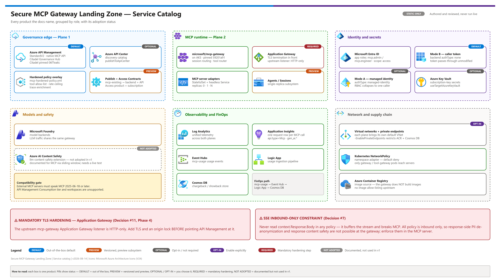
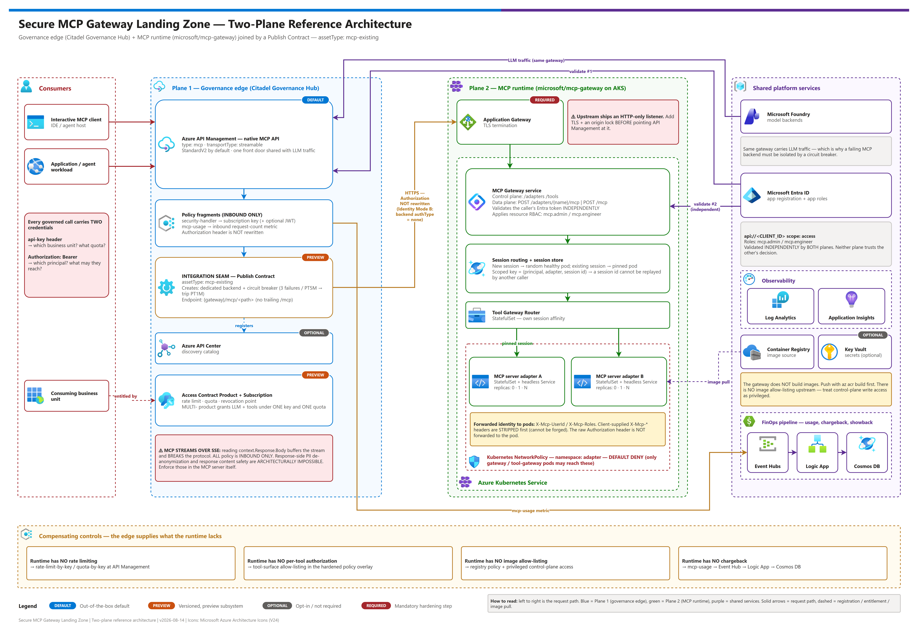

# Governed MCP Tool Platform — Secure MCP Gateway Landing Zone

<p align="center">
  &nbsp;&nbsp;
  &nbsp;&nbsp;
  &nbsp;&nbsp;
  &nbsp;&nbsp;
  &nbsp;&nbsp;
  &nbsp;&nbsp;
  &nbsp;&nbsp;
  
</p>

<p align="center">
  
  
</p>

> [!WARNING]
> **For testing and demonstration purposes only.** This is a personal reference demo provided "as is" under the [MIT License](LICENSE), without warranty or support. It is not an official Microsoft product or sample, has not been through a production security review, and is not intended for production use. Review, test, and harden it before reusing any part of it, deploy only to non-production subscriptions, and never use real customer or personal data.

A reusable, governance-first starting point for running a **governed MCP tool platform** on Azure: enterprise **Model Context Protocol (MCP) tool governance** at scale, with **end-user identity propagated** through the gateway to the tool, and **per-team quotas and chargeback** on every tool call. It combines two real Microsoft upstream projects into one coherent architecture:

| Plane | Upstream | Contributes |
|---|---|---|
| **Governance edge** | [Citadel Governance Hub](https://github.com/Azure-Samples/ai-hub-gateway-solution-accelerator/tree/citadel-v1) (formerly *AI Hub Gateway*) | Azure API Management as a single AI front door, consumer onboarding via products/subscriptions, per-business-unit quota, token metering and FinOps pipeline, private networking, policy fragment library |
| **MCP runtime** | [`microsoft/mcp-gateway`](https://github.com/microsoft/mcp-gateway) | Session-aware routing across many MCP server replicas, dynamic MCP server registration and lifecycle, Entra-integrated resource RBAC, Kubernetes network isolation, workload identity |

Neither project solves the whole problem alone. The accelerator governs *access* but has no opinion on how MCP servers are hosted or scaled. The MCP Gateway hosts and scales MCP servers but has no rate limiting, no per-tool authorization, no chargeback, and no consumer onboarding model. **This pattern is the seam between them** — and the seam is a supported, first-class extensibility point, not custom glue.

> [!NOTE]
> **Validation status: static / documentation-verified.** The docs, contracts, and policy overlay were authored and reviewed against the upstream repositories and Microsoft Learn, and the local test suites and doc lint pass — but no dated live end-to-end deployment run is recorded. Treat every pass criterion in [04-testing.md](./docs/04-testing.md) as the expected result to confirm in your own subscription.

> [!NOTE]
> **Generic on purpose.** Nothing here is tied to an industry, a use case, or a tool domain. The same landing zone serves developer-platform tools, line-of-business data tools, operational runbook tools, or partner-facing tool catalogs by changing configuration, not architecture.

> [!WARNING]
> **Hardening is mandatory, not optional.** The MCP runtime ships an HTTP-only edge listener, so you must terminate TLS **and** lock the origin to API Management (Phase 4 in [03-deployment.md](./docs/03-deployment.md#phase-4--harden-the-mcp-runtime-edge)) before pointing the gateway at it. Separately, MCP policy processing is **inbound only** — never read the response body, because MCP streams over SSE and body access breaks streaming.

## At a glance

| | What | Detail |
|---|---|---|
|  | Governance edge | Citadel Governance Hub: API Management as the single AI front door, quota, metering, FinOps |
|  | MCP runtime | `microsoft/mcp-gateway` on AKS: session affinity and dynamic server registration |
|  | Integration seam | Publish Contract (`mcp-existing`) and Access Contract; declarative, no custom glue |
|  | Identity | Mode B caller-token passthrough, so end-user identity reaches the MCP runtime |
|  | Time to stand up | Roughly half a day for a first build; see [00-reproduce-this-demo.md](./docs/00-reproduce-this-demo.md) |

## What's inside

<table align="center">
  <tr>
    <td align="center" width="140"><br/><sub>API Management</sub></td>
    <td align="center" width="140"><br/><sub>AKS</sub></td>
    <td align="center" width="140"><br/><sub>Application Gateway</sub></td>
    <td align="center" width="140"><br/><sub>Entra ID</sub></td>
  </tr>
  <tr>
    <td align="center" width="140"><br/><sub>Microsoft Foundry</sub></td>
    <td align="center" width="140"><br/><sub>Event Hubs</sub></td>
    <td align="center" width="140"><br/><sub>Cosmos DB</sub></td>
    <td align="center" width="140"><br/><sub>Key Vault</sub></td>
  </tr>
  <tr>
    <td align="center" width="140"><br/><sub>Logic Apps</sub></td>
    <td align="center" width="140"><br/><sub>API Center</sub></td>
    <td align="center" width="140"><br/><sub>Application Insights</sub></td>
    <td align="center" width="140"><br/><sub>Container Registry</sub></td>
  </tr>
</table>

[](./docs/assets/service-catalog.png)

---

## What this pattern delivers

A working end-to-end platform where:

- **Any MCP server** — a container you built, a community stdio server bridged into HTTP, or a remote hosted MCP endpoint — is registered dynamically through a control-plane REST call, with no redeploy of the platform
- Each MCP server runs as a **multi-replica Kubernetes StatefulSet** with real **session affinity**, so stateful MCP sessions survive horizontal scale
- Every MCP call arrives through **Azure API Management**, where it is authenticated, attributed to a consuming business unit, rate-limited, quota-enforced, metered, and logged — using the *same* gateway, the *same* subscription key, and the *same* FinOps pipeline that governs the organization's LLM traffic
- **End-user identity survives the hop.** The pattern's default identity mode passes the caller's Entra token through the gateway intact, so the MCP runtime's per-resource RBAC still sees the real human or workload — rather than collapsing every call into "API Management called me"
- A single consumer subscription can be granted **LLM access and MCP tool access together** through one governed product, with one key and one quota envelope
- MCP servers are **discoverable** through Azure API Center rather than tribal knowledge

The pattern is **thin-code by design**: the integration itself is declarative parameter files plus one hardened policy overlay. The code in this folder is operator tooling and a reference MCP server used to *prove* the platform works — not platform code you have to maintain.

[](./docs/assets/secure-mcp-gateway-architecture.png)

<sub>Editable source: [`docs/assets/secure-mcp-gateway-architecture.drawio`](./docs/assets/secure-mcp-gateway-architecture.drawio) - regenerate with `python scripts/export_diagrams.py docs/assets`.</sub>

---

## Locked design decisions

These are **the v1 baseline**. Deviate only with an explicit decision record and updated guidance.

| # | Decision | Choice | Why |
|---|---|---|---|
| 1 | Governance edge | **Citadel Governance Hub**, API Management **StandardV2** by default | One AI front door for LLM, MCP, and agent traffic. Policy library, metering pipeline, and private networking already exist — rebuilding them for MCP alone would be waste |
| 2 | MCP runtime | **`microsoft/mcp-gateway`** on AKS | The only Microsoft-authored runtime that solves MCP session affinity across replicas plus dynamic server lifecycle. Purpose-built for exactly the hard part |
| 3 | Integration seam | Citadel **Publish Contract**, `assetType: mcp-existing` | Purpose-built extensibility point. Produces a native API Management API of `type: 'mcp'` with a dedicated backend and circuit breaker. **No custom glue code** |
| 4 | Transport | **Streamable HTTP** (`transportType: streamable`) | The only transport both planes speak end to end. stdio-only servers are bridged into HTTP inside the MCP runtime, not at the edge |
| 5 | **Identity mode (default)** | **Mode B — caller-token passthrough** (backend `authType: none`) | Preserves real end-user identity into the MCP runtime's RBAC while API Management still enforces subscription key, quota, and metering. See [docs/07](./docs/07-identity-and-token-flow.md) |
| 6 | Consumer governance | Citadel **Access Contract**, `MULTI-` product | One product and one key grant a business unit both LLM tokens and MCP tools, with a single quota envelope and a single revocation point |
| 7 | Policy processing for MCP | **Inbound only — never read the response body** | MCP streams over SSE. Reading `context.Response.Body` forces buffering and breaks streaming. This is a hard architectural constraint, not a style preference |
| 8 | Response-side controls | **PII de-anonymization: not available. Response content safety: available only via the purpose-built `llm-content-safety` policy — not adopted in v1** | Custom policies cannot read the response body without breaking the stream. But `llm-content-safety` uses a sliding-window mechanism (`window-size`, configurable only for responses) and Microsoft documents it as applicable to **MCP tools**. See [01-architecture.md](./docs/01-architecture.md#the-streaming-constraint-read-this-before-designing-policy) |
| 9 | Resilience | API Management **circuit breaker** on the MCP backend (3 failures / `PT5M` → trip `PT1M`, honors `Retry-After`) | MCP runtime pod churn must not cascade into the shared AI gateway |
| 10 | Upstream pinning | **Pin both upstreams by commit SHA** | `microsoft/mcp-gateway` publishes zero releases and zero tags; `citadel-v1` is a moving branch. Reproducibility requires SHAs |
| 11 | Edge TLS | **Terminate HTTPS before API Management is pointed at the MCP runtime** | The MCP runtime ships an HTTP-only listener by default. Fronting it without fixing this puts cleartext tool traffic on the wire |
| 12 | Network posture | Private endpoints / VNet integration on both planes; Kubernetes NetworkPolicy default-deny for MCP server pods | MCP server pods are reachable *only* through the gateway; the gateway is reachable *only* through API Management |
| 13 | Discovery | Azure **API Center** registration (`publishToApiCenter`) | A governed tool catalog is what turns this from a gateway into a platform |
| 14 | Compensating controls | Rate limiting, per-consumer quota, and tool-surface allow-listing enforced **at API Management** | The MCP runtime has none of these today. The edge supplies them |

See [01-architecture.md](./docs/01-architecture.md) for the full design narrative, trust boundaries, and rejected alternatives.

---

## The one thing to understand first

MCP responses **stream**. Any *custom* policy that inspects a response body buffers the stream and breaks the protocol — Microsoft states this in its own MCP documentation, and the Citadel baseline policy enforces it.

That single constraint shapes the security model: almost everything you want to enforce must be enforced **on the way in**, at the MCP server itself, or through the one purpose-built policy designed for streamed output. Architectures that assume "we'll scan the response for PII the way we do for chat completions" do not work here — response-side **PII de-anonymization is genuinely unavailable**, while response **content safety** has a documented streaming-aware route (`llm-content-safety`) that this pattern treats as an opt-in extension rather than a v1 default.

Crucially, this is a limit on **enforcement**, not on **visibility**. API Management understands MCP semantically, so it emits per-tool, per-session, per-client telemetry natively — no policy, no body access. Teams routinely conflate the two and conclude MCP traffic is a black box. It isn't. See [docs/08-observability-and-governance-parity.md](./docs/08-observability-and-governance-parity.md).

| | Concern | Where it works |
|---|---|---|
|  | Request-side enforcement | At API Management on the way in, and at the MCP server itself |
|  | Response content safety | Only via the purpose-built `llm-content-safety` policy; opt-in, not adopted in v1 |
|  | Visibility | Native per-tool, per-session, per-client telemetry; no policy and no body access |

---

## File index

| File | Purpose |
|---|---|
| [`README.md`](./README.md) | This file |
| [`01-architecture.md`](./docs/01-architecture.md) | Reference architecture: diagrams, components, request path, trust boundaries, decisions, rejected alternatives |
| [`02-prerequisites.md`](./docs/02-prerequisites.md) | Subscriptions, RBAC, Entra setup, resource providers, quotas, regional matrix, cost posture, pre-flight checklist |
| [`03-deployment.md`](./docs/03-deployment.md) | Phased build with a validation gate at the end of every phase |
| [`04-testing.md`](./docs/04-testing.md) | Functional, governance, session-affinity, resilience, security, and demo-script tests |
| [`05-troubleshooting.md`](./docs/05-troubleshooting.md) | Quick-triage table then symptom-by-symptom diagnosis |
| [`docs/00-reproduce-this-demo.md`](./docs/00-reproduce-this-demo.md) | Single-page stand-up orchestrator with time budget and checkpoints |
| [`docs/06-mcp-publishing-and-access-contracts.md`](./docs/06-mcp-publishing-and-access-contracts.md) | Deep dive: Publish Contract and Access Contract — the integration seam |
| [`docs/07-identity-and-token-flow.md`](./docs/07-identity-and-token-flow.md) | Deep dive: the three identity modes, token flow, and the confused-deputy trade-off |
| [`docs/08-observability-and-governance-parity.md`](./docs/08-observability-and-governance-parity.md) | Deep dive: MCP tool traffic vs. LLM/model traffic — parity matrix, native `gen_ai.*` telemetry, KQL cookbook, and where parity genuinely cannot close |
| [`docs/assets/`](./docs/assets/) | Presentation-ready `.drawio` diagrams — two-plane architecture and identity/token flow |
| `infra/` | Hardened MCP policy overlay, publish-contract and access-contract parameter templates |
| `scripts/` | Operator tooling — adapter registration, asset publishing, endpoint validation |
| `samples/mcp-server/` | Reference MCP server that makes session affinity and identity propagation visible |
| [`samples/README.md`](./samples/README.md) | **Expansion scenario catalog** — four guides for building a real, differentiated MCP use case on this landing zone |
| `tests/` | Test suites for the validator and the sample server |
| `.azuredevops/pipelines/` | Multi-stage pipeline with approval gates between planes |

Read documents 01–05 in order on a first build; they live in [`docs/`](./docs/) beside the deep dives 06–08. For a time-boxed stand-up, start at [`docs/00-reproduce-this-demo.md`](./docs/00-reproduce-this-demo.md).

---

## Quick-start prerequisites at a glance

Full detail in [02-prerequisites.md](./docs/02-prerequisites.md):

| | Requirement | Detail |
|---|---|---|
|  | Subscription | An Azure subscription with **Owner**, or **Contributor + User Access Administrator** (both planes create role assignments) |
|  | Entra tenant | **One Entra tenant** shared by both planes, with an app registration exposing `api://<CLIENT_ID>` scope `access`, app roles `mcp.admin` and `mcp.engineer`, and VS Code + Azure CLI pre-authorized as client applications |
|  | Quota | API Management (StandardV2 or Developer), an AKS cluster, Application Gateway, Cosmos DB, Event Hub, and at least one Microsoft Foundry model deployment |
|  | Region | A region carrying **all** components — verify against the matrix in [02-prerequisites.md](./docs/02-prerequisites.md#7-regional-alignment); API Management StandardV2 and Azure API Center are the usual constraints |
|  | Workstation | Azure CLI, Azure Developer CLI (`azd`), `kubectl`, Docker or an OCI builder, PowerShell 7, Python 3.11+, and an MCP-capable client such as VS Code |

---

## When to use this pattern (and when not to)

| | Verdict | When |
|---|---|---|
|  | Use this pattern | Many MCP servers, several consuming teams, stateful sessions, existing AI-gateway governance, identity must reach the tool |
|  | Use something simpler | Tools are already REST APIs in API Management, one or two servers for one team, or retrieval-only tools |
|  | Use a different runtime | In-runtime per-tool authorization is a hard requirement, or you are standardized on the stateless MCP protocol revision |

### Use this pattern when

- The customer wants to expose **more than a handful of MCP servers** to more than one consuming team, and needs onboarding, quota, and chargeback to be a repeatable process rather than a ticket
- MCP servers are **arbitrary containers** — internally built, community stdio servers, or remote endpoints — and teams need **self-service registration** without a platform redeploy
- MCP sessions are **stateful** and must survive horizontal scaling
- The organization **already governs LLM traffic** through an AI gateway and wants tool traffic under the same control plane, the same key, and the same cost model
- **End-user identity must reach the tool** for downstream authorization or audit

### Use something simpler when

- **Your "tools" are already REST APIs managed in API Management.** Use API Management's native *expose REST API as MCP server* capability directly — zero additional compute, and this landing zone is over-engineering. (The accelerator supports this as `assetType: mcp-from-api` if you want it governed the same way.)
- **You have one or two MCP servers and one consuming team.** Deploy them to Azure Container Apps behind API Management passthrough. You do not need a Kubernetes session-routing layer.
- **You need only a grounded retrieval tool for developers.** A knowledge-base MCP endpoint consumed directly by an IDE is a much smaller pattern.
- **You need MCP resources or prompts, not just tools**, at the API Management layer. For **external** MCP servers, API Management supports tools **and resources**, but **not prompts** (per *Expose and govern existing MCP server*). If prompts are a hard requirement, keep them client-side or expose the capability another way.
- **You need MCP servers inside an API Management workspace** — MCP server capabilities are not supported in workspaces.

### Use a different runtime when

- You need **per-tool authorization inside the runtime** today. The MCP runtime authorizes at the server-registration level, not per individual tool call. This pattern compensates at the edge, but if fine-grained in-runtime authorization is a hard requirement, validate the current upstream state before committing.
- You are already standardized on the **stateless MCP protocol revision**. The MCP runtime's session affinity assumes the legacy session model — see the maturity note below.

---

## Expanding this pattern

The reference server in `samples/mcp-server/` exists to prove the platform works. It is not the use case. **[`samples/README.md`](./samples/README.md) is the catalog of four expansion scenarios** that take this landing zone to a real, differentiated build:

| Scenario | Start here when | What it exercises |
|---|---|---|
| [Bridging a stdio MCP server](./samples/scenarios/01-stdio-bridge.md) | You want to govern an existing community or third-party MCP server (most are stdio-only) | The `mcp-proxy` adapter, third-party trust review, edge allow-listing as compensation |
| [Exposing a REST API as MCP](./samples/scenarios/02-rest-api-as-mcp.md) | Your "tools" are already REST APIs | `mcp-from-api` — **and no MCP runtime plane at all**; the honest "you may not need this pattern" path |
| [Workload-identity data tool](./samples/scenarios/03-workload-identity-data-tool.md) | The tool must reach Azure resources on its own behalf | Federated workload identity, admin-only fail-closed gating, per-user filtering via forwarded identity |
| [Multi-tool catalog](./samples/scenarios/04-multi-tool-catalog.md) | You want many curated tools behind one MCP surface | The Tool Gateway Router, `POST /tools`, router-level session affinity |

Each scenario documents when **not** to use it, the architecture delta, the exact registration or contract payload, identity-mode implications, and its specific traps.

---

## Maturity and honesty notes

> [!IMPORTANT]
> This pattern deliberately documents where the ground is soft. Read these before putting it in front of a customer.

1. **This specific composition is not an official Microsoft reference architecture.** Both upstreams are real and Microsoft-authored, and the Publish Contract seam is a supported extensibility point — but neither repository documents fronting the MCP Gateway with API Management. Present it as an integration you are standing up and validating, not as a published Microsoft blueprint.
2. **Protocol-era risk is the largest single risk.** The MCP runtime's session model assumes the legacy session-oriented protocol. A newer spec revision removes protocol-level sessions entirely, and upstream tracking for dual-era support is open. Pin your client and server SDK versions deliberately and test against the exact revision your client speaks.
3. **The MCP runtime's Agents/Sessions subsystem is preview and single-replica**, and its built-in tools execute in-process in the gateway pod. Upstream states plainly that it should not be enabled in multi-replica or multi-tenant production without an out-of-process sandbox. Do not demonstrate it as a security boundary.
4. **There is no image or catalog allow-listing in the MCP runtime.** Anyone with write access to the control plane can point it at any reachable image. Treat control-plane write access as a privileged role and compensate with registry policy and the edge controls in this pattern.
5. **No TLS by default on the MCP runtime's edge listener.** This pattern requires you to fix that in Phase 4 before wiring API Management to it.
6. **Cost figures are deliberately absent.** API Management SKU dominates the governance plane, AKS node hours plus Application Gateway dominate the MCP plane, and Foundry token spend can exceed both. Pull current numbers from the Azure Pricing Calculator at scoping time rather than trusting a figure baked into a document.

---

## Pro-code alternative

| | Path | Use when |
|---|---|---|
|  | Thin-code (this folder) | Declarative contracts plus operator tooling cover the need |
|  | Custom runtime | Bespoke routing, a custom tool catalog with approval workflow, or per-tool policy evaluation the upstream does not yet offer |

This folder **is** the thin-code path: declarative contracts plus operator tooling. If an engagement needs a genuinely custom MCP runtime — bespoke routing, a custom tool catalog with approval workflow, or per-tool policy evaluation the upstream does not yet offer — fork the MCP server sample into a dedicated repository rather than growing it here, and keep this landing zone as the governance envelope around it.

---

## Distribution

This repository is self-contained; the included `.azuredevops/` pipeline is optional and can be adapted to any CI system. `.gitignore` excludes secrets, kubeconfigs, and populated local state. `demo-ids.template.json` is the committed reference for the identifiers a real deployment produces — copy it to `demo-ids.local.json` (gitignored) and populate the local copy after your first deploy.

**Never commit a populated `demo-ids.local.json`, an API Management subscription key, a kubeconfig, an Entra client secret, or any `.env` file.** Pipeline credentials come from an Azure DevOps variable group or Key Vault, never from a file in this repository. Before pushing:

```bash
git ls-files | grep -E '(\.sp-secret|secrets|demo-ids\.json$|kubeconfig|\.env(\.local)?$)'
```

Any hit is a hard block — clean the tree and rotate anything that leaked.

---

## Upstream pins

| Upstream | Ref | Commit | Verified |
|---|---|---|---|
| `Azure-Samples/ai-hub-gateway-solution-accelerator` | `citadel-v1` | `06f7ea6c2f99371900feefba11c10212b16364b4` | 2026-08-14 |
| `microsoft/mcp-gateway` | `main` | `59201a91f0c033dab7259f7c3c27be15353dafa4` | 2026-08-14 |

`microsoft/mcp-gateway` publishes **no releases and no tags** — the commit SHA is the only durable pin. `citadel-v1` is an active branch that was content-identical to `main` at verification time; re-check before a customer-facing build.

---

## Decision provenance

| Date | Decision | Reference |
|---|---|---|
| 2026-08-14 | Locked v1 architecture: Citadel Governance Hub as the AI front door, `microsoft/mcp-gateway` as the MCP runtime, joined by a `mcp-existing` Publish Contract with caller-token passthrough as the default identity mode | [Locked design decisions](#locked-design-decisions) and [`CHANGELOG.md`](./CHANGELOG.md) |

---

## Disclaimer

> [!CAUTION]
> This project is provided for testing, learning, and demonstration purposes only. It is not an official Microsoft product, sample, or service, and it is not supported under any Microsoft support program. Azure services, APIs, and pricing referenced here change over time — validate against current Microsoft Learn documentation before relying on any detail. Deploying it creates billable Azure resources; you are responsible for their cost, security, and cleanup.

## License

> [!NOTE]
> Released under the [MIT License](LICENSE).

---

Next: [00 Reproduce this demo →](./docs/00-reproduce-this-demo.md)

*Last updated: 2026-10-08*
