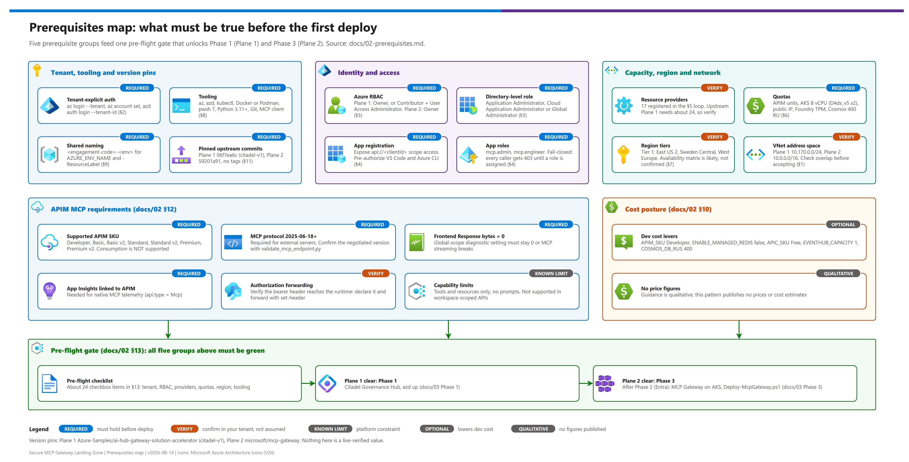

[README](../README.md) › [docs index](./00-reproduce-this-demo.md) › 02 Prerequisites

# 02 — Prerequisites

<p align="center">
  &nbsp;&nbsp;
  &nbsp;&nbsp;
  &nbsp;&nbsp;
  &nbsp;&nbsp;
  &nbsp;&nbsp;
  
</p>

<p align="center">
  
  
</p>

> Part of the **Secure MCP Gateway Landing Zone** pattern. See [`./README.md`](../README.md) for the pattern overview, [`./01-architecture.md`](./01-architecture.md) for the full architecture and network diagrams, [`./03-deployment.md`](./03-deployment.md) for the step-by-step deployment runbook this document feeds into, [`./04-testing.md`](./04-testing.md) for validation, and [`./05-troubleshooting.md`](./05-troubleshooting.md) when something in this checklist was skipped and it bites you later. For a fast end-to-end walkthrough see [`./00-reproduce-this-demo.md`](./00-reproduce-this-demo.md).

This document is the gate-keeper for the pattern. Nothing in [`./03-deployment.md`](./03-deployment.md) should be attempted until every section below has been worked through for the target subscription, tenant, and region. Most of the failure modes catalogued in [`./05-troubleshooting.md`](./05-troubleshooting.md) trace back to a skipped step here.

## At a glance

| | Gate | What you confirm | Section |
|---|---|---|---|
|  | Subscription and tenant | Tenant + subscription verified explicitly, never ambient | § 2 |
|  | RBAC | Owner (or Contributor + User Access Administrator) per plane; directory role for the app registration | § 3 |
|  | Entra ID | App registration, `access` scope, `mcp.admin` / `mcp.engineer` roles assigned | § 4 |
|  | Providers and quotas | Resource providers registered; APIM, AKS, Foundry TPM, Cosmos, public IP headroom | § 5, § 6 |
|  | Region | Tier 1 or Tier 2, verified live with the CLI | § 7 |
|  | APIM MCP exposure | SKU supports MCP, protocol version, global-scope logging, App Insights link, header forwarding | § 12 |

[](./assets/prerequisites-map.png)

<sub>Editable source: [`assets/prerequisites-map.drawio`](./assets/prerequisites-map.drawio) - regenerate with `python scripts/export_diagrams.py docs/assets`.</sub>

---

## 1. Overview + the two-plane mental model

This pattern is **two independently-maintained upstream projects, pinned and wired together**, not a single codebase. Treat them as two separate deployable planes with two separate toolchains, two separate identity stories, and two separate on-call/troubleshooting surfaces. The only place they truly meet is the integration seam described below.

| | **Plane 1 — Governance Edge** | **Plane 2 — MCP Runtime** |
|---|---|---|
| Nickname | "Citadel Governance Hub" | "MCP Gateway" |
| Upstream repo | `Azure-Samples/ai-hub-gateway-solution-accelerator` | `microsoft/mcp-gateway` |
| Ref pinned by this pattern | branch `citadel-v1` @ commit `06f7ea6c2f99371900feefba11c10212b16364b4` | commit `59201a91f0c033dab7259f7c3c27be15353dafa4` (no branch/tag — see § 11) |
| Primary compute | Azure API Management + Microsoft Foundry (AI Services) | Azure Kubernetes Service (AKS) |
| Deploy toolchain | `azd up` (azd + Bicep) | `deployment/Deploy-McpGateway.ps1` (PowerShell + Bicep, raw K8s YAML — no Helm) |
| Identity role | Issues/validates API Management subscriptions, quotas, products | Issues/validates per-user Entra tokens against `mcp.admin` / `mcp.engineer` app roles |
| What it is NOT | Not a runtime for MCP tool execution | Not an API gateway/governance product — no products, quotas, or usage metering of its own |

**Why two planes at all?** Neither upstream project solves the whole problem alone. The Citadel Governance Hub gives you enterprise API governance (products, subscriptions, quotas, usage metering, PII/content-safety policy) but has no concept of hosting or orchestrating MCP tool servers. `mcp-gateway` gives you a purpose-built MCP/tool-calling runtime on AKS with per-user Entra authorization and session-aware routing to tool adapters, but has no governance surface for consumer onboarding, quota enforcement, or usage metering. This pattern's integration seam — the Citadel **Publish Contract** (`assetType: 'mcp-existing'`) — registers `mcp-gateway`'s public endpoint as a native `type: 'mcp'` API inside APIM, so consumers governed by Citadel Access Contracts get a single, metered, quota-enforced front door onto the MCP runtime. Full mechanics: [`./06-mcp-publishing-and-access-contracts.md`](./06-mcp-publishing-and-access-contracts.md).

**A note on network address planning.** Each plane brings its own default VNet CIDR block, and they do not overlap with each other out of the box:

| Plane | Default VNet | Subnets |
|---|---|---|
| Plane 1 (Citadel) | `10.170.0.0/24` | `apim` `10.170.0.0/26`, `privateEndpoint` `10.170.0.64/26`, `functionApp` `10.170.0.128/26`, `agent` `10.170.0.192/26` |
| Plane 2 (mcp-gateway) | `10.0.0.0/16` | AKS, Application Gateway, and Private Endpoint subnets (exact carve-up in the deploy Bicep — see [`./01-architecture.md`](./01-architecture.md)) |

`10.0.0.0/16` is a very commonly pre-claimed range in corporate hub-and-spoke networks — **before accepting the default, check it against any existing VNets/on-prem ranges you intend to peer with.** This pattern does not verify address-space conflicts for you.

Continue to [`./01-architecture.md`](./01-architecture.md) for the full component diagram and data-flow description, or jump straight to the remaining sections below to gate your deployment.

---

## 2. Azure subscription + tenant requirements

- A single Azure subscription is sufficient for a demo/dev instance of both planes; use separate resource groups per plane at minimum (see § 9 naming conventions) so the two toolchains don't collide, and consider separate subscriptions if the consuming business unit needs hard cost/blast-radius isolation.

> [!WARNING]
> **This pattern assumes the operator works across multiple Azure tenants.** The Azure CLI and `azd` both keep a single *ambient* active account/tenant that silently changes whenever a login happens anywhere else on the workstation (another project, another terminal tab). **Never trust the ambient session.** Resolve and verify the intended tenant + subscription explicitly, every time, before running any command that provisions resources or mints a token.

### Required sequence — Azure CLI

```bash
az login --tenant <TENANT_ID>
az account set --subscription <SUBSCRIPTION_ID>
az account show --query "{tenant:tenantId, subscription:id, subName:name, user:user.name}" -o table
```

Do not proceed until the output of `az account show` shows the tenant and subscription you actually intend to deploy into. If it doesn't match, re-run the two `az` commands above — don't assume a second `az login` alone fixes the subscription context.

### Required sequence — azd (Plane 1 only)

```bash
azd auth login --tenant-id <TENANT_ID>
azd env set AZURE_TENANT_ID <TENANT_ID>
azd env set AZURE_SUBSCRIPTION_ID <SUBSCRIPTION_ID>
azd env get-values
```

Confirm `AZURE_TENANT_ID` and `AZURE_SUBSCRIPTION_ID` in the `azd env get-values` output match intent before running `azd up`.

### Non-negotiables

- ❌ **Never** run a bare `az login` and assume the resulting account is correct.
- ❌ **Never** run a bare `azd up` relying on ambient environment/login state.
- ❌ **Never** hardcode a real tenant or subscription GUID into any file that will be committed to source control for this pattern — use the `<TENANT_ID>` / `<SUBSCRIPTION_ID>` placeholders shown throughout this pattern's docs, and keep real values in gitignored local config only.
- If the target tenant/subscription for a given engagement is not yet known, **ask** — do not infer it from whatever `az account show` currently returns.

---

## 3. RBAC and permissions required

The two planes have **different, independently-documented RBAC floors**. Confirm both before starting, ideally before you're mid-deployment and blocked.

| Plane | Minimum RBAC (subscription or target-RG scope) | Why |
|---|---|---|
| Plane 1 — Citadel Governance Hub | **Owner**, OR **Contributor + User Access Administrator** | The Bicep/`azd` deployment creates `Microsoft.Authorization/roleAssignments` (e.g., granting the APIM managed identity access to Key Vault, Cosmos DB, and Foundry). Contributor alone cannot create role assignments — the deployment fails partway through (see [`./05-troubleshooting.md#sym-2`](./05-troubleshooting.md#sym-2)). |
| Plane 2 — mcp-gateway | **Owner** (as stated by the upstream repo's own README) | `Deploy-McpGateway.ps1` provisions AKS with a system-assigned identity, OIDC issuer + Workload Identity, federated credentials, and additional role assignments across AKS/ACR/Cosmos/App Gateway. The upstream project does not document a reduced-privilege path — if your organization requires least-privilege, budget time to test Contributor + User Access Administrator scoped to a dedicated resource group yourself; this pattern has not validated that substitution. |

Separately, at the **directory (Entra ID) level**, whoever configures the app registration in § 4 needs **Application Administrator**, **Cloud Application Administrator**, or **Global Administrator** — this is independent of, and not satisfied by, subscription-level Owner/Contributor. Confirm this before § 4, not during it.

> [!TIP]
> **Recommendation:** if you don't already know who holds subscription Owner (or can grant Contributor + User Access Administrator / directory app-registration rights) for the target subscription/tenant, resolve that before scheduling any deployment window — this is the single most common reason a first deployment attempt stalls.

---

## 4. Entra ID prerequisites

The MCP runtime plane (Plane 2) is fronted by an Entra ID app registration that both governs direct developer access (Mode C) and provides the token audience that Mode B (caller-token passthrough) validates against. Set this up **before** any deployment attempt — it is not created automatically by either plane's tooling.

### 4.1 App registration

1. Create an Entra ID app registration for the MCP Gateway (name it consistently with § 9 naming conventions).
2. Expose an API under `api://<clientId>` with a scope named **`access`**.
3. Pre-authorize these client applications on that scope, so interactive clients can silently acquire tokens without a per-session admin-consent prompt:

   | Client | Client (application) ID |
   |---|---|
   | Visual Studio Code | `aebc6443-996d-45c2-90f0-388ff96faa56` |
   | Azure CLI | `04b07795-8ddb-461a-bbee-02f9e1bf7b46` |

4. Define **app roles** on the registration: `mcp.admin` and `mcp.engineer` (see the upstream repo's `docs/entra-app-roles.md` for the authoritative role semantics).
5. Assign at least one of these app roles to a test user or service principal **before** the first end-to-end test — see the fail-closed warning immediately below.

### 4.2 Fail-closed warning (budget real setup time for this)

mcp-gateway's built-in agent tools (`bash`, `read_file`, `write_file`) and the `useWorkloadIdentity: true` code path **both fail closed to `mcp.admin`-only** whenever `BuiltinToolSettings:RequiredRoles` / `WorkloadIdentitySettings:RequiredRoles` are left unset. In practice this means:

- A fresh deployment, with no app roles assigned to anyone yet, will return **403 Forbidden** to every caller — including the operator who just deployed it — until at least one identity is explicitly granted `mcp.admin` or `mcp.engineer`.

> [!IMPORTANT]
> This is **not a bug to troubleshoot** — it's documented fail-closed behavior. Treat "assign the first app role" as the very last step of infrastructure stand-up, before the first smoke test, not a thing you discover you're missing after a confusing 403 (full diagnosis: [`./05-troubleshooting.md#sym-7`](./05-troubleshooting.md#sym-7)).

### 4.3 Feeds into runtime configuration

The values created in this section are consumed directly by mcp-gateway's own configuration (see [`./03-deployment.md`](./03-deployment.md) for the full env var list) — most directly `AzureAd__TenantId`, `AzureAd__ClientId`, and `AzureAd__Audience`. They are also the values a Mode B consumer's token must be scoped against — see [`./07-identity-and-token-flow.md`](./07-identity-and-token-flow.md) and [`./05-troubleshooting.md#sym-17`](./05-troubleshooting.md#sym-17) for the specific failure this produces when a caller requests a token for the wrong audience.

---

## 5. Resource providers to register

Plane 1's own deployment guide enumerates roughly **24 resource providers** that must be registered on the target subscription before `azd up` will succeed cleanly (`guides/full-deployment-guide.md` in the upstream repo has the authoritative, complete list — always cross-check against it, since provider requirements can shift between commits). The providers explicitly called out as required include:

```text
Microsoft.ApiManagement
Microsoft.CognitiveServices
Microsoft.EventHub
Microsoft.DocumentDB
Microsoft.Cache
Microsoft.App
Microsoft.Network
Microsoft.KeyVault
Microsoft.OperationalInsights
Microsoft.Insights
Microsoft.Logic
Microsoft.Web
Microsoft.Storage
Microsoft.ApiCenter
```

Plane 2 additionally depends on the standard providers backing AKS, ACR, and managed identity — these are ordinary Azure resource-type-to-provider mappings rather than an upstream-enumerated list, so verify them the same way:

```text
Microsoft.ContainerService
Microsoft.ContainerRegistry
Microsoft.ManagedIdentity
```

### Copy-paste registration loop

```bash
providers=(
  "Microsoft.ApiManagement"
  "Microsoft.CognitiveServices"
  "Microsoft.EventHub"
  "Microsoft.DocumentDB"
  "Microsoft.Cache"
  "Microsoft.App"
  "Microsoft.Network"
  "Microsoft.KeyVault"
  "Microsoft.OperationalInsights"
  "Microsoft.Insights"
  "Microsoft.Logic"
  "Microsoft.Web"
  "Microsoft.Storage"
  "Microsoft.ApiCenter"
  "Microsoft.ContainerService"
  "Microsoft.ContainerRegistry"
  "Microsoft.ManagedIdentity"
)

for p in "${providers[@]}"; do
  az provider register --namespace "$p" --subscription <SUBSCRIPTION_ID>
done
```

PowerShell equivalent for the loop body (the `az` command itself is identical on any shell):

```powershell
$providers = @(
  "Microsoft.ApiManagement","Microsoft.CognitiveServices","Microsoft.EventHub",
  "Microsoft.DocumentDB","Microsoft.Cache","Microsoft.App","Microsoft.Network",
  "Microsoft.KeyVault","Microsoft.OperationalInsights","Microsoft.Insights",
  "Microsoft.Logic","Microsoft.Web","Microsoft.Storage","Microsoft.ApiCenter",
  "Microsoft.ContainerService","Microsoft.ContainerRegistry","Microsoft.ManagedIdentity"
)
foreach ($p in $providers) {
  az provider register --namespace $p --subscription "<SUBSCRIPTION_ID>"
}
```

### Verify registration completed

Provider registration is asynchronous and can take a few minutes per namespace:

```bash
az provider list --query "[?registrationState=='Registered'].namespace" -o tsv --subscription <SUBSCRIPTION_ID>
```

Diff the output against the full list above (and the upstream `guides/full-deployment-guide.md`) before starting a deployment — a missing provider surfaces mid-deployment as a `MissingSubscriptionRegistration`-style error (see [`./05-troubleshooting.md#sym-3`](./05-troubleshooting.md#sym-3)).

---

## 6. Quotas to pre-check

Confirm headroom on these dimensions **before** deployment, not after a failed provisioning run. Where an exact CLI subcommand name is uncertain across Azure CLI versions, this is flagged explicitly rather than guessed.

| | Resource | Quota dimension | Why it matters | Check |
|---|---|---|---|---|
|  | APIM | Unit count per SKU tier, per region | StandardV2/Premium scale by "units"; default is `APIM_SKU_UNITS=1`, but region-level capacity limits still apply | Azure Portal → Quotas blade, or open a support request for a unit increase. There is no single dedicated `az` quota-check subcommand for APIM units as of this writing — verify current tooling before relying on a specific command. |
|  | AKS / VM family vCPU | Regional core quota for the nodepool's VM family (`Standard_D4ds_v5` ×2 by default = 8 vCPU) | A quota-exhausted region/family blocks the System nodepool from provisioning | `az vm list-usage --location <region> -o table` |
|  | Public IP | Regional public IP quota | Plane 2's Application Gateway provisions a public IP with a DNS label | `az network list-usages --location <region> -o table` |
|  | Microsoft Foundry / Azure OpenAI | Tokens-per-minute (TPM) quota for the specific model + version you intend to deploy | Model deployment can fail, or requests throttle once real traffic flows, if TPM quota is too low for the demo's expected load | Azure AI Foundry portal → Quotas page; `az cognitiveservices usage list --location <region>` also surfaces usage/limit counters, but its exact output shape has varied across CLI/API versions — verify against your installed CLI before scripting against it. |
|  | Cosmos DB | Provisioned RU/s (default `COSMOS_DB_RUS=400`) and account-level RU ceilings | Demo defaults are modest; only relevant if you plan to scale beyond default throughput | Azure Portal → Cosmos DB account → Metrics/Quota; no universally-stable dedicated CLI quota subcommand is asserted here — verify in-portal. |

**Do not assume defaults are sufficient for anything beyond a single demo instance.** If two engineers plan to run this pattern in the same subscription/region simultaneously, quota contention (especially AKS vCPU and Foundry TPM) is the most likely early collision.

---

## 7. Regional alignment

Both planes, and the Foundry model deployment specifically, need to land in a region where every dependent service/SKU is actually available. This is the single most consequential decision in this checklist — get it wrong and you'll hit [`./05-troubleshooting.md#sym-4`](./05-troubleshooting.md#sym-4) or [`./05-troubleshooting.md#sym-5`](./05-troubleshooting.md#sym-5) partway through a 30–45 minute deployment.

### 7.1 Tiered recommendation

| Tier | Regions | Guidance |
|---|---|---|
| **Tier 1 — strongly recommended** | East US 2, Sweden Central, West Europe | Best current alignment across APIM StandardV2, Foundry model breadth, AKS, and the newer/narrower-rollout services (API Center, Azure Managed Redis). Default choice unless data-residency or latency requirements force otherwise. |
| **Tier 2 — acceptable** | East US, West US 3, UK South, Australia East | Core services (AKS, Cosmos DB, Event Hub, APIM Premium, Application Gateway, Private Endpoints) are reliably available; the newer/narrower-rollout services (APIM StandardV2 specifically, API Center, Azure Managed Redis, and specific Foundry model/version combinations) need an explicit availability check before committing — see § 7.3. |
| **Tier 3 — workarounds required** | Any region not confirmed to offer APIM StandardV2 and/or Azure API Center | Treat as a fallback only. If forced into a Tier 3 region (data residency, regulatory or contractual mandate), plan workarounds up front: fall back to `APIM_SKU=Premium` or `Developer` instead of StandardV2, set `ENABLE_API_CENTER=false`, and consider deploying the Foundry model in a paired Tier-1/Tier-2 region if cross-region model access is acceptable for the demo. **Do not guess which regions fall into this tier — run the § 7.3 verification commands against your actual candidate region.** |

### 7.2 Component availability matrix (published 2026-08-14 — verify before relying on it)

> [!WARNING]
> **Verification caveat.** The markers below reflect general Azure rollout patterns and public service-maturity signals as understood at the time this pattern was authored (2026-08-14) — **they are not the result of a cell-by-cell live check against your subscription.** Regional and SKU availability changes frequently and can differ by subscription/offer type (enterprise agreement vs. pay-as-you-go vs. sovereign cloud vs. capacity-constrained region). **Treat every cell as "likely," not "confirmed," and run the § 7.3 commands for your actual target region and subscription before provisioning.**

Legend: ✅ long-established/near-universal Azure capability — low regional risk, still confirm SKU/quota specifics. ⚠️ generally available in mainstream regions but with real SKU/version nuance — confirm before relying on it. 🔍 newer or narrower-rollout service — meaningfully more likely to be limited or absent in a given region — confirm explicitly.

| | Component | East US 2 | Sweden Central | West Europe | East US | West US 3 | UK South | Australia East |
|---|---|---|---|---|---|---|---|---|
|  | APIM StandardV2 | ⚠️ | ⚠️ | ⚠️ | ⚠️ | ⚠️ | ⚠️ | ⚠️ |
|  | APIM Premium | ✅ | ✅ | ✅ | ✅ | ✅ | ✅ | ✅ |
|  | Microsoft Foundry / Azure OpenAI models | 🔍 | 🔍 | 🔍 | 🔍 | 🔍 | 🔍 | 🔍 |
|  | AKS | ✅ | ✅ | ✅ | ✅ | ✅ | ✅ | ✅ |
|  | Application Gateway Standard_v2 | ✅ | ✅ | ✅ | ✅ | ✅ | ✅ | ✅ |
|  | Cosmos DB | ✅ | ✅ | ✅ | ✅ | ✅ | ✅ | ✅ |
|  | Event Hub | ✅ | ✅ | ✅ | ✅ | ✅ | ✅ | ✅ |
|  | Azure Managed Redis | 🔍 | 🔍 | 🔍 | 🔍 | 🔍 | 🔍 | 🔍 |
|  | Azure API Center | 🔍 | 🔍 | 🔍 | 🔍 | 🔍 | 🔍 | 🔍 |
|  | Private Endpoints / Private DNS | ✅ | ✅ | ✅ | ✅ | ✅ | ✅ | ✅ |

Foundry/Azure OpenAI model availability is marked 🔍 across the board deliberately — availability is driven by the **specific model and version**, not just the region, and shifts frequently as new models roll out and older ones retire. Never assume a model is available in a region because the region itself is "Tier 1" — always check the model specifically (§ 7.3).

### 7.3 CLI verification commands (run these before choosing a region)

```bash
# Resource providers already registered on the target subscription
az provider list --query "[?registrationState=='Registered'].namespace" -o tsv --subscription <SUBSCRIPTION_ID>

# APIM SKU availability by region — NOTE: "az apim list-skus" is NOT a real command.
# Use az rest against the Microsoft.ApiManagement skus API, or inspect provider metadata:
az rest --method get \
  --url "https://management.azure.com/subscriptions/<SUBSCRIPTION_ID>/providers/Microsoft.ApiManagement/skus?api-version=2023-03-01-preview"

# Alternative / lighter-weight check — confirm the provider's "service" resource type covers the region at all
az provider show -n Microsoft.ApiManagement --query "resourceTypes[?resourceType=='service'].locations" -o json

# Microsoft Foundry / Azure OpenAI model + version availability in a specific region
az cognitiveservices model list --location <region> -o table

# AKS Kubernetes version availability in a specific region (also tells you the regional default,
# which matters because mcp-gateway's Bicep does NOT pin a minimum AKS version — see ./05-troubleshooting.md)
az aks get-versions --location <region> -o table

# Sanity-check the exact region name spelling/slug your subscription recognizes
az account list-locations -o table
```

Run these against the **actual target subscription** (after the tenant/subscription verification in § 2) — provider registrations and available SKUs can differ by subscription/offer type even within the same tenant.

---

## 8. Tooling on the operator workstation

| | Tool | Purpose | Verify |
|---|---|---|---|
|  | Azure CLI | All `az` operations across both planes; drives auth, provider registration, quota checks | `az version` — neither upstream repo pins an exact minimum version in the facts available to this pattern; run `az upgrade` before starting and confirm a recent (2024+) release. |
|  | Azure Developer CLI (`azd`) | Drives Plane 1's `azd up`/`azd init`/`azd env` workflow | `azd version` |
|  | `kubectl` | Interacting with the Plane 2 AKS cluster (adapters, NetworkPolicies, deployments) | `kubectl version --client` — align within standard Kubernetes version-skew guidance (generally ±1 minor version) against whatever AKS version the cluster actually deployed with, since **the version is not pinned in the Bicep and takes the regional default at deploy time** (confirm via `az aks get-versions` from § 7.3, then re-check the live cluster with `az aks show`). |
|  | Docker or Podman | Building/pushing custom or updated adapter and tool images to ACR | `docker version` / `podman version` |
|  | PowerShell 7 (`pwsh`) | Required to run Plane 2's `deployment/Deploy-McpGateway.ps1` deploy script | `pwsh -Version` |
|  | Python 3.11+ | Used by this pattern's own `tests/` and `samples/mcp-server/` scripts (see [`./04-testing.md`](./04-testing.md)) — verify the exact interpreter/package requirements against whatever `requirements.txt`/`pyproject.toml` exists in those folders at deploy time | `python --version` |
|  | Git | Cloning and pinning both upstream repositories at the exact commit SHAs in § 11 | `git --version` |
|  | An MCP-capable client (e.g., Visual Studio Code with an MCP extension) | End-to-end testing against mcp-gateway; ties directly to the pre-authorized VS Code client ID in § 4 | N/A |

`jq` is a convenient but optional add-on for parsing `az`/`kubectl` JSON output from a shell — not a hard requirement of either upstream project.

---

## 9. Naming conventions

Neither upstream project shares a naming scheme with the other — Plane 1 derives resource names from Cloud Adoption Framework (CAF) abbreviations in `bicep/infra/abbreviations.json` combined with your chosen `AZURE_ENV_NAME`; Plane 2's naming is controlled by the `-ResourceLabel` parameter passed to `Deploy-McpGateway.ps1`. They will **not** auto-align just because you deploy them back-to-back — you have to make that choice deliberately.

**Recommended discipline for this pattern:**

| | Item | Convention |
|---|---|---|
|  | Plane 1 name seed | `AZURE_ENV_NAME` = `<engagement-code>-<env>` (feeds CAF-abbreviated names via `abbreviations.json`) |
|  | Plane 2 name seed | `-ResourceLabel` = the same `<engagement-code>-<env>` string |
|  | Resource groups | `rg-<engagement-code>-citadel-<env>` and `rg-<engagement-code>-mcpgw-<env>` |
|  | Suggested tags | `pattern=secure-mcp-gateway-landing-zone`, `plane=governance\|runtime`, `env=<dev\|test\|demo>` |

- Pick a single short **engagement code** (e.g., an internal project/demo identifier) and an **environment tag** (`dev`, `demo`, `test`) up front.
- Use that same `<engagement-code>-<env>` string consistently as:
  - Plane 1's `AZURE_ENV_NAME` (feeds CAF-abbreviated resource names via `abbreviations.json`)
  - Plane 2's `-ResourceLabel` argument to `Deploy-McpGateway.ps1`
- Use paired, obviously-related resource group names, e.g. `rg-<engagement-code>-citadel-<env>` and `rg-<engagement-code>-mcpgw-<env>` — this makes the two-plane relationship legible in the portal even though the two toolchains never share a resource group.
- Tag every resource group (both planes) with at least: `pattern=secure-mcp-gateway-landing-zone`, `plane=governance|runtime`, `env=<dev|test|demo>`. These are suggested operational-hygiene tags for this pattern, not an upstream-enforced requirement of either project.
- Do **not** hand-name individual resources inside either plane — let `azd`/Bicep (Plane 1) and the deploy script/Bicep (Plane 2) derive them; hardcoding names defeats the CAF-abbreviation scheme and risks collisions on redeploy.

---

## 10. Cost posture

No dollar figures are quoted anywhere in this pattern's documentation — Azure retail pricing changes by region, currency, and negotiated rate, and any number written here would go stale immediately and mislead more than it helps. Use the [Azure Pricing Calculator](https://azure.microsoft.com/pricing/calculator/) or query the Retail Prices API directly (`az rest --method get --url "https://prices.azure.com/api/retail/prices?..."`) for current, region-specific numbers before committing to a sizing decision.

### Cost drivers by plane (qualitative)

| Plane | Dominant driver | Secondary drivers |
|---|---|---|
| Plane 1 — Governance | **APIM SKU tier** — Developer is roughly an order of magnitude cheaper than Premium, with StandardV2 sitting between them as the default production-capable tier that doesn't require full VNet injection | Cosmos DB RU/s (modest at the `COSMOS_DB_RUS=400` default), Event Hub throughput units (`EVENTHUB_CAPACITY=1` default), optional Azure Managed Redis (zero cost impact when `ENABLE_MANAGED_REDIS=false`, the default), optional API Center (`APIC_SKU=Free` by default — negligible at that tier), Function App + Logic App consumption billing for usage ingestion, Log Analytics/App Insights ingestion volume (scales with traffic and telemetry verbosity) |
| Plane 2 — MCP Runtime | **AKS node hours** (2× `Standard_D4ds_v5` System nodepool by default) **and Application Gateway Standard_v2** (hourly + capacity-unit charges) | ACR Standard tier, Cosmos DB (session consistency), Application Insights ingestion, the public IP resource |
| Cross-plane | **Foundry/Azure OpenAI token or Provisioned Throughput Unit (PTU) spend** — this is usage-driven by actual demo traffic and can exceed both infrastructure planes combined once real model calls flow; it is not a fixed infrastructure cost and cannot be estimated from SKU alone | — |

### T-shirt sizing → APIM SKU (from upstream guidance)

| Size | APIM SKU | Notes |
|---|---|---|
| Small | Developer | Dev/test only — **no SLA** |
| Medium (classic) | Premium | Broader historical regional footprint, supports full VNet injection/multi-zone |
| Medium (v2) | StandardV2 | Default recommendation for this pattern where available (§ 7) |
| Large | Premium (multi-unit) | Scale `APIM_SKU_UNITS` beyond 1 |

### Dev-mode cost levers (apply these for any non-production demo)

```bash
azd env set APIM_SKU Developer
azd env set ENABLE_MANAGED_REDIS false
azd env set APIC_SKU Free
azd env set EVENTHUB_CAPACITY 1
azd env set COSMOS_DB_RUS 400
```

For Plane 2, check `deployment/infra/azure-deployment.bicep` for any exposed nodepool size/count parameter before assuming a smaller footprint is configurable — this pattern's verified facts do not enumerate one, so treat it as **verify at deployment time** rather than assumed.

**Tear-down discipline:** both planes are demo/dev-oriented by default and neither is cheap to leave running unattended. Tear down promptly after each session — `azd down` for Plane 1, and deleting the resource group for Plane 2 — rather than leaving both stood up between engagements.

---

## 11. Version pinning

| Plane | Repository | Ref | Pinned commit SHA | Pin date | Release/tag status |
|---|---|---|---|---|---|
| 1 — Governance | `Azure-Samples/ai-hub-gateway-solution-accelerator` | branch `citadel-v1` | `06f7ea6c2f99371900feefba11c10212b16364b4` | 2026-08-14 | The accelerator carries its own internal version marker in `release.json` (`master-version: 1.0.2`) — this is **not** a git tag, just an in-repo marker. Pin to the commit SHA above, not to "1.0.2" or to the branch head, for reproducibility. |
| 2 — MCP Runtime | `microsoft/mcp-gateway` | (no branch pinned — repo default) | `59201a91f0c033dab7259f7c3c27be15353dafa4` | 2026-08-12 | **Zero releases and zero git tags exist on this repository as of the pin date.** The commit SHA is the *only* reproducible reference — there is no `v1.x` tag to fall back to, and the default branch will move without warning. |

**Non-negotiable:** clone/checkout both repositories at these exact commit SHAs for this pattern, not at `main`/`citadel-v1` HEAD. Re-verify both SHAs are still reachable before each delivery — a repository with no protected release tags has no structural guarantee against history rewrites, however uncommon that may be in practice.

---

## 12. APIM MCP server exposure requirements

This section captures MCP-specific requirements that sit *on top of* the general APIM prerequisites already covered above (§ 3 RBAC, § 4 Entra ID, § 5 resource providers, § 7 regional alignment) — verified against Microsoft Learn's dedicated MCP server documentation rather than the general APIM guidance the rest of this checklist draws from. Treat every subsection below as an additional gate before [`./03-deployment.md`](./03-deployment.md), not a replacement for anything above it.

| | Subsection | Gate |
|---|---|---|
|  | § 12.1 | APIM SKU tier supports MCP servers (not Consumption) |
|  | § 12.2 | MCP protocol version compatibility, verified with an `initialize` handshake |
|  | § 12.3 | Global scope evaluates first: payload-byte logging `0`, no global response-body policy |
|  | § 12.4 | Application Insights **linked** to the APIM instance |
|  | § 12.5 | `Authorization` header reaches `mcp-gateway` intact (Mode B) |

### 12.1 Supported APIM SKU tiers

Per *Overview of MCP servers in Azure API Management* (Microsoft Learn, updated 2025-11-13), the MCP server feature is supported on the **Developer, Basic, Basic v2, Standard, Standard v2, and Premium / Premium v2** tiers. **Consumption is not on that list** — if `APIM_SKU=Consumption` is ever considered as a cost lever (it is not this pattern's default; see § 10), the MCP server feature will not work on it. The page carries no "(preview)" qualifier for the feature at any listed tier. This pattern's default, StandardV2 (§ 7, § 10), is fully supported.

### 12.2 MCP protocol version compatibility gate — verify at deployment time, don't assume

Per *Connect and Govern Existing MCP server* (Microsoft Learn, updated 2026-04-28), an external MCP server published through APIM must conform to **MCP protocol version `2025-06-18` or later**. Supported transports are **Streamable HTTP or SSE**, with Streamable HTTP as the portal default. For external MCP servers, APIM supports MCP **tools and resources**, but **not MCP prompts** (see [`./05-troubleshooting.md#sym-22`](./05-troubleshooting.md#sym-22)) — and **MCP server capabilities are not supported inside APIM workspaces** at all (see [`./05-troubleshooting.md#sym-23`](./05-troubleshooting.md#sym-23)).

This creates a compatibility question that **cuts both ways** for `mcp-gateway` (Plane 2, pinned per § 11) and must be verified at deployment time rather than assumed either way:

- `mcp-gateway`'s session model is built on the **session-oriented** MCP protocol (an `mcp-session-id` header, RFC 9728 protected-resource-metadata authorization) — a shape consistent with the `2025-06-18` specification family, which gives it a plausible floor of meeting APIM's stated minimum.
- Its SDK is pinned (§ 11) to `0.4.0-preview.3`, and the upstream repository's issue #98 tracks support for a *newer*, **stateless** protocol revision that removes protocol-level sessions entirely — the same protocol-era caveat already flagged in [`./01-architecture.md`](./01-architecture.md). A client speaking that newer revision may outrun what this pinned SDK version supports.

**Do not treat either direction as confirmed.** Verify the actual negotiated protocol version at deployment time with an `initialize` handshake — [`./scripts/validate_mcp_endpoint.py`](../scripts/validate_mcp_endpoint.py) already performs this handshake and reports the negotiated protocol version back (its `--json` output includes a `protocol_version` field) — and treat its output, not this paragraph, as the source of truth for a given deployment. See [`./05-troubleshooting.md#sym-24`](./05-troubleshooting.md#sym-24) if the handshake is rejected outright.

### 12.3 Global scope evaluates before MCP server scope — diagnostic logging and policy order

Two related facts from *Connect and Govern Existing MCP server* (Microsoft Learn, updated 2026-04-28), both easy to miss because neither lives anywhere near MCP-specific configuration:

1. **Policy evaluation order.** APIM evaluates policies configured at the **global (all APIs) scope** *before* it evaluates policies at MCP server scope. A global policy that reads or buffers the response body — even a well-intentioned logging or transformation policy — can break MCP's streaming behavior regardless of how clean every MCP-scope policy is. This pattern's own [`./infra/policies/mcp-hardened-policy.xml`](../infra/policies/mcp-hardened-policy.xml) is written to avoid touching the response body at MCP scope for exactly this reason — but that discipline only holds if nothing upstream at global scope violates it too.
2. **Diagnostic logging.** If diagnostic logging through Application Insights or Azure Monitor is enabled at **global scope (all APIs)** for the APIM instance, the **"Number of payload bytes to log"** setting for **Frontend Response** must be set to **`0`**. Leaving it non-zero at global scope risks unintended logging of response bodies across every API and can interfere with MCP servers functioning correctly. To log payloads selectively, configure the setting **per-API** (or, more precisely for this pattern, per-MCP-server — see § 12.4) instead of at global scope.

**Pre-flight check:** before onboarding the MCP server in APIM, confirm (a) the global Frontend Response payload-byte setting is `0`, and (b) no global-scope policy reads the response body. Both are one-time platform-level settings that are easy to inherit unknowingly if another team manages the APIM instance's global configuration. See [`./05-troubleshooting.md#sym-20`](./05-troubleshooting.md#sym-20) for the exact symptom this produces and how to diagnose it after the fact.

### 12.4 Application Insights linkage for native MCP telemetry

Per *Monitor MCP Server Traffic in Azure API Management* (Microsoft Learn, updated 2026-06-30), APIM emits MCP request telemetry into Application Insights **natively, with zero additional configuration**, following the **OpenTelemetry semantic conventions for generative AI** (`gen_ai.*`). Every MCP request carries dimensions including `gen_ai.operation.name`, `gen_ai.conversation.id` (the MCP session ID), `auth.type`, `user_agent.name`/`user_agent.version` (the MCP client), `service.name`/`service.version`, `api.type` (`Mcp`), and `error.message`/`error.type`; `tools/call` requests additionally carry `gen_ai.tool.name` and `gen_ai.tool.type`.

**Prerequisite: an Application Insights resource must be linked to the APIM instance.** The same Microsoft Learn page lists this as an explicit prerequisite before any native telemetry appears at all. This pattern's Citadel governance deployment (Plane 1) already provisions an Application Insights resource — the gap to close is confirming it is actually **linked** to the APIM instance, not merely present somewhere in the same resource group. See [`./05-troubleshooting.md#sym-25`](./05-troubleshooting.md#sym-25) if no MCP telemetry appears.

Tool call arguments and results (`gen_ai.tool.call.arguments`, `gen_ai.tool.call.result`) are **not** part of this default telemetry — capturing them is a separate, deliberate **per-MCP-server** opt-in (Portal → APIs → MCP servers → select server → Settings → Diagnostic Logs → enable Frontend and Backend payload logging). Those fields can contain prompts, customer data, or secrets, so enable this narrowly and apply scrubbing/claim allowlists before any broad rollout — see [`./05-troubleshooting.md#sym-26`](./05-troubleshooting.md#sym-26). For the full KQL query cookbook against this telemetry schema, see [`./08-observability-and-governance-parity.md`](./08-observability-and-governance-parity.md).

### 12.5 Inbound auth header forwarding — verify before relying on Mode B

APIM's own inbound access to the published MCP endpoint is secured with either a subscription key (`Ocp-Apim-Subscription-Key`) or an OAuth 2.1/JWT token issued by Microsoft Entra ID and validated with the `validate-azure-ad-token` policy, per *Secure access to MCP servers in Azure API Management* (Microsoft Learn, updated 2025-11-18) — see [`./05-troubleshooting.md#sym-14`](./05-troubleshooting.md#sym-14) for the subscription-key failure mode already catalogued. § 4 above covers the separate Entra ID app registration and audience that `mcp-gateway` itself validates once a call reaches it.

One additional nuance from the same page: request headers are **automatically forwarded to MCP tool invocations, with certain exclusions** that Microsoft's documentation does not fully enumerate. In most configurations this carries the caller's `Authorization` header through to `mcp-gateway` unmodified — which is what lets Mode B's per-caller authorization keep working — but **do not assume this holds for every environment.**

If Mode B's caller-token passthrough is load-bearing for a given deployment, confirm the `Authorization` header actually reaches `mcp-gateway` intact as part of deployment validation (§ 13), rather than discovering otherwise via a confusing authorization failure. If it does not arrive, declare `Authorization` as a required header in the API's settings and forward it explicitly with a `set-header` policy, or use APIM's credential manager (`get-authorization-context` + `set-header`) instead. See [`./05-troubleshooting.md#sym-21`](./05-troubleshooting.md#sym-21) for the failure mode and diagnostic steps.

---

## 13. Pre-flight checklist

> [!NOTE]
> Treat this as a hard gate: every box must be checked for the target subscription, tenant, and region before you start [`./03-deployment.md`](./03-deployment.md).

- [ ] Correct tenant selected and verified via `az account show` (§ 2)
- [ ] Correct subscription selected and verified via `az account show` (§ 2)
- [ ] `azd env get-values` confirms `AZURE_TENANT_ID` / `AZURE_SUBSCRIPTION_ID` match intent (§ 2)
- [ ] RBAC confirmed for the identity running Plane 1's deployment: Owner, or Contributor + User Access Administrator (§ 3)
- [ ] RBAC confirmed for the identity running Plane 2's deployment: Owner (§ 3)
- [ ] Directory-level Entra role confirmed for whoever configures the app registration: Application Administrator / Cloud Application Administrator / Global Administrator (§ 3, § 4)
- [ ] Entra app registration created; `api://<clientId>` exposed with scope `access` (§ 4)
- [ ] VS Code (`aebc6443-996d-45c2-90f0-388ff96faa56`) and Azure CLI (`04b07795-8ddb-461a-bbee-02f9e1bf7b46`) pre-authorized on that scope (§ 4)
- [ ] `mcp.admin` / `mcp.engineer` app roles created **and assigned to at least one test identity** before first smoke test (§ 4.2)
- [ ] All required resource providers registered on the target subscription (§ 5)
- [ ] APIM unit, AKS vCPU/VM-family, public IP, Foundry TPM, and Cosmos RU quota headroom checked for the target region (§ 6)
- [ ] Target region selected from Tier 1 (preferred) or Tier 2 with documented workarounds, and independently verified live via the § 7.3 CLI commands — not assumed from the matrix alone (§ 7)
- [ ] `AZURE_LOCATION` set explicitly (do **not** rely on the upstream default — it is inconsistent between `main.bicepparam` and the quick-deployment guide)
- [ ] `ENABLE_API_CENTER` set explicitly (do **not** rely on the upstream default — it differs between `main.bicepparam` and the README)
- [ ] Operator workstation tooling installed and versions checked (§ 8)
- [ ] Naming convention / shared `AZURE_ENV_NAME` ↔ `-ResourceLabel` code agreed upon before first deploy (§ 9)
- [ ] Cost posture reviewed with whoever owns the subscription's budget; dev-mode toggles applied if this is a non-production demo (§ 10)
- [ ] Both upstream repositories cloned/checked out at the exact pinned commit SHAs (§ 11)
- [ ] Aware that `main.bicepparam`/`main.bicep` at `bicep/infra/` on `citadel-v1` do **not** include `main.parameters.dev.bicepparam` / `main.parameters.prod.bicepparam` despite guide references to them — cost/env tuning happens via `azd env set <VAR> <value>`, not by selecting a pre-built parameter file (see [`./03-deployment.md`](./03-deployment.md))
- [ ] APIM SKU tier confirmed to support MCP servers — Developer / Basic / Basic v2 / Standard / Standard v2 / Premium / Premium v2; **not** Consumption (§ 12.1)
- [ ] MCP protocol version compatibility verified for the actual deployed endpoint via an `initialize` handshake (`./scripts/validate_mcp_endpoint.py`), not assumed from either side of the compatibility gate (§ 12.2)
- [ ] Global-scope diagnostic logging's Frontend Response payload-byte setting confirmed at `0`, and the global (all-APIs) policy confirmed not to read the response body (§ 12.3)
- [ ] Application Insights resource confirmed **linked** to the APIM instance, not just present in the same resource group (§ 12.4)
- [ ] `Authorization` header forwarding to `mcp-gateway` confirmed empirically if Mode B's caller-token passthrough is required for this deployment (§ 12.5)

Once every box is checked, proceed to [`./03-deployment.md`](./03-deployment.md). If a deployment attempt still fails, start at the quick-triage table in [`./05-troubleshooting.md`](./05-troubleshooting.md).

---

Next: [03 Deployment →](./03-deployment.md)

*Last updated: 2026-10-02*
