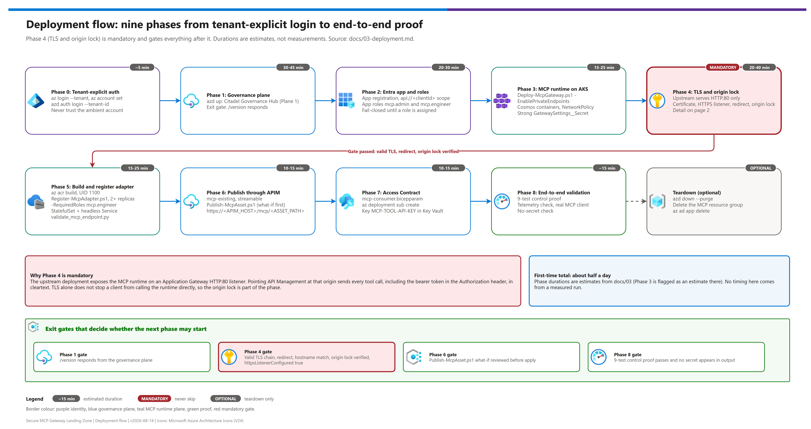
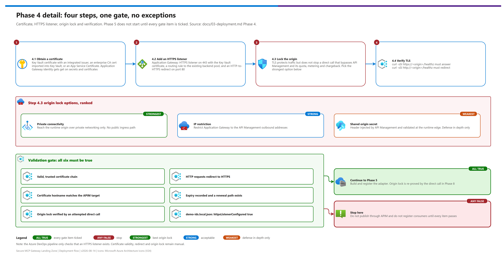
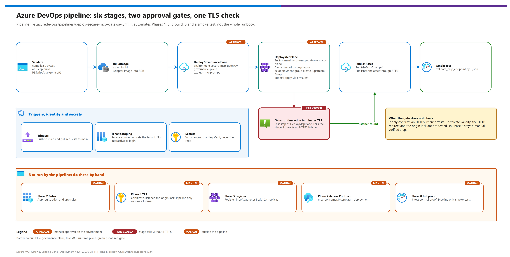

[README](../README.md) › [docs index](./00-reproduce-this-demo.md) › 03 Deployment

# 03 — Deployment

<p align="center">
  &nbsp;&nbsp;
  &nbsp;&nbsp;
  &nbsp;&nbsp;
  &nbsp;&nbsp;
  &nbsp;&nbsp;
  
</p>

<p align="center">
  
  
  
</p>

Phased build for the **Secure MCP Gateway Landing Zone**. Every phase ends with a **validation gate** — do not proceed past a gate with unchecked boxes.

**Prerequisites must be complete before Phase 0.** See [02-prerequisites.md](./02-prerequisites.md).
For a time-boxed stand-up with checkpoints, use [00-reproduce-this-demo.md](./00-reproduce-this-demo.md).

## At a glance

| | What | Detail |
|---|---|---|
|  | Auth | Tenant-explicit `az` and `azd` login (Phase 0), then one Entra app registration with app roles (Phase 2) |
|  | Plane 1 | Citadel Governance Hub deployed with `azd up` (Phase 1) |
|  | Plane 2 | `microsoft/mcp-gateway` on AKS via `Deploy-McpGateway.ps1` (Phase 3) |
|  | Hardening | Mandatory TLS listener and origin lock (Phase 4) |
|  | Publish and access | Publish Contract, then Access Contract (Phases 6–7) |
|  | Proof | Full-path validation and negative tests (Phase 8) |

The flow has three pages: the full phase sequence, the Phase 4 TLS and origin-lock detail, and the Azure DevOps pipeline.

**Page 1 — Phases 0-8**

[](./assets/deployment-flow-1.png)

**Page 2 — Phase 4 detail (TLS + origin lock)**

[](./assets/deployment-flow-2.png)

**Page 3 — Azure DevOps pipeline**

[](./assets/deployment-flow-3.png)

<sub>Editable source (all three pages): [`assets/deployment-flow.drawio`](./assets/deployment-flow.drawio) - regenerate with `python scripts/export_diagrams.py docs/assets`.</sub>

---

## Phase map

| | Phase | What it builds | Typical duration |
|---|---|---|---|
|  | [0](#phase-0--authenticate-to-the-right-tenant) | Tenant-explicit authentication | 5 min |
|  | [1](#phase-1--deploy-the-governance-plane) | Citadel Governance Hub (API Management, Foundry, FinOps pipeline) | 30–45 min |
|  | [2](#phase-2--entra-app-registration-and-app-roles) | Entra app registration, scope, app roles | 20–30 min |
|  | [3](#phase-3--deploy-the-mcp-runtime-plane) | MCP Gateway on AKS | ~15–25 min *(estimate — not documented upstream)* |
|  | [4](#phase-4--harden-the-mcp-runtime-edge) | **TLS termination + origin lock** | 20–40 min |
|  | [5](#phase-5--build-and-register-an-mcp-server-adapter) | Container build + adapter registration | 15–25 min |
|  | [6](#phase-6--publish-the-mcp-asset-through-api-management) | Publish Contract (`mcp-existing`) | 10–15 min |
|  | [7](#phase-7--grant-governed-access) | Access Contract (product + subscription) | 10–15 min |
|  | [8](#phase-8--end-to-end-validation) | Full-path validation | 15 min |

**First-time total: roughly half a day**, excluding prerequisite lead times such as quota increases or certificate issuance.

### Scripts and hooks used

| | Script | Phase | Purpose |
|---|---|---|---|
|  | `azd up` | 1 | Provisions the governance plane |
|  | `deployment/Deploy-McpGateway.ps1` | 3 | Provisions the MCP runtime plane (upstream `microsoft/mcp-gateway`) |
|  | `scripts/Register-McpAdapter.ps1` | 5 | Registers the adapter with the runtime control plane |
|  | `scripts/Publish-McpAsset.ps1` | 6 | Deploys the Publish Contract (tenant-explicit, what-if, confirmation) |
|  | `scripts/validate_mcp_endpoint.py` | 5, 8 | Protocol-level validation of the MCP endpoint |

---

## Phase 0 — Authenticate to the right tenant

> [!WARNING]
> **Do not skip this and do not shorten it to a bare `az login`.** This architecture is commonly built by operators who work across multiple Azure tenants, and the Azure CLI keeps a single ambient active account that silently changes whenever any other login happens. A bare `az login` or `azd up` will cheerfully deploy into the wrong tenant and subscription. Treat ambient CLI context as untrusted until verified. Pass `--tenant` explicitly and re-verify with `az account show`.

### 0.1 Resolve the intended target

Record these before touching a CLI. If you do not know them, **ask — do not guess**.

| Value | Where it comes from |
|---|---|
| `<TENANT_ID>` | The tenant that will host both planes and the MCP app registration |
| `<SUBSCRIPTION_ID>` | The deployment target subscription |
| `<AZURE_REGION>` | Verified against the regional matrix in [02-prerequisites.md](./02-prerequisites.md#7-regional-alignment) |

### 0.2 Authenticate explicitly

```bash
az login --tenant <TENANT_ID>
az account set --subscription <SUBSCRIPTION_ID>
```

Use `az login --tenant <TENANT_ID> --use-device-code` when no browser is available.

### 0.3 Verify before proceeding

```bash
az account show --query "{tenant:tenantId, subscription:id, subName:name, user:user.name}" -o table
```

The `tenant` and `subscription` values **must** match section 0.1 exactly. If they do not, re-run 0.2 — do not continue.

### 0.4 Authenticate the Azure Developer CLI

`azd` maintains its own auth context, independent of `az`.

```bash
azd auth login --tenant-id <TENANT_ID>
```

### Validation gate — Phase 0

- [ ] `az account show` reports the intended tenant **and** subscription
- [ ] `azd auth login --tenant-id` completed without error
- [ ] The target region is confirmed present in the availability matrix
- [ ] Both upstream repositories are cloned and checked out at the **pinned commits** (see [README](../README.md#upstream-pins))

---

## Phase 1 — Deploy the governance plane

Deploys the Citadel Governance Hub: API Management, Microsoft Foundry, Event Hub, Cosmos DB, the Logic App usage pipeline, Log Analytics, Application Insights, VNet, and private endpoints.

### 1.1 Initialize the environment

```bash
azd init \
  --template Azure-Samples/ai-hub-gateway-solution-accelerator \
  -e <AZD_ENV_NAME> \
  --branch citadel-v1
```

> **Pin the commit.** `citadel-v1` is an active branch. For a reproducible build, clone directly and check out the pinned SHA rather than tracking the branch head:
> ```bash
> git clone https://github.com/Azure-Samples/ai-hub-gateway-solution-accelerator.git
> cd ai-hub-gateway-solution-accelerator
> git checkout 06f7ea6c2f99371900feefba11c10212b16364b4
> ```

### 1.2 Set environment values explicitly

```bash
azd env set AZURE_TENANT_ID       <TENANT_ID>
azd env set AZURE_SUBSCRIPTION_ID <SUBSCRIPTION_ID>
azd env set AZURE_LOCATION        <AZURE_REGION>
```

> **Set `AZURE_LOCATION` explicitly — always.** The upstream default differs between the parameter file and the published guide. Relying on the default is how a deployment ends up in an unintended region.

### 1.3 Choose the API Management SKU

The SKU is the dominant cost and capacity lever on this plane.

| Intent | Setting |
|---|---|
| Demo / dev / lab, no SLA | `azd env set APIM_SKU Developer` |
| Non-production with SLA | `azd env set APIM_SKU StandardV2` *(upstream default)* |
| Production, multi-zone, classic VNet injection | `azd env set APIM_SKU Premium` |

> [!NOTE]
> **The upstream guides reference `main.parameters.dev.bicepparam` and similarly named files. Those files do not exist on `citadel-v1`** — verified 2026-08-14. The only parameter files present are `main.bicepparam` and `resources.bicepparam`. Do all cost and feature tuning with `azd env set`, not by selecting a pre-built dev parameter file.

Optional levers for a lab build:

```bash
azd env set ENABLE_MANAGED_REDIS false   # skip the semantic cache
azd env set ENABLE_API_CENTER    true    # set EXPLICITLY — upstream default is inconsistent
azd env set COSMOS_DB_RUS        400     # floor
azd env set EVENTHUB_CAPACITY    1       # floor
```

### 1.4 Deploy

```bash
azd up
```

Expect **30–45 minutes**. Transient provisioning failures are documented upstream — **re-run `azd up`**, which is idempotent, before investigating.

### 1.5 Capture outputs

Record into `demo-ids.local.json`: API Management name and gateway host, resource group, Foundry account and endpoint, Key Vault name, Log Analytics workspace id, Application Insights name, Event Hub namespace, Cosmos account.

```bash
azd env get-values
```

### Validation gate — Phase 1

- [ ] `azd up` completed successfully
- [ ] API Management is reachable: `curl -s -o /dev/null -w "%{http_code}" https://<APIM_HOST>/version` returns a success status
- [ ] `GET /version` returns the component version manifest
- [ ] At least one Foundry model deployment exists and is in a succeeded state
- [ ] Application Insights is receiving telemetry from API Management
- [ ] All values captured into `demo-ids.local.json` (**never** into `demo-ids.template.json`)

---

## Phase 2 — Entra app registration and app roles

The MCP runtime authenticates callers against a single Entra app registration. Under this pattern's default identity mode, the **same** registration issues the token that consumers present through API Management.

### 2.1 Create the app registration

```bash
az ad app create --display-name "<MCP_GATEWAY_APP_NAME>"
```

Capture the resulting `appId` as `<CLIENT_ID>`.

### 2.2 Set the application ID URI and expose the scope

Set the identifier URI to `api://<CLIENT_ID>` and expose a delegated scope named **`access`**. The runtime expects this exact scope name.

### 2.3 Pre-authorize client applications

So interactive clients can acquire tokens without a separate consent prompt, pre-authorize:

| Client | Application ID |
|---|---|
| Visual Studio Code | `aebc6443-996d-45c2-90f0-388ff96faa56` |
| Azure CLI | `04b07795-8ddb-461a-bbee-02f9e1bf7b46` |

These are well-known first-party Microsoft application IDs, identical in every tenant.

### 2.4 Define app roles

Create two **application** roles on the registration:

| Role value | Grants |
|---|---|
| `mcp.admin` | Full control — register, update, delete MCP servers; use privileged capabilities |
| `mcp.engineer` | Register and read MCP servers within permitted scopes |

### 2.5 Assign roles to real principals

> [!IMPORTANT]
> **These roles fail closed.** Privileged capabilities — the runtime's built-in tools and workload-identity usage — default to **admin-only** when their role configuration is unset. A fresh deployment where no one holds a role produces `403 Forbidden` on every privileged operation. This is correct behaviour and is a common first-run surprise. Assign roles **now**, not after you hit the 403.

Assign `mcp.admin` to the platform operators and `mcp.engineer` to the teams who will register MCP servers.

### 2.6 Verify token issuance

```bash
az account get-access-token \
  --tenant <TENANT_ID> \
  --resource api://<CLIENT_ID> \
  --query expiresOn -o tsv
```

Decode the token at a trusted local decoder and confirm the `aud` claim is `api://<CLIENT_ID>` and that expected `roles` are present.

> **Never paste a real token into a public web decoder.** Decode locally.

### Validation gate — Phase 2

- [ ] App registration exists; `<CLIENT_ID>` recorded
- [ ] Application ID URI is `api://<CLIENT_ID>`
- [ ] Delegated scope `access` is exposed
- [ ] VS Code and Azure CLI are pre-authorized
- [ ] App roles `mcp.admin` and `mcp.engineer` exist
- [ ] At least one human principal holds `mcp.admin`
- [ ] A token acquired for `api://<CLIENT_ID>` carries the expected `aud` and `roles`

---

## Phase 3 — Deploy the MCP runtime plane

Deploys `microsoft/mcp-gateway`: AKS, container registry, Cosmos DB, Application Gateway, Application Insights, managed identities with federated credentials.

### 3.1 Clone at the pinned commit

```bash
git clone https://github.com/microsoft/mcp-gateway.git
cd mcp-gateway
git checkout 59201a91f0c033dab7259f7c3c27be15353dafa4
```

> **This repository publishes no releases and no git tags.** The commit SHA is the only durable pin. Verify with `git rev-parse HEAD`.

### 3.2 Re-verify tenant context

Phase 1 and 2 may have spanned a break. Re-verify — this is cheap and catches drift:

```bash
az account show --query "{tenant:tenantId, subscription:id}" -o table
```

### 3.3 Deploy

```powershell
./deployment/Deploy-McpGateway.ps1 `
  -ResourceGroupName <MCP_PLANE_RESOURCE_GROUP> `
  -ClientId          <CLIENT_ID> `
  -ResourceLabel     <SHORT_LABEL> `
  -Location          <AZURE_REGION> `
  -EnablePrivateEndpoints
```

`-EnablePrivateEndpoints` restricts the container registry and Cosmos DB to VNet access. **Enable it** unless a lab constraint prevents it.

Expect roughly **15–25 minutes**. That is an estimate based on the resource mix; upstream does not document a figure.

### 3.4 Connect to the cluster

```bash
az aks get-credentials \
  --resource-group <MCP_PLANE_RESOURCE_GROUP> \
  --name <AKS_CLUSTER_NAME>

kubectl get nodes
kubectl get pods -A
```

> Kubeconfigs are gitignored in this repository for a reason. Never commit one.

### 3.5 Verify Cosmos containers

The upstream infrastructure documentation lists three containers, while the service code also references containers for the preview Agents/Sessions feature. Verify what actually exists before relying on that preview:

```bash
az cosmosdb sql container list \
  --account-name    <COSMOS_ACCOUNT_NAME> \
  --database-name   <COSMOS_DATABASE_NAME> \
  --resource-group  <MCP_PLANE_RESOURCE_GROUP> \
  --query "[].name" -o tsv
```

If `AgentContainer` or `SessionContainer` are absent, **do not enable the Agents/Sessions preview** — you will hit runtime container-not-found errors. The core adapter and tool functionality this pattern depends on does not require them.

### 3.6 Confirm workload isolation

```bash
kubectl get networkpolicy -n adapter
```

A default-deny ingress policy plus an explicit gateway-access allow policy should be present.

### Validation gate — Phase 3

- [ ] Deployment completed; all pods `Running`
- [ ] `kubectl get nodes` shows the expected node count `Ready`
- [ ] The gateway service pod is healthy
- [ ] NetworkPolicies exist in the `adapter` namespace
- [ ] Cosmos containers enumerated and recorded; Agents/Sessions preview status decided
- [ ] Application Insights is receiving telemetry from the gateway
- [ ] `GatewaySettings__Secret` is set to a strong random value — **not** a default or placeholder

---

## Phase 4 — Harden the MCP runtime edge

> [!WARNING]
> **This phase is mandatory. Do not skip it.**
> The upstream deployment provisions an Application Gateway listener on **HTTP port 80**. Upstream lists adding TLS as a manual production-onboarding step. If you point API Management at an HTTP origin, every MCP tool call — including the bearer token in the `Authorization` header — traverses the gap between the two planes in cleartext. TLS alone also does not stop a client from calling the runtime directly, so the origin lock in 4.3 is required as well.

### 4.1 Obtain a certificate

Use a certificate for the hostname consumers and API Management will resolve. Options in rough order of preference: Azure Key Vault certificate with an integrated issuer; an enterprise CA-issued certificate imported into Key Vault; an App Service Certificate.

Store it in the Key Vault deployed with the governance plane and grant the Application Gateway identity **get** access on secrets and certificates.

### 4.2 Add an HTTPS listener

Add to the Application Gateway: an HTTPS listener on port 443 referencing the Key Vault certificate, a routing rule to the existing backend pool, and an HTTP-to-HTTPS redirect on the port 80 listener.

```bash
# Confirm the resulting listener set
az network application-gateway http-listener list \
  --gateway-name   <APP_GATEWAY_NAME> \
  --resource-group <MCP_PLANE_RESOURCE_GROUP> \
  --query "[].{name:name, protocol:protocol, port:frontendPort.id}" -o table
```

### 4.3 Lock the origin to the governance plane

TLS protects the traffic; it does not stop a client from bypassing API Management entirely and calling the runtime directly — which would bypass quota, metering, and chargeback while still passing the runtime's own token validation.

**Close this.** Choose the strongest option your topology allows:

| Option | Mechanism | Strength |
|---|---|---|
| **Private connectivity** | Reach the runtime origin over private networking only; no public ingress path | Strongest |
| **IP restriction** | Restrict Application Gateway to the API Management outbound addresses | Strong |
| **Shared origin secret** | Require a header injected by API Management and validated at the runtime edge | Weakest — use only as defense in depth |

Treat "the governed path is the **only** path" as a deployment requirement, not an assumption. Verify it by attempting a direct call in Phase 8.

### 4.4 Verify TLS

```bash
curl -sSI https://<MCP_RUNTIME_PUBLIC_ORIGIN>/healthz | head -n 1
curl -sSI http://<MCP_RUNTIME_PUBLIC_ORIGIN>/healthz  | head -n 1   # expect a redirect
```

### Validation gate — Phase 4

- [ ] HTTPS listener is serving a valid, trusted certificate chain
- [ ] HTTP requests redirect to HTTPS
- [ ] Certificate hostname matches the origin API Management will target
- [ ] Certificate expiry is recorded and a renewal path exists
- [ ] Origin restriction is in place and **verified** by an attempted direct call
- [ ] `demo-ids.local.json` records `httpsListenerConfigured: true`

---

## Phase 5 — Build and register an MCP server adapter

### 5.1 Build the reference server image

The runtime **does not build images** — it deploys images that already exist in its registry.

```bash
az acr build \
  --registry <ACR_NAME> \
  --image <ADAPTER_NAME>:1.0.0 \
  ./samples/mcp-server
```

The reference server in [`samples/mcp-server/`](../samples/mcp-server/README.md) exposes two deliberately generic tools: `echo` (round-trip proof) and `describe_environment` (returns the serving pod's identity and any forwarded identity headers). The second is what makes session affinity and identity propagation **visible** in a demo rather than theoretical.

> The Dockerfile runs as UID/GID **1100** to match the pod security context the runtime applies. A mismatch causes permission failures at startup.

### 5.2 Register the adapter

```powershell
./scripts/Register-McpAdapter.ps1 `
  -GatewayBaseUrl <MCP_RUNTIME_PUBLIC_ORIGIN> `
  -Name           <ADAPTER_NAME> `
  -ImageName      <ADAPTER_NAME> `
  -ImageVersion   1.0.0 `
  -ReplicaCount   2 `
  -RequiredRoles  mcp.engineer `
  -TenantId       <TENANT_ID> `
  -Scope          api://<CLIENT_ID>
```

> **Use at least 2 replicas.** A single replica cannot demonstrate session affinity — and session affinity is the reason this runtime is in the architecture at all.

The script verifies tenant context, checks for an existing adapter, registers, then polls until ready.

### 5.3 Verify the Kubernetes objects

```bash
kubectl get statefulset,svc,pods -n adapter -l adapter/name=<ADAPTER_NAME>
```

Expect a **StatefulSet** (not a Deployment) and a **headless Service** with `clusterIP: None`. Both are required for per-session pod pinning — a plain Deployment with a ClusterIP Service silently breaks affinity.

### 5.4 Test directly, before involving API Management

Isolate faults by proving the runtime path first:

```bash
python ./scripts/validate_mcp_endpoint.py \
  --endpoint https://<MCP_RUNTIME_PUBLIC_ORIGIN>/adapters/<ADAPTER_NAME>/mcp \
  --use-azure-identity \
  --scope api://<CLIENT_ID>/.default
```

### Validation gate — Phase 5

- [ ] Image built and present in the registry
- [ ] Adapter registered; control plane reports it ready
- [ ] Workload is a **StatefulSet** with a **headless Service**
- [ ] Expected replica count is `Running` and `Ready`
- [ ] Direct validation passes: `initialize`, `tools/list` returns both tools
- [ ] A repeated `describe_environment` call with the same session identifier returns the **same** pod
- [ ] Adapter logs are retrievable through the control plane

---

## Phase 6 — Publish the MCP asset through API Management

### 6.1 Prepare the parameter file

Copy [`infra/publish-contract/mcp-gateway.bicepparam`](../infra/publish-contract/mcp-gateway.bicepparam) over the accelerator's `bicep/infra/citadel-publish-contracts/main.bicepparam` and replace every placeholder.

Confirm these values in particular:

| Field | Value | Why |
|---|---|---|
| `assetType` | `mcp-existing` | Publishes an already-running MCP server, rather than synthesizing MCP from a REST API |
| `transportType` | `streamable` | The only transport both planes speak |
| `backend.url` | `https://…` | Must be the **TLS** origin from Phase 4 |
| `backend.authType` | `none` | Identity Mode B — lets the caller's token through untouched |
| `subscriptionRequired` | `true` | Ties every call to a consuming business unit |
| `useAssetTypePathPrefix` | `true` | Serves the asset under `/mcp/…` |

> **Diff against upstream first.** This subsystem is preview and versioned. Compare the template's own `main.bicepparam` at the pinned commit against this file before deploying.

### 6.2 Deploy the publish contract

```powershell
./scripts/Publish-McpAsset.ps1 `
  -TenantId        <TENANT_ID> `
  -SubscriptionId  <SUBSCRIPTION_ID> `
  -Location        <AZURE_REGION> `
  -AcceleratorPath <PATH_TO_ACCELERATOR_CLONE>
```

The script enforces tenant-explicit auth, warns on a commit-pin mismatch, runs a what-if, and requires confirmation before deploying.

### 6.3 Confirm the published endpoint

```bash
az apim api list \
  --resource-group <GOVERNANCE_PLANE_RESOURCE_GROUP> \
  --service-name   <APIM_INSTANCE_NAME> \
  --query "[].{name:name, path:path, type:type}" -o table
```

The published endpoint is:

```
https://<APIM_HOST>/mcp/<ASSET_PATH>
```

> [!TIP]
> **Note the path shape.** `mcp-existing` has **no** trailing `/mcp` — the upstream runtime already serves MCP at its own path. Only `mcp-from-api` gets `/mcp` appended, because API Management synthesizes that surface itself. Confusing the two is the single most common 404 in this architecture.

### 6.4 Optional — apply the hardened policy overlay

To add tool-surface allow-listing and a per-asset rate ceiling:

1. Create the `mcp-allowed-tools` named value in API Management (comma-separated tool names, or `*` to disable allow-listing)
2. Replace `RATE_LIMIT_CALLS` and `RATE_LIMIT_PERIOD` in [`infra/policies/mcp-hardened-policy.xml`](../infra/policies/mcp-hardened-policy.xml)
3. Uncomment the `policyXml` line on the asset and redeploy

> The overlay **replaces** the baseline policy, which is why it opens with `<base />` to inherit the shared security and metering fragments. Removing that line silently disables authentication and metering.

### Validation gate — Phase 6

- [ ] Deployment succeeded
- [ ] An API Management API of type `mcp` exists with `transportType: streamable`
- [ ] A dedicated backend points at the **HTTPS** runtime origin
- [ ] Circuit breaker is configured on that backend
- [ ] Published path resolves (a call without a key returns `401`, **not** `404`)
- [ ] If API Center is enabled, the asset appears in the catalog

---

## Phase 7 — Grant governed access

Publishing created the endpoint. It entitled nobody. This phase creates the product and subscription a consumer actually uses.

### 7.1 Resolve the published API name

```bash
az apim api list \
  --resource-group <GOVERNANCE_PLANE_RESOURCE_GROUP> \
  --service-name   <APIM_INSTANCE_NAME> \
  --query "[?type=='mcp'].{name:name, path:path}" -o table
```

API names are **case-sensitive** in the mapping.

### 7.2 Prepare the access contract

Copy [`infra/access-contract/mcp-consumer.bicepparam`](../infra/access-contract/mcp-consumer.bicepparam) over the accelerator's `bicep/infra/citadel-access-contracts/main.bicepparam`.

Set `useCase` to the consuming business unit, use case, and environment — this drives product and subscription naming and is the granularity at which quota and revocation operate.

Keep both `TOOL` and `LLM` entries in `services` if this consumer should reach models **and** tools with one key under one quota envelope. Remove `LLM` for tool-only access.

Set `useTargetAzureKeyVault: true` for anything beyond a lab — with `false`, the subscription key appears in deployment outputs and CI logs.

### 7.3 Deploy

```bash
az deployment sub create \
  --name grant-mcp-access \
  --location <AZURE_REGION> \
  --template-file bicep/infra/citadel-access-contracts/main.bicep \
  --parameters bicep/infra/citadel-access-contracts/main.bicepparam
```

### 7.4 Retrieve the subscription key

```bash
az keyvault secret show \
  --vault-name <KEY_VAULT_NAME> \
  --name       MCP-TOOL-API-KEY \
  --query value -o tsv
```

> Underscores in secret names are normalized to hyphens. Never echo this value into a shared terminal, a log, or a chat.

### Validation gate — Phase 7

- [ ] Product created with the expected `<code>-<businessUnit>-<useCase>-<environment>` name
- [ ] Subscription created with primary and secondary keys
- [ ] Keys stored in Key Vault (not emitted in deployment outputs)
- [ ] Product policy applies rate limit and quota to the tool asset
- [ ] The product is associated with the published MCP API

---

## Phase 8 — End-to-end validation

### 8.1 Acquire both credentials

Under this pattern's default identity mode a governed call carries **two** credentials with two different jobs:

| Credential | Header | Answers |
|---|---|---|
| API Management subscription key | `api-key` | *Which business unit is this, and what is their quota?* |
| Entra bearer token | `Authorization: Bearer` | *Which principal is this, and what may they reach?* |

```bash
az account get-access-token \
  --tenant <TENANT_ID> \
  --resource api://<CLIENT_ID> \
  --query accessToken -o tsv
```

### 8.2 Validate the full governed path

```bash
python ./scripts/validate_mcp_endpoint.py \
  --endpoint https://<APIM_HOST>/mcp/<ASSET_PATH> \
  --subscription-key <SUBSCRIPTION_KEY> \
  --subscription-key-header api-key \
  --use-azure-identity \
  --scope api://<CLIENT_ID>/.default
```

Expect: reachability and TLS pass, `initialize` succeeds, a protocol version is negotiated, and `tools/list` returns `echo` and `describe_environment`.

### 8.3 Prove each control actually works

A control you have not seen fail is a control you have not verified.

| Test | Expected | Proves |
|---|---|---|
| Omit the subscription key | `401` | Gateway entitlement enforced |
| Valid key, **no** bearer token | Rejected at the runtime | Identity enforced independently |
| Valid key, token for the **wrong** audience | Rejected | Audience binding enforced |
| Principal without an app role | `403` | Runtime RBAC enforced |
| Exceed the product quota | `429` | Quota envelope enforced |
| Call a tool outside the allow-list *(if overlay applied)* | `403` with a JSON-RPC error | Tool-surface allow-listing enforced |
| Call the runtime origin **directly**, bypassing API Management | Blocked | Phase 4.3 origin lock enforced |
| Repeat `describe_environment` with the same session id | **Same** pod each time | Session affinity working |
| New session, repeated many times | Distributes across pods | Load distribution working |

Full procedures in [04-testing.md](./04-testing.md).

### 8.4 Confirm the governance telemetry

- Requests appear in Application Insights with the correlation id
- Inbound MCP usage metrics reach the Event Hub → Logic App → Cosmos pipeline
- Usage is attributable to the **product and subscription**, not just an IP

### 8.5 Connect a real MCP client

Point an MCP-capable client at the **governed** endpoint, not the runtime origin:

```jsonc
{
  "servers": {
    "governed-mcp": {
      "url": "https://<APIM_HOST>/mcp/<ASSET_PATH>"
    }
  }
}
```

The client must present both credentials. Where a client cannot send a custom header alongside its OAuth token, either subscribe that client through a product whose key is delivered in a supported header, or use the split-plane identity mode described in [07-identity-and-token-flow.md](./07-identity-and-token-flow.md).

### Validation gate — Phase 8

- [ ] End-to-end validation passes through API Management
- [ ] All negative tests in 8.3 produce their expected rejections
- [ ] Session affinity demonstrated with a repeated session identifier
- [ ] Usage telemetry attributable to product and subscription
- [ ] A real MCP client completes a tool call through the governed endpoint
- [ ] `demo-ids.local.json` fully populated
- [ ] No secret was committed: `git ls-files | grep -E '(secret|demo-ids\.json$|kubeconfig|\.env)'` returns nothing

---

## Teardown

```bash
# Governance plane
azd down --purge

# MCP runtime plane
az group delete --name <MCP_PLANE_RESOURCE_GROUP> --yes --no-wait
```

`--purge` matters: API Management, Key Vault, and Cognitive Services resources soft-delete by default and will block a same-name redeploy otherwise.

Also remove the Entra app registration when the environment is retired — it outlives the resource groups:

```bash
az ad app delete --id <CLIENT_ID>
```

---

Next: [04 Testing →](./04-testing.md)

*Last updated: 2026-10-02*
