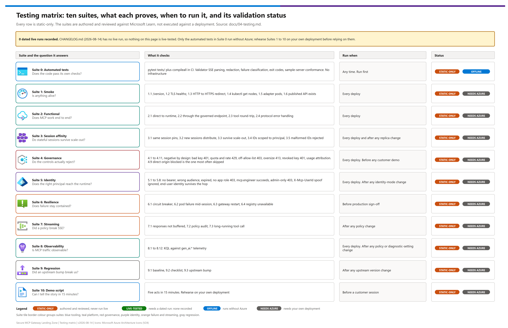

[README](../README.md) › [docs index](./00-reproduce-this-demo.md) › 04 Testing

# 04 — Testing

<p>
&nbsp;
&nbsp;
&nbsp;
&nbsp;
&nbsp;

</p>


Validation suite for the **Secure MCP Gateway Landing Zone**. Functional tests prove the platform works; governance tests prove the controls actually engage; the demo script turns both into a narrative.

**A control you have never seen fail is a control you have not verified.** Most sections below are deliberately negative tests.

Prerequisite: [03-deployment.md](./03-deployment.md) complete through Phase 8.

## At a glance

| | Topic | One-line answer |
|---|---|---|
|  | Offline tests | `pytest tests/` needs no infrastructure and covers the validator and the reference server (§ 0) |
|  | Governance tests | Negative by design: 401 / 403 / 413 / 429 prove each control engages, including the direct-origin bypass (§ 4) |
|  | Identity tests | The forwarded identity must be the end user, not the gateway service principal (§ 5) |
|  | Session and resilience | Pod pinning, scale-out, circuit breaker and pod-failure containment (§ 3, § 6) |
|  | Observability | Native `gen_ai.*` MCP telemetry is verified with KQL, not assumed (§ 8) |

> [!IMPORTANT]
> Every suite below is a procedure to run against **your** deployment. Nothing in this page records a live run — see [Validation status](#validation-status).

## Test inventory

[](./assets/testing-matrix.png)

<sub>Editable source: [`assets/testing-matrix.drawio`](./assets/testing-matrix.drawio) - regenerate with `python scripts/export_diagrams.py docs/assets`.</sub>

| Suite | Question it answers | Run when |
|---|---|---|
| [1. Smoke](#1-smoke-tests) | Is anything alive? | Every deploy |
| [2. Functional](#2-functional-tests) | Does MCP work end to end? | Every deploy |
| [3. Session affinity](#3-session-affinity-tests) | Do stateful sessions survive scale-out? | Every deploy, and after any replica change |
| [4. Governance](#4-governance-tests-negative-by-design) | Do the controls actually reject? | Every deploy; **before any customer demo** |
| [5. Identity](#5-identity-and-token-flow-tests) | Does the right principal reach the runtime? | Every deploy; after any identity-mode change |
| [6. Resilience](#6-resilience-tests) | Does failure stay contained? | Before production sign-off |
| [7. Streaming](#7-streaming-integrity-tests) | Did a policy break SSE? | **After any policy change** |
| [8. Observability](#8-observability-and-telemetry-tests) | Is MCP traffic actually observable? | Every deploy; after any policy or diagnostic-setting change |
| [9. Regression](#9-regression-harness) | Did an upstream bump break us? | After any upstream version change |
| [10. Demo script](#10-demo-script) | Can I tell the story in 15 minutes? | Before a customer session |

## Validation status

| Layer | What it covers | Status |
|---|---|---|
| Automated tests (`tests/`) | Validator SSE parsing, secret redaction, failure classification, exit codes, reference MCP server conformance, doc-visual lint |  ✅ runs offline, no Azure |
| Suites 1–9 (smoke → regression) | Procedures and pass criteria for a deployed environment |  ⏳ authored and reviewed against Microsoft Learn (see `CHANGELOG.md`, 2026-08-14); no dated live run is recorded |
| Suite 10 (demo script) | Narrative built on the results of suites 1–9 |  ⏳ rehearse against your own deployment |

> [!NOTE]
> This pattern is **static-only**: neither `CHANGELOG.md` nor the docs record a dated live deployment run. Treat every `Pass` criterion as the expected result to confirm, and record your own results in the regression baseline ([9.1](#91-baseline-capture)).

---

## 0. Automated tests in this repository

Run these first — they need no deployed infrastructure.

| Step | | Action | Gate |
|---|---|---|---|
| **1** |  | `python -m pip install -r scripts/requirements.txt` | ☐ Dependencies installed |
| **2** |  | `python -m pytest tests/ -v` | ☐ All tests pass |

```bash
python -m pip install -r scripts/requirements.txt
python -m pytest tests/ -v
```

Covers the endpoint validator's SSE parsing, secret redaction, failure classification, and exit-code mapping, plus the reference MCP server's protocol conformance. A failure here means the tooling is wrong, not the platform.

---

## 1. Smoke tests

| # | Test | Command | Pass |
|---|---|---|---|
| 1.1 | Governance plane responds | `curl -s -o /dev/null -w "%{http_code}" https://<APIM_HOST>/version` | Success status |
| 1.2 | Runtime edge serves TLS | `curl -sSI https://<MCP_ORIGIN>/healthz \| head -1` | `200`, valid chain |
| 1.3 | HTTP redirects to HTTPS | `curl -sSI http://<MCP_ORIGIN>/healthz \| head -1` | Redirect |
| 1.4 | Cluster healthy | `kubectl get nodes` | All `Ready` |
| 1.5 | Adapter pods running | `kubectl get pods -n adapter` | Expected replicas `Running`/`Ready` |
| 1.6 | Published API exists | `az apim api list … --query "[?type=='mcp']"` | Asset present |

---

## 2. Functional tests

### 2.1 Direct to the runtime (bypasses the gateway)

Run this **first** when something is broken — it isolates the runtime from the governance plane.

```bash
python ./scripts/validate_mcp_endpoint.py \
  --endpoint https://<MCP_ORIGIN>/adapters/<ADAPTER_NAME>/mcp \
  --use-azure-identity --scope api://<CLIENT_ID>/.default
```

**Pass:** `initialize` succeeds, protocol version negotiated, `tools/list` returns `echo` and `describe_environment`.

> If this passes but 2.2 fails, the fault is in the governance plane or the publish contract — not the runtime.

### 2.2 Through the governed endpoint

```bash
python ./scripts/validate_mcp_endpoint.py \
  --endpoint https://<APIM_HOST>/mcp/<ASSET_PATH> \
  --subscription-key <SUBSCRIPTION_KEY> \
  --use-azure-identity --scope api://<CLIENT_ID>/.default
```

**Pass:** identical tool list to 2.1, with governance headers (`X-RateLimit-Remaining`, `X-Correlation-Id`) present when the hardened overlay is applied.

### 2.3 Tool invocation round-trip

```bash
python ./scripts/validate_mcp_endpoint.py \
  --endpoint https://<APIM_HOST>/mcp/<ASSET_PATH> \
  --subscription-key <SUBSCRIPTION_KEY> \
  --use-azure-identity --scope api://<CLIENT_ID>/.default \
  --call-tool echo --tool-args '{"message":"round-trip"}'
```

**Pass:** the response contains `round-trip`.

### 2.4 Protocol error handling

| Input | Expected JSON-RPC error |
|---|---|
| Unknown method | `-32601` method not found |
| Unknown tool in `tools/call` | Tool-level error, not a transport failure |
| Malformed JSON | `-32700` parse error |
| `tools/call` with no tool name | `-32602` invalid params |

> **Known upstream limitation.** The runtime may convert some newer-protocol error responses into gateway `500`s rather than passing through the correct `4xx`. If you see a `500` where a `4xx` was expected, check the protocol-era mismatch note in [05-troubleshooting.md](./05-troubleshooting.md) before assuming a platform fault.

---

## 3. Session affinity tests

This is the reason the MCP runtime is in the architecture. Test it explicitly.

### 3.1 Same session pins to the same pod

`describe_environment` returns the serving pod's identity, which is what makes this visible.

```bash
SESSION_ID="test-$(date +%s)"
for i in 1 2 3 4 5; do
  python ./scripts/validate_mcp_endpoint.py \
    --endpoint https://<APIM_HOST>/mcp/<ASSET_PATH> \
    --subscription-key <SUBSCRIPTION_KEY> \
    --use-azure-identity --scope api://<CLIENT_ID>/.default \
    --call-tool describe_environment --tool-args '{}' \
    --json | jq -r '.toolResult.podName'
done
```

**Pass:** all five calls within one session return the **same** pod name.
**Fail:** differing pod names → affinity is broken. Check that the workload is a StatefulSet with a headless Service, and see 3.4.

### 3.2 New sessions distribute

Run 3.1 ten times with a **fresh** session each time.

**Pass:** results span more than one pod (with ≥2 replicas). All calls landing on one pod suggests only one pod is `Ready`.

### 3.3 Sessions survive scale-out

```bash
# Establish a session, note the pod, then:
kubectl scale statefulset <ADAPTER_NAME> -n adapter --replicas=4
# Re-issue calls on the SAME session
```

**Pass:** the existing session continues hitting its original pod; new sessions begin using the added pods.

### 3.4 Session identifiers are scoped to the principal

Capture a session identifier as principal A, then replay it as principal B.

**Pass:** principal B does **not** inherit principal A's session. The runtime scopes sessions by authenticated principal, server, and session id.

> This test only means anything under **Identity Mode B**. Under Mode A every call shares one principal, so session scoping cannot discriminate between users — a direct consequence of the trade-off in [docs/07](./07-identity-and-token-flow.md).

### 3.5 Malformed session identifiers are rejected

Send session identifiers containing `../`, a very long string, and shell metacharacters.

**Pass:** all rejected. The runtime validates session identifiers against a strict character allow-list.

---

## 4. Governance tests (negative by design)

**Run every one of these before a customer demo.** Each proves a control engages.

| # | Test | Expected | Proves |
|---|---|---|---|
| 4.1 | Omit the subscription key | `401` | Gateway entitlement enforced |
| 4.2 | Invalid subscription key | `401` | Key validated, not merely present |
| 4.3 | Key in the **wrong header** (`Ocp-Apim-Subscription-Key` when the asset expects `api-key`) | `401` | Header convention is real; a top-3 false alarm |
| 4.4 | Exceed the product quota | `429` | Quota envelope enforced |
| 4.5 | Exceed the per-asset rate ceiling *(overlay applied)* | `429` + `X-RateLimit-Remaining: 0` | Per-asset ceiling enforced |
| 4.6 | Call a tool outside the allow-list *(overlay applied)* | `403` with JSON-RPC error | Tool-surface allow-listing enforced |
| 4.7 | Call an allow-listed tool | Success | Allow-list is not over-blocking |
| 4.8 | Oversized payload *(overlay applied)* | `413` | Payload guard enforced |
| 4.9 | **Call the runtime origin directly, bypassing the gateway** | **Blocked** | Phase 4.3 origin lock — quota and metering cannot be bypassed |
| 4.10 | Revoke the subscription, then call | `401` | Single revocation point works |

> [!WARNING]
> **4.9 is the one teams most often skip and most often fail.** If a client can reach the runtime origin directly, every governance control above is optional from the client's point of view. Test it from outside your network path.

### 4.11 Usage attribution

After generating traffic, confirm usage records attribute calls to the **product and subscription**, not just a source address — that is what makes chargeback possible.

```bash
az monitor app-insights query \
  --app <APP_INSIGHTS_NAME> \
  --analytics-query "requests | where timestamp > ago(1h) | where url contains '/mcp/' | summarize count() by tostring(customDimensions['Subscription Name'])"
```

**Pass:** requests group by subscription with non-empty names.

---

## 5. Identity and token flow tests

| # | Test | Expected | Proves |
|---|---|---|---|
| 5.1 | Valid key, **no** bearer token | Rejected at the runtime | Identity checked independently of entitlement |
| 5.2 | Valid key, token for the **wrong audience** | Rejected | Audience binding enforced |
| 5.3 | Valid key, **expired** token | Rejected | Expiry validated |
| 5.4 | Principal with **no** app role calls a role-gated operation | `403` | Runtime RBAC enforced |
| 5.5 | Principal with `mcp.engineer` registers an adapter | Success | Role grants work |
| 5.6 | Principal with `mcp.engineer` attempts an admin-only capability | `403` | Privileged capabilities fail closed |
| 5.7 | Client spoofs `X-Mcp-UserId` | Header ignored/stripped | Forwarded identity cannot be forged |

### 5.8 End-user identity actually survives the hop

The definitive Mode B test.

```bash
# As principal A
python ./scripts/validate_mcp_endpoint.py \
  --endpoint https://<APIM_HOST>/mcp/<ASSET_PATH> \
  --subscription-key <SUBSCRIPTION_KEY> \
  --use-azure-identity --scope api://<CLIENT_ID>/.default \
  --call-tool describe_environment --tool-args '{}'
```

**Pass:** the forwarded identity in the response corresponds to **principal A**, not to API Management's service principal.
**Fail:** if it shows a single constant identity for every caller, the asset is effectively running in **Mode A** — check that `backend.authType` is `none`.

---

## 6. Resilience tests

### 6.1 Circuit breaker opens

Scale the adapter to zero, then call repeatedly through the gateway.

```bash
kubectl scale statefulset <ADAPTER_NAME> -n adapter --replicas=0
```

**Pass:** after the failure threshold (default 3 within `PT5M`), the gateway returns a `5xx` **quickly** rather than waiting on the backend. Restore replicas and confirm recovery after the trip duration.

**Why it matters:** the same API Management instance carries LLM traffic. A failing MCP runtime must not exhaust shared gateway capacity.

### 6.2 Pod failure mid-session

Delete the pod serving an active session.

**Pass:** the affected session fails cleanly (clients are expected to re-establish); **other** sessions are unaffected; new sessions route to healthy pods.

### 6.3 Gateway restart

```bash
kubectl rollout restart deployment/<GATEWAY_DEPLOYMENT> -n <GATEWAY_NAMESPACE>
```

**Pass:** the service recovers; session state persisted in the distributed store survives where expected. Record actual behaviour — it depends on the session store configuration.

### 6.4 Registry unavailable

**Pass:** existing adapters continue serving; only **new** adapter registrations fail. Deployment-time and runtime dependencies are correctly separated.

---

## 7. Streaming integrity tests

> [!WARNING]
> **Run these after every policy change.** A buffering policy is the most likely way to silently break this platform, and it usually looks like "the client hangs" rather than an error.

### 7.1 Streaming is not buffered

Issue a call that produces a streamed response and observe arrival timing:

```bash
curl -N -s \
  -H "api-key: <SUBSCRIPTION_KEY>" \
  -H "Authorization: Bearer <TOKEN>" \
  -H "Accept: text/event-stream, application/json" \
  -H "Content-Type: application/json" \
  -d '{"jsonrpc":"2.0","id":1,"method":"tools/list"}' \
  https://<APIM_HOST>/mcp/<ASSET_PATH> \
  | while IFS= read -r line; do printf '%s  %s\n' "$(date +%T.%3N)" "$line"; done
```

**Pass:** lines arrive incrementally.
**Fail:** everything arrives at once after a long pause → a policy is buffering. Audit every policy in scope for response-body access (`context.Response.Body`, outbound `validate-content`, outbound body transforms). See [01-architecture.md](./01-architecture.md#the-streaming-constraint-read-this-before-designing-policy).

### 7.2 Policy audit

Review the effective policy at global, product, API, and operation scope.

**Pass:** **no** MCP-scoped policy reads the response body. Header-only outbound manipulation is fine.

### 7.3 Long-running tool call

Invoke a tool that takes longer than a typical idle timeout.

**Pass:** the connection is held and the result is delivered. A premature close points at a timeout on the Application Gateway, API Management, or the client.

> **Global scope evaluates first.** Azure API Management evaluates policies — and diagnostic settings — at global (All APIs) scope *before* MCP server scope (Microsoft Learn, "Expose and govern existing MCP server"). A policy set that is clean at MCP scope is not sufficient on its own: a global-scope policy that touches the response body, or a global diagnostic setting with a non-zero Frontend Response payload-byte count, breaks streaming even when every MCP-scoped policy is clean. See [8.12](#812-global-scope-regression-guard) for the specific regression guard.

---

## 8. Observability and telemetry tests

> Azure API Management emits rich MCP-native telemetry to Application Insights **with zero configuration** — this suite proves that claim rather than assuming it. Facts below come from Microsoft Learn, "Monitor MCP server traffic" (last updated 2026-06-30) and "Expose and govern existing MCP server," unless otherwise noted. See [01-architecture.md](./01-architecture.md#native-observability--richer-than-the-policy-constraint-suggests) for the narrative overview — this suite is the verification.

All KQL below runs via:

```bash
az monitor app-insights query \
  --app <APP_INSIGHTS_NAME> \
  --analytics-query "<KQL below, collapsed to one line>"
```

or pasted directly into **Logs** on the Application Insights resource in the portal.

When more than one MCP server or asset shares the same Application Insights resource, narrow any query below with `and customDimensions["service.name"] == "<mcp-server-name>"` (`service.name` is present on every MCP request) or `and url contains "<ASSET_PATH>"` (the same pattern [4.11](#411-usage-attribution) already uses).

### 8.1 Telemetry arrives at all

Make one tool call through the governed endpoint (reuse [2.3](#23-tool-invocation-round-trip)), then confirm a row exists:

```kusto
requests
| where timestamp > ago(15m)
| where customDimensions["api.type"] == "Mcp"
| project timestamp, name, duration, success, tostring(customDimensions["gen_ai.operation.name"])
| order by timestamp desc
```

**Pass:** at least one row appears within minutes of the call, with `duration` populated.
**Proves:** the telemetry claim holds with no diagnostic setting of your own — this is native to the MCP server resource type.

### 8.2 Per-operation visibility

Make one `tools/list` call and one `tools/call` (2.1/2.3), then:

```kusto
requests
| where timestamp > ago(15m) and customDimensions["api.type"] == "Mcp"
| summarize count(), any_ToolCount = any(customDimensions["ToolCount"]) by tostring(customDimensions["gen_ai.operation.name"])
```

**Pass:** two distinct `gen_ai.operation.name` values, `tools/list` and `tools/call`, each with `count() >= 1`; the `tools/list` row carries a populated `ToolCount`.

### 8.3 Per-tool visibility

Call the `echo` tool (2.3), then:

```kusto
requests
| where timestamp > ago(15m) and customDimensions["gen_ai.operation.name"] == "tools/call"
| project timestamp, tostring(customDimensions["gen_ai.tool.name"]), tostring(customDimensions["gen_ai.tool.type"]), success
| order by timestamp desc
```

**Pass:** `gen_ai.tool.name` is `echo` — matching the tool actually invoked, not a generic operation label.

### 8.4 Session correlation

This is the telemetry-side confirmation of [3.1](#31-same-session-pins-to-the-same-pod). Re-run the 3.1 loop (five calls, one `SESSION_ID`), capturing the session id the runtime actually assigned — either from the `Mcp-Session-Id` response header, or from `validate_mcp_endpoint.py --json`'s `session_id` field. Then:

```kusto
requests
| where timestamp > ago(15m) and customDimensions["api.type"] == "Mcp"
| summarize count() by tostring(customDimensions["gen_ai.conversation.id"])
```

**Pass:** the five calls share one `gen_ai.conversation.id` value, and that value **matches** the session id captured above.
**Fail:** distinct `gen_ai.conversation.id` values per call means the calls did not actually share a session, or session correlation is not propagating into telemetry — re-check 3.1 first.

### 8.5 Client attribution

```kusto
requests
| where timestamp > ago(15m) and customDimensions["api.type"] == "Mcp"
| project timestamp, tostring(customDimensions["user_agent.name"]), tostring(customDimensions["user_agent.version"])
| order by timestamp desc
```

**Pass:** `user_agent.name`/`user_agent.version` identify the calling MCP client (for example `vscode` or `claude-desktop`). `validate_mcp_endpoint.py` sets its own MCP `clientInfo` in the `initialize` payload, a protocol-level field that is not necessarily the same string that lands in the HTTP `user_agent.name` dimension — for a demo-quality client-identification result, drive this test from a real MCP client rather than the validator script.

### 8.6 Auth method visibility

```kusto
requests
| where timestamp > ago(15m) and customDimensions["api.type"] == "Mcp"
| project timestamp, tostring(customDimensions["auth.type"]), success
| order by timestamp desc
```

**Pass:** `auth.type` is populated and reflects the inbound authentication actually used for that call — cross-reference [suite 5](#5-identity-and-token-flow-tests) when validating this against a specific identity mode.

### 8.7 Latency percentiles per tool

```kusto
requests
| where timestamp > ago(1h) and customDimensions["gen_ai.operation.name"] == "tools/call"
| summarize p50 = percentile(duration, 50), p95 = percentile(duration, 95), count() by tostring(customDimensions["gen_ai.tool.name"])
| order by p95 desc
```

**Pass:** p50/p95 compute per tool using the `duration` field API Management already sets — no client-side timestamp math required.

### 8.8 Error-rate visibility

Trigger a known failure — a tool outside the allow-list (governance test [4.6](#4-governance-tests-negative-by-design), expects `403`) — then:

```kusto
requests
| where timestamp > ago(15m) and success == false and customDimensions["api.type"] == "Mcp"
| project timestamp, tostring(customDimensions["gen_ai.tool.name"]), tostring(customDimensions["error.type"]), tostring(customDimensions["error.message"])
| order by timestamp desc
```

**Pass:** the 4.6 rejection appears with `success == false` and populated `error.type`/`error.message` — the governance-plane rejection is visible in telemetry, not just in the HTTP response the client saw.

### 8.9 Chargeback attribution

```kusto
requests
| where timestamp > ago(1h) and customDimensions["gen_ai.operation.name"] == "tools/call"
| summarize calls = count() by tostring(customDimensions['Subscription Name']), tostring(customDimensions["gen_ai.tool.name"])
| order by calls desc
```

**Pass:** tool-call volume groups cleanly by subscription **and** by tool — the per-tool granularity that makes the usage-attribution story in [4.11](#411-usage-attribution) usable for FinOps, not just aggregate request counts.

### 8.10 Payload logging on and off

**Off (default):** make a `tools/call`, then:

```kusto
requests
| where timestamp > ago(15m) and customDimensions["gen_ai.operation.name"] == "tools/call"
| project timestamp, tostring(customDimensions["gen_ai.tool.name"]), isnotempty(customDimensions["gen_ai.tool.call.arguments"]), isnotempty(customDimensions["gen_ai.tool.call.result"])
| order by timestamp desc
```

**Pass (default):** both `isnotempty(...)` columns are `false` for every row — arguments and results are absent by default.

**On (opt-in):** Portal → **APIs → MCP servers** → select the server → **Settings → Diagnostic Logs** → enable **Frontend and Backend** payload logging (portal-only; no CLI flag is documented for this per-MCP-server toggle). Repeat the tool call, re-run the same query.

**Pass (after enabling):** `gen_ai.tool.call.arguments` and `gen_ai.tool.call.result` are populated with the actual call payload and result.

> [!CAUTION]
> **From Microsoft Learn "Monitor MCP server traffic":** these fields can contain prompts, customer data, or secrets. Treat them as sensitive, and disable payload logging again after the demo unless a specific engagement requires it continuously.

### 8.11 Custom trace dimensions

Only applies when the hardened overlay ([mcp-hardened-policy.xml](../infra/policies/mcp-hardened-policy.xml)) is applied to the asset. Make one call, then check **Transaction search** (or the query below) for the trace emitted by its section 4:

```kusto
traces
| where timestamp > ago(15m)
| where message startswith "MCP inbound request"
| project timestamp, message, tostring(customDimensions["correlationId"]), tostring(customDimensions["agentId"]), tostring(customDimensions["subscriptionName"]), tostring(customDimensions["productName"]), tostring(customDimensions["jsonRpcMethod"])
| order by timestamp desc
```

**Pass:** one `traces` row per inbound MCP request, with all five metadata values populated — `correlationId` matches the `X-Correlation-Id` response header from the same call, `agentId` is either the caller-supplied `x-agent-id` header or `unspecified`, `subscriptionName`/`productName` resolve to real values or `unknown`, and `jsonRpcMethod` matches the method actually invoked.

### 8.12 Global-scope regression guard

Portal-only check (no CLI flag documented): **APIs → All APIs → Settings → Diagnostic Logs** → confirm **"Number of payload bytes to log"** for **Frontend Response** is **`0`** at this global scope.

**Pass:** the global-scope value is `0`.
**Fail / regression trap:** raising it above `0` breaks MCP streaming for **every** asset, because Azure API Management evaluates global-scope policies and diagnostic settings **before** MCP server scope — an MCP-scope policy set as clean as [mcp-hardened-policy.xml](../infra/policies/mcp-hardened-policy.xml) cannot compensate for a global-scope setting or policy that touches the response body. This is a documented *cause* of the "client hangs" symptom [suite 7](#7-streaming-integrity-tests) detects — if 7.1 fails with no matching MCP-scope policy change, check this setting first.

---

## 9. Regression harness

Run after **any** upstream version change, policy change, or identity-mode change.

### 9.1 Baseline capture

Before changing anything, capture a baseline:

```bash
python ./scripts/validate_mcp_endpoint.py \
  --endpoint https://<APIM_HOST>/mcp/<ASSET_PATH> \
  --subscription-key <SUBSCRIPTION_KEY> \
  --use-azure-identity --scope api://<CLIENT_ID>/.default \
  --json > baseline-$(date +%Y%m%d).json
```

### 9.2 Regression checklist

| Check | Baseline | Current | Verdict |
|---|---|---|---|
| Tool count and names | | | |
| Protocol version negotiated | | | |
| Session id present on `initialize` | | | |
| `initialize` latency (ms) | | | |
| `tools/list` latency (ms) | | | |
| Governance tests 4.1–4.10 all reject | | | |
| Session affinity (3.1) holds | | | |
| Streaming not buffered (7.1) | | | |
| Forwarded identity is the end user (5.8) | | | |

### 9.3 Upstream bump procedure

1. Record both current pinned SHAs
2. Review upstream changes between the pinned SHA and the candidate — **read the diff**, especially for the publish/access contract schemas and policy fragments
3. Deploy to a non-production environment
4. Run the full regression checklist
5. Update pins in `README.md` and `demo-ids.template.json`
6. Note the change in `CHANGELOG.md`

**Highest-risk upstream changes to watch for:**

- **MCP protocol-era changes** in the runtime — the session model is the fragile part
- **Publish/Access Contract schema changes** — these subsystems are versioned and preview
- **Policy fragment renames** — a renamed fragment silently changes behaviour if a custom overlay references it
- **API Management API type or transport changes**

---

## 10. Demo script

A 15-minute narrative that shows the platform doing something a single product cannot.

### Setup (before the audience arrives)

- Adapter running with **≥2 replicas**
- Hardened policy overlay applied with a **deliberately restrictive** allow-list
- A **second**, unauthorized principal ready
- A terminal with large, readable font; secrets **not** on screen

> [!CAUTION]
> Do not show subscription keys, bearer tokens or `demo-ids.local.json` on screen. Use `<SUBSCRIPTION_KEY>`-style environment variables so nothing sensitive reaches the shared display.

### Act 1 — Onboarding is self-service (3 min)

> "A team wants to expose a new tool server. Watch how long this takes."

Register an adapter with `Register-McpAdapter.ps1`. Show the StatefulSet appear.

> "No platform redeploy. No ticket. The control plane created a scaled, network-isolated workload — and it is not reachable by anyone yet."

### Act 2 — Governance is inherited, not rebuilt (4 min)

Show the published endpoint and call it successfully.

> "This tool now sits behind the same gateway, the same subscription key, and the same billing pipeline as our model traffic. We did not build an MCP-specific security stack — we published into the one we already had."

Then run the negative tests **live**:

- No key → `401`
- Non-allow-listed tool → `403`
- Hammer the endpoint → `429`

> "Rate limiting and per-tool authorization aren't in the MCP runtime today. They're at the edge, so they apply to every tool automatically."

### Act 3 — Identity survives the hop (4 min)

Call `describe_environment` and point at the forwarded identity.

> "That's *me*, not the gateway's service principal. The runtime makes its own authorization decision about the real caller."

Now switch to the unauthorized principal → `403`.

> "Same subscription key. Same quota. Different person. Different answer. Entitlement and identity are separate questions, answered by separate systems."

### Act 4 — Sessions survive scale (3 min)

Call `describe_environment` five times in one session — same pod every time.

> "MCP sessions are stateful. Naive load balancing breaks them on call two."

Scale to four replicas live; existing session holds, new sessions spread.

> "That's the piece you'd otherwise have to build yourself."

### Act 5 — Close on the honest boundary (1 min)

> "One thing this cannot do: inspect MCP **responses**. MCP streams, and anything that reads the response body breaks streaming. So outbound controls belong in the tool server itself. We'd rather tell you that now than have you discover it in your pilot."

### Questions to expect

| Question | Answer |
|---|---|
| "Why not just use API Management's native expose-REST-as-MCP?" | Use it when your tools already **are** REST APIs in API Management. This pattern is for hosting arbitrary MCP server workloads with session affinity and dynamic registration. |
| "Is this an official Microsoft reference architecture?" | Both components are Microsoft-authored and the integration point is a supported extensibility feature, but this specific composition is not a published Microsoft blueprint. |
| "What's the biggest risk?" | MCP protocol evolution. The runtime's session model assumes the legacy session-oriented protocol; a newer revision removes protocol-level sessions. Pin versions deliberately. |
| "Can we do DLP on tool responses?" | Not at the gateway — streaming forbids it. It belongs in the tool server. |
| "What does it cost?" | API Management SKU dominates the governance plane; AKS nodes plus Application Gateway dominate the runtime plane. Scope it against the pricing calculator — see [02-prerequisites.md](./02-prerequisites.md). |

---

## Sign-off checklist

Before declaring an environment ready, work through the gate table, then tick the checklist.

| Stage | | Suites | Gate |
|---|---|---|---|
| **A** |  | Automated tests, smoke, functional (0–2) | ☐ Offline tests green; endpoints alive and tools listed |
| **B** |  | Governance and streaming (4, 7) | ☐ Every control rejects as expected; no buffering policy |
| **C** |  | Identity (5) | ☐ 5.8 shows the real end user |
| **D** |  | Sessions and resilience (3, 6) | ☐ Affinity holds; failure stays contained |
| **E** |  | Observability and regression (8, 9) | ☐ Telemetry verified; baseline captured |

- [ ] Automated tests pass (`pytest tests/ -v`)
- [ ] Smoke tests 1.1–1.6 pass
- [ ] Functional tests 2.1–2.4 pass
- [ ] Session affinity 3.1–3.5 pass
- [ ] **All** governance tests 4.1–4.11 reject as expected
- [ ] Identity tests 5.1–5.8 pass, including 5.8 showing the real end user
- [ ] Resilience tests 6.1–6.4 pass
- [ ] Streaming integrity 7.1–7.3 pass
- [ ] Observability tests 8.1–8.12 pass, including 8.11 only when the hardened overlay is applied
- [ ] Regression baseline captured and stored
- [ ] Upstream pins recorded in `demo-ids.local.json`
- [ ] No secret in the repository

---

Next: [05 - Troubleshooting](./05-troubleshooting.md) →

*Last updated: 2026-10-02*
