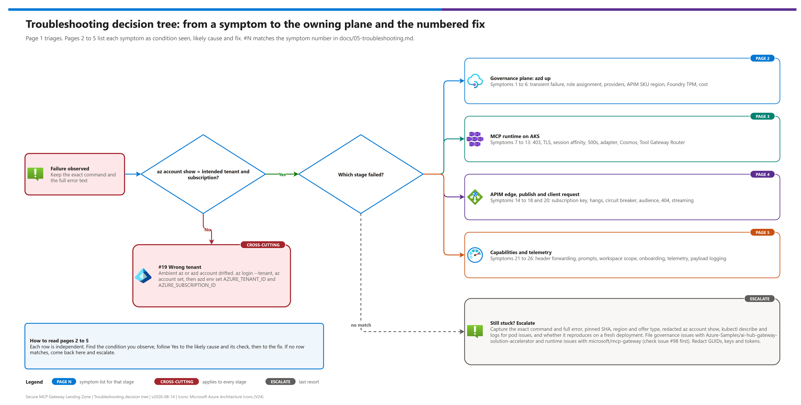
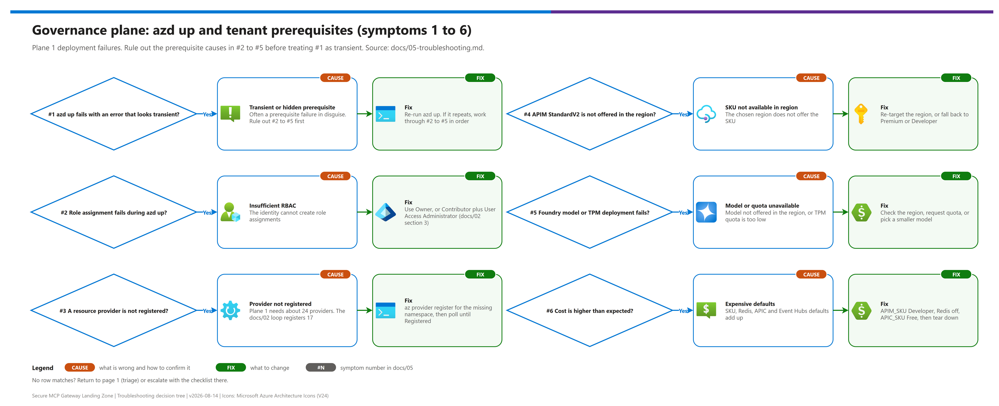
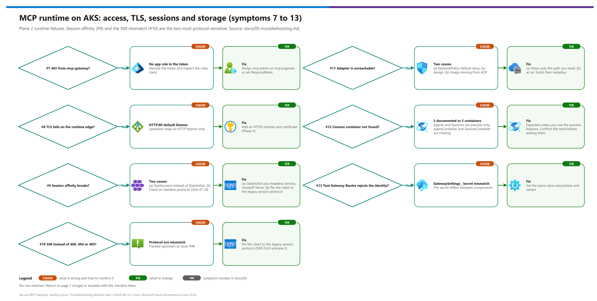
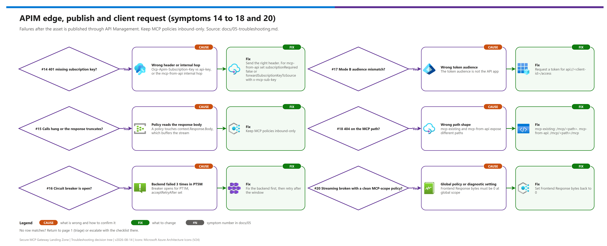
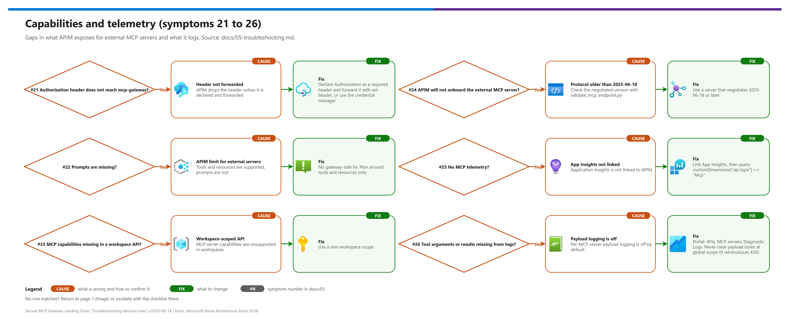

[README](../README.md) › [docs index](./00-reproduce-this-demo.md) › 05 Troubleshooting

# 05 — Troubleshooting

<p>
&nbsp;
&nbsp;
&nbsp;
&nbsp;
&nbsp;

</p>


> Part of the **Secure MCP Gateway Landing Zone** pattern. See [`./README.md`](../README.md) for the pattern overview, [`./01-architecture.md`](./01-architecture.md) for the architecture this troubleshooting guide assumes, [`./02-prerequisites.md`](./02-prerequisites.md) for the setup checklist most of these symptoms trace back to a skipped step in, [`./03-deployment.md`](./03-deployment.md) for the deployment runbook, and [`./04-testing.md`](./04-testing.md) for validation steps. Identity/token deep-dives live in [`./docs/07-identity-and-token-flow.md`](./07-identity-and-token-flow.md); publish/access contract mechanics live in [`./docs/06-mcp-publishing-and-access-contracts.md`](./06-mcp-publishing-and-access-contracts.md).

This pattern combines two independently-maintained upstream projects (see [`./02-prerequisites.md#1-overview--the-two-plane-mental-model`](./02-prerequisites.md#1-overview--the-two-plane-mental-model)) plus an integration seam that is unique to this pattern. Most symptoms below are grouped by which of those three surfaces actually owns the fix.

## At a glance

| | Where it fails | Symptoms | Start with |
|---|---|---|---|
|  | Governance plane — Citadel Governance Hub | [#1–#6](#governance-plane--citadel-governance-hub) | Deployment, RBAC, providers, region, quota, cost |
|  | MCP runtime plane — mcp-gateway | [#7–#13](#mcp-runtime-plane--mcp-gateway) | App roles, TLS, session affinity, NetworkPolicy, Cosmos, router secret |
|  | Integration seam | [#14–#18](#integration-seam--publish--access-contracts), [#20–#26](#integration-seam--apim-native-mcp-server-feature) | Subscription key, streaming, circuit breaker, audience, paths, native MCP limits, telemetry |
|  | Cross-cutting | [#19](#cross-cutting) | Ambient `az`/`azd` tenant drift |

> [!TIP]
> Always run [04 - Testing § 2.1](./04-testing.md#21-direct-to-the-runtime-bypasses-the-gateway) first. It isolates the runtime from the governance plane and halves the search space.

> [!IMPORTANT]
> Rule out [#19](#sym-19) (wrong tenant or subscription) before debugging anything else: a drifted login makes every other symptom look like a platform fault.

## Decision tree

Start on page 1, the triage router. It checks the tenant first, then sends you to the page for the plane that failed.

| Page | Covers |
|---|---|
| 1 | Triage router (tenant check, then which stage failed) |
| 2 | Governance plane (#1–6) |
| 3 | MCP runtime (#7–13) |
| 4 | APIM edge and client (#14–18, #20) |
| 5 | Capabilities and telemetry (#21–26) |

[](./assets/troubleshooting-decision-tree-1.png)

[](./assets/troubleshooting-decision-tree-2.png)

[](./assets/troubleshooting-decision-tree-3.png)

[](./assets/troubleshooting-decision-tree-4.png)

[](./assets/troubleshooting-decision-tree-5.png)

<sub>Editable source (all five pages): [`assets/troubleshooting-decision-tree.drawio`](./assets/troubleshooting-decision-tree.drawio) - regenerate with `python scripts/export_diagrams.py docs/assets`.</sub>

---

## Quick-triage table

Find the symptom that best matches what you're seeing, then jump straight to that section.

| Where | # | Symptom | Likely root cause | Plane | Jump |
|---|---|---|---|---|---|
|  | 1 | `azd up` fails partway through with a generic/transient provisioning error | Known upstream transient deployment behavior | Governance | [→](#sym-1) |
|  | 2 | Deployment fails on a role-assignment write (`AuthorizationFailed` or similar) | Deploying identity has Contributor but not User Access Administrator (or isn't Owner) | Governance | [→](#sym-2) |
|  | 3 | Deployment fails with "provider not registered" / `MissingSubscriptionRegistration` | A required resource provider isn't registered on the subscription | Governance | [→](#sym-3) |
|  | 4 | APIM deployment fails, or StandardV2 isn't offered for the chosen region | APIM StandardV2 not available in that region | Governance | [→](#sym-4) |
|  | 5 | Foundry/Azure OpenAI model deployment fails, or requests throttle once traffic starts | Model not offered in region, or TPM quota exceeded | Governance | [→](#sym-5) |
|  | 6 | Spend is much higher than expected for a demo/dev footprint | APIM SKU tier or AKS node count/size set too high | Governance | [→](#sym-6) |
|  | 7 | MCP client authenticates fine but every call to mcp-gateway returns 403 | Missing `mcp.admin`/`mcp.engineer` app role assignment (fail-closed default) | MCP Runtime | [→](#sym-7) |
|  | 8 | Calls into mcp-gateway's public endpoint fail on TLS/certificate | Application Gateway listener is HTTP:80 by default — no TLS configured | MCP Runtime | [→](#sym-8) |
|  | 9 | Multi-step tool sessions behave as if state was lost / calls land on different pods | Adapter isn't a StatefulSet + headless Service, or client speaks the stateless 2026-07-28 MCP protocol | MCP Runtime | [→](#sym-9) |
|  | 10 | Gateway returns 500 where 400/404/405 was expected | MCP protocol-era mismatch — upstream issue #98 | MCP Runtime | [→](#sym-10) |
|  | 11 | Adapter pod never becomes reachable / tool calls time out | NetworkPolicy default-deny working as designed, or image never pushed to ACR | MCP Runtime | [→](#sym-11) |
|  | 12 | Cosmos DB "container not found" only when using Agents/Sessions  | 3-vs-5 container mismatch between docs and `Program.cs` | MCP Runtime | [→](#sym-12) |
|  | 13 | Tool Gateway Router rejects/ignores forwarded caller identity | `GatewaySettings__Secret` mismatch between mcp-gateway and tool-gateway | MCP Runtime | [→](#sym-13) |
|  | 14 | MCP endpoint via APIM returns 401 "missing subscription key" | Wrong header name, or `mcp-from-api` internal hop needs `subscriptionRequired:false`/forwarding config | Integration seam | [→](#sym-14) |
|  | 15 | MCP responses hang, truncate, or never stream | A policy read `context.Response.Body`, buffering the SSE stream | Integration seam | [→](#sym-15) |
|  | 16 | APIM fails fast on an MCP backend without attempting the real call | Circuit breaker tripped (3 failures / PT5M) | Integration seam | [→](#sym-16) |
|  | 17 | Mode B (caller-token passthrough) calls fail authorization at mcp-gateway despite APIM accepting them | Caller token audience doesn't match `api://<mcp-gateway-client-id>` | Integration seam | [→](#sym-17) |
|  | 18 | MCP endpoint returns `404 Not Found` even though the Publish Contract deployment succeeded | Wrong path shape for the asset type — `mcp-existing` has no trailing `/mcp`, `mcp-from-api` does | Integration seam | [→](#sym-18) |
|  | 19 | Commands "succeed" but touch the wrong environment, or resources land in an unexpected tenant | Ambient `az`/`azd` login context drifted to the wrong tenant/subscription | Cross-cutting | [→](#sym-19) |
|  | 20 | MCP streaming breaks even though every MCP-scope policy is inbound-only | A global-scope (all-APIs) diagnostic setting or policy reads the response body — global scope evaluates before MCP server scope | Integration seam | [→](#sym-20) |
|  | 21 | `Authorization` header never reaches mcp-gateway; Mode B calls fail despite a valid caller token | Request headers are forwarded to MCP tool invocations with undocumented exclusions — `Authorization` isn't guaranteed to pass through by default | Integration seam | [→](#sym-21) |
|  | 22 | MCP prompts don't work / are missing from an external MCP server exposed through APIM | For external MCP servers, APIM supports MCP tools and resources but not prompts | Integration seam | [→](#sym-22) |
|  | 23 | MCP server capabilities unavailable when the API is scoped to an APIM workspace | MCP server capabilities are not supported inside APIM workspaces | Integration seam | [→](#sym-23) |
|  | 24 | APIM rejects/won't onboard an external MCP server | The external MCP server doesn't conform to MCP protocol version `2025-06-18` or later | Integration seam | [→](#sym-24) |
|  | 25 | No MCP telemetry (`gen_ai.*` dimensions) appears in Application Insights | No Application Insights resource linked to the APIM instance, or querying the wrong dimension | Integration seam | [→](#sym-25) |
|  | 26 | Tool call arguments/results missing from telemetry | Per-MCP-server payload logging is off by default and must be opted in explicitly | Integration seam | [→](#sym-26) |

---

## Governance plane — Citadel Governance Hub

<a id="sym-1"></a>
### 1. `azd up` fails with a transient provisioning error

**Symptom:** `azd up` (or `azd provision`) fails partway through with a generic Azure Resource Manager error — a timeout, a dependency-not-ready condition, or a throttling-style message — without an obviously actionable root cause in the text itself.

**Likely cause:** The upstream repo's own documentation calls this out as a known, expected occurrence — some resource dependency chains in the template (APIM's own initial provisioning is itself lengthy; Private Endpoint DNS registration and Cosmos DB account creation have their own timing characteristics) occasionally trip ARM-level sequencing issues that resolve themselves on retry.

**Diagnosis:**
```bash
azd show
```
Also check the specific failed resource's error detail in the Azure Portal's resource group → **Deployments** blade — "transient" does not mean "no root cause." Before treating this as transient, rule out the more specific causes below (missing RBAC in [#2](#sym-2), unregistered provider in [#3](#sym-3), or a region/SKU problem in [#4](#sym-4)/[#5](#sym-5)) — those produce error text that can superficially look generic too.

**Fix:** Re-run `azd up`. This is explicitly documented upstream as expected behavior; subsequent runs typically succeed once the dependent resource has caught up.

**Prevention:** Don't run other deployments or role-assignment changes concurrently against the same resource group while `azd up` is mid-flight. Allow the full documented 30–45 minute window before concluding something is actually broken.

---

<a id="sym-2"></a>
### 2. Deployment fails creating role assignments

**Symptom:** Deployment fails with an authorization error specifically on a role-assignment write — e.g. `AuthorizationFailed`, or text indicating the caller lacks permission to perform `Microsoft.Authorization/roleAssignments/write`.

**Likely cause:** The Bicep/`azd` deployment creates RBAC role assignments as part of standing up the environment (for example, granting the APIM managed identity access to Key Vault, Cosmos DB, and Foundry). The identity running the deployment has **Contributor only** — Contributor cannot create role assignments.

**Diagnosis:**
```bash
az role assignment list --assignee <deploying-identity-object-id> --scope /subscriptions/<SUBSCRIPTION_ID> -o table
```
Confirm whether the deploying identity currently holds **Owner**, or **both** Contributor and User Access Administrator.

**Fix:** Have the subscription owner grant the deploying identity **Owner**, or **Contributor + User Access Administrator**, at the subscription (or target resource group) scope, then re-run `azd up`.

**Prevention:** Confirm RBAC per [`./02-prerequisites.md#3-rbac-and-permissions-required`](./02-prerequisites.md#3-rbac-and-permissions-required) *before* scheduling the deployment window, not after the first failed attempt.

---

<a id="sym-3"></a>
### 3. Resource provider not registered

**Symptom:** Deployment fails with an error resembling `MissingSubscriptionRegistration`, or text stating the subscription is not registered to use a given resource namespace.

**Likely cause:** One or more of the ~24 resource providers this pattern depends on (APIM, CognitiveServices, EventHub, DocumentDB, Cache, App, Network, KeyVault, OperationalInsights, Insights, Logic, Web, Storage, ApiCenter, plus AKS/ACR/ManagedIdentity for Plane 2) has never been registered on the target subscription — common on subscriptions that have never hosted that resource type before.

**Diagnosis:**
```bash
az provider list --query "[?registrationState=='Registered'].namespace" -o tsv --subscription <SUBSCRIPTION_ID>
```
Diff the result against the list in [`./02-prerequisites.md#5-resource-providers-to-register`](./02-prerequisites.md#5-resource-providers-to-register) and the upstream repo's `guides/full-deployment-guide.md`.

**Fix:**
```bash
az provider register --namespace <Microsoft.X> --subscription <SUBSCRIPTION_ID>
```
Registration is asynchronous — poll before retrying the deployment:
```bash
az provider show -n <Microsoft.X> --query registrationState --subscription <SUBSCRIPTION_ID>
```

**Prevention:** Run the full registration loop in [`./02-prerequisites.md § 5`](./02-prerequisites.md) on any subscription before its first deployment attempt for this pattern.

---

<a id="sym-4"></a>
### 4. APIM StandardV2 not available in the chosen region

**Symptom:** The APIM resource fails to deploy, or the StandardV2 SKU option is rejected/unavailable for the selected `AZURE_LOCATION`.

**Likely cause:** APIM StandardV2 availability is regional and still expanding — not every Azure region offers it, and this pattern's own regional matrix ([`./02-prerequisites.md § 7`](./02-prerequisites.md)) flags it as needing explicit per-region verification rather than assumption.

**Diagnosis:**
```bash
az provider show -n Microsoft.ApiManagement --query "resourceTypes[?resourceType=='service'].locations" -o json
```
and/or the `az rest` SKU query from [`./02-prerequisites.md § 7.3`](./02-prerequisites.md), run specifically for the target region *before* deploying.

**Fix:** Re-target a region confirmed to support StandardV2 (Tier 1 first, then Tier 2 with verification — [`./02-prerequisites.md § 7.1`](./02-prerequisites.md)); or, if StandardV2 specifically isn't required for the demo, fall back to `APIM_SKU=Premium` (broader historical regional footprint, higher cost) or `APIM_SKU=Developer` (dev/test only, no SLA).

**Prevention:** Always run the § 7.3 regional verification commands before picking `AZURE_LOCATION` — do not trust the upstream quick-start default, which is itself inconsistent between `main.bicepparam` (`swedencentral`) and the quick-deployment guide (`eastus`). Set `AZURE_LOCATION` explicitly every time.

---

<a id="sym-5"></a>
### 5. Foundry model not deployed in region / TPM quota exceeded

**Symptom:** The model deployment step fails outright, or — once traffic starts flowing — requests are throttled or rejected with quota-exceeded errors.

**Likely cause:** Either the chosen Foundry/Azure OpenAI model + version isn't offered in the target region at all, or the subscription's tokens-per-minute (TPM) quota for that model is too low for the demo's expected load. Model-level availability shifts frequently and independently of general region maturity — see the regional matrix caveat in [`./02-prerequisites.md § 7.2`](./02-prerequisites.md).

**Diagnosis:**
```bash
az cognitiveservices model list --location <region> -o table
```
to confirm the specific model + version is offered in that region. Check current TPM consumption via the Azure AI Foundry portal's Quotas page (`az cognitiveservices usage list --location <region>` also surfaces usage/limit counters, but verify its exact output shape against your installed CLI version before scripting against it).

**Fix:** Re-target a region where the model is confirmed available, request a TPM quota increase, or select a smaller/alternate model deployment sized to the demo's actual expected load.

**Prevention:** Confirm model + quota availability as an explicit regional pre-flight step ([`./02-prerequisites.md § 6`](./02-prerequisites.md), [§ 7.3](./02-prerequisites.md)) before committing to a region for the whole pattern — ideally a single region that also satisfies Plane 2's requirements, to avoid cross-region latency.

---

<a id="sym-6"></a>
### 6. Costs unexpectedly high

**Symptom:** Spend on the resource group(s) is materially higher than expected for a demo/dev footprint.

**Likely cause:** APIM SKU (StandardV2/Premium) or AKS nodepool size/count left at a production-oriented default instead of the documented dev-mode levers.

**Diagnosis:** Review Cost Management + Billing scoped to the resource group(s); cross-check the live `APIM_SKU` / `APIM_SKU_UNITS` values and the AKS nodepool VM size/count against the T-shirt sizing table and dev-mode levers in [`./02-prerequisites.md § 10`](./02-prerequisites.md).

**Fix:** Switch to `APIM_SKU=Developer` for non-production demos (roughly an order of magnitude cheaper than Premium), keep `ENABLE_MANAGED_REDIS=false` and `APIC_SKU=Free`, and check `deployment/infra/azure-deployment.bicep` for any exposed nodepool sizing parameter on Plane 2 before assuming a smaller footprint is configurable there.

**Prevention:** Apply the dev-mode toggles from [`./02-prerequisites.md § 10`](./02-prerequisites.md) from the very first deployment of any non-production instance, and tear down promptly after each session (`azd down` for Plane 1; delete the resource group for Plane 2) rather than leaving both planes running between engagements.

---

## MCP runtime plane — mcp-gateway

<a id="sym-7"></a>
### 7. MCP client gets 403 from mcp-gateway

**Symptom:** The MCP client successfully authenticates against Entra ID (a token is issued) but every call to mcp-gateway is rejected with 403 Forbidden.

**Likely cause:** mcp-gateway's built-in tools and the Workload Identity path both fail closed to `mcp.admin`-only whenever `BuiltinToolSettings:RequiredRoles` / `WorkloadIdentitySettings:RequiredRoles` are left unset — and, more generally, the calling identity may simply have no `mcp.admin`/`mcp.engineer` app role assignment yet. This is documented fail-closed behavior, not a bug — see [`./02-prerequisites.md § 4.2`](./02-prerequisites.md).

**Diagnosis:** Decode the caller's bearer token (e.g., paste it into a JWT decoder) and inspect the `roles` claim; compare against the app roles actually assigned to that identity under the Entra app registration's **App roles** / **Users and groups** blades.

**Fix:** Assign `mcp.admin` or `mcp.engineer` to the calling user/service principal on the Entra app registration, and/or set `BuiltinToolSettings__RequiredRoles__0` / `WorkloadIdentitySettings__RequiredRoles__0` explicitly rather than leaving them unset.

**Prevention:** Treat app-role assignment as a mandatory, explicit post-deploy step — budget time for it immediately after infrastructure stands up and before the first smoke test, per the pre-flight checklist in [`./02-prerequisites.md § 13`](./02-prerequisites.md).

---

<a id="sym-8"></a>
### 8. APIM → mcp-gateway calls fail TLS

**Symptom:** Calls into the mcp-gateway public endpoint over HTTPS fail — a certificate error, connection reset, or an APIM backend health probe reporting failure — even though the Application Gateway resource itself shows healthy.

**Likely cause:** The Application Gateway listener created by the deploy tooling is **HTTP on port 80 by default.** There is no TLS/HTTPS listener and no certificate configured out of the box; the upstream repo's own "Production Onboarding" checklist calls this out explicitly as a manual step the operator must complete.

**Diagnosis:**
```bash
az network application-gateway http-listener list --gateway-name <appgw-name> --resource-group <rg> -o table
```
Confirm whether an HTTPS listener exists at all — if only an HTTP:80 listener is present, this is the cause.

**Fix:** Add an HTTPS listener to the Application Gateway backed by a real certificate (Key Vault-integrated or directly uploaded) before pointing APIM — or any other internet-facing consumer — at the endpoint.

**Prevention:** Treat "add TLS to the App Gateway listener" as a **mandatory pre-go-live step** for this pattern, not an optional hardening nicety. The upstream default is intentionally minimal and assumes the operator completes onboarding before the endpoint is fronted by APIM in any non-throwaway environment.

---

<a id="sym-9"></a>
### 9. Session affinity breaks / tool calls land on the wrong pod

**Symptom:** Multi-step MCP sessions behave inconsistently — a tool call that depends on state established by a prior call in the same session appears to hit a different adapter instance with no memory of the earlier call.

**Likely cause:** Two independent possibilities:
- (a) the adapter was deployed as a plain Kubernetes `Deployment` instead of the expected `StatefulSet` + headless Service (`clusterIP: None`) pairing, which is what gives each adapter pod a stable, individually addressable DNS name (`pod-name.<adapter>-service.adapter.svc.cluster.local:8000`); or
- (b) the client is speaking the newer, stateless MCP protocol revision (`2026-07-28`), which has no `initialize`/`mcp-session-id` concept at all — see upstream issue #98, and [#10](#sym-10) below for the related symptom.

**Diagnosis:**
```bash
kubectl get statefulsets -n adapter
kubectl get svc -n adapter -o wide
```
Confirm the workload type is actually `StatefulSet` and that the Service has `clusterIP: None`. Separately, check the MCP client/SDK version against the pinned preview SDK (`ModelContextProtocol` / `ModelContextProtocol.AspNetCore` `0.4.0-preview.3`) to rule out a protocol-era mismatch.

**Fix:** Redeploy the adapter from the repo's own `deployment/k8s/` StatefulSet + headless Service manifests rather than a hand-rolled `Deployment`. If the root cause is protocol-era mismatch, pin the client SDK to the legacy-session protocol version the gateway currently supports until upstream issue #98 is resolved.

**Prevention:** Don't hand-roll adapter manifests from memory — deploy from the pinned commit's actual `deployment/k8s/` templates, and pin client + server SDK versions deliberately (see [`./02-prerequisites.md § 11`](./02-prerequisites.md)) rather than tracking `latest` on either side.

---

<a id="sym-10"></a>
### 10. Gateway returns 500 where 400/404/405 was expected

**Symptom:** A request that should fail with a specific, meaningful client error (400 Bad Request, 404 Not Found, 405 Method Not Allowed) instead comes back as a generic 500 Internal Server Error.

**Likely cause:** Open upstream issue #98 (filed 2026-08-12): the MCP spec revision `2026-07-28` removed protocol-level sessions (`initialize`/`mcp-session-id`) in favor of stateless per-request `_meta` plus a new `server/discover` method. mcp-gateway's design still assumes the legacy session model end-to-end, so error paths for the newer protocol shape aren't mapped correctly and surface as unhandled 500s instead of the correct status code.

**Diagnosis:** Capture the exact request that produced the 500, including whatever protocol-version header/field the client sent, and compare against the gateway's pinned SDK version (`ModelContextProtocol`/`ModelContextProtocol.AspNetCore` `0.4.0-preview.3`) and the behavior described in issue #98.

**Fix:** There is no upstream fix as of the pinned commit (`59201a91f0c033dab7259f7c3c27be15353dafa4`). Work around it by pinning the client to speak the legacy session-based protocol the gateway expects, and track [issue #98](https://github.com/microsoft/mcp-gateway/issues/98) for resolution.

**Prevention:** Don't upgrade MCP client SDKs ahead of the gateway's pinned SDK version without testing against this gateway specifically. Treat protocol-version alignment as part of the version-pinning discipline for this pattern, not a detail that "should just work" because both sides say "MCP."

---

<a id="sym-11"></a>
### 11. Adapter pod unreachable

**Symptom:** Tool calls that should route to a specific adapter pod time out or never connect.

**Likely cause:** Two independent, easily-confused causes:
- (a) the `adapter` namespace's default-deny NetworkPolicy is correctly blocking traffic because the caller isn't `mcpgateway`/`toolgateway` — this is *working as designed*, but easy to trip over if you try to reach an adapter pod directly while debugging; or
- (b) the adapter's container image was never actually pushed to the ACR instance the cluster pulls from — mcp-gateway's deploy tooling does **not** build or push adapter images for you.

**Diagnosis:**
```bash
kubectl get networkpolicy -n adapter -o yaml
```
Confirm the default-deny + allow rules match expectation (only `mcpgateway`/`toolgateway` pods should reach adapter/tool pods on port 8000). Separately:
```bash
az acr repository show-tags --name <acr-name> --repository <adapter-image>
```
Confirm the expected image tag actually exists in the registry the cluster is configured to pull from.

**Fix:** For (a), only call adapters through `mcpgateway`/`toolgateway` — do not attempt direct pod-to-pod debugging traffic without an explicit, deliberate policy exception. For (b), build and push the image first:
```bash
az acr build --registry <acr-name> --image <adapter-image>:<tag> <path-to-adapter-source>
```
then redeploy or restart the pod so it can pull the now-present image.

**Prevention:** Confirm the image exists in ACR (and that the pod's `imagePullPolicy`/tag matches) as an explicit pre-deploy step for any new or customized adapter — check this before spending time on NetworkPolicy debugging, since it's the more common of the two causes for a *new* adapter specifically.

---

<a id="sym-12"></a>
### 12. Cosmos "container not found" using Agents/Sessions preview

**Symptom:** An error referencing a missing/nonexistent Cosmos DB container appears, but only when exercising the Agents/Sessions preview feature — normal adapter/tool traffic is unaffected.

**Likely cause:** The infra README documents only 3 containers (`AdapterContainer`, `CacheContainer`, `ToolContainer`), but `Program.cs` also references `AgentContainer` and `SessionContainer` for the preview Agents/Sessions feature. A deployment that provisioned only the documented 3 containers is missing the other 2 that the preview code path actually needs.

**Diagnosis:**
```bash
az cosmosdb sql container list --account-name <cosmos-account> --database-name <db-name> --resource-group <rg> -o table
```
Compare the result against all 5 expected container names: `AdapterContainer`, `CacheContainer`, `ToolContainer`, `AgentContainer`, `SessionContainer`.

**Fix:** Create the missing container(s) manually, matching the partitioning/throughput settings of the existing containers:
```bash
az cosmosdb sql container create \
  --account-name <cosmos-account> --database-name <db-name> --resource-group <rg> \
  --name <AgentContainer-or-SessionContainer> --partition-key-path <matching-partition-key>
```
Verify the exact partition key and throughput settings against the other containers before creating these — don't guess a different shape.

**Prevention:** Whenever a demo will touch the Agents/Sessions preview feature, verify all 5 containers exist as an explicit pre-flight step. Don't rely on the infra README's 3-container list alone — cross-check `Program.cs` at the pinned commit for the authoritative current set, since preview features are exactly where docs and code are most likely to drift.

---

<a id="sym-13"></a>
### 13. Tool Gateway Router rejects forwarded identity

**Symptom:** The Tool Gateway Router ignores or rejects identity headers forwarded from mcp-gateway, so requests that should have been authorized based on the original caller's identity are not.

**Likely cause:** `GatewaySettings__Secret` — the shared secret the Tool Gateway Router uses to trust forwarded identity headers from mcp-gateway — is mismatched between the two deployments (commonly because it was set independently per-environment, or rotated on one side without updating the other).

**Diagnosis:** Compare the `GatewaySettings__Secret` value configured on both the `mcp-gateway` and `tool-gateway` deployments:
```bash
kubectl get deployment <mcp-gateway-deployment-name> -n <namespace> -o yaml
kubectl get deployment <tool-gateway-deployment-name> -n <namespace> -o yaml
```
(or your secret store, if the value is sourced from Key Vault / a Kubernetes Secret rather than inline). The values must match exactly.

**Fix:** Set the same strong random value for `GatewaySettings__Secret` on both deployments, then restart both sets of pods so the new value takes effect.

**Prevention:** Source this secret from a single location (e.g., one Key Vault secret referenced by both deployments' configuration) rather than setting it independently in two places, and rotate both sides together.

---

## Integration seam — Publish / Access Contracts

> [!NOTE]
> The two most common contract-side failures are a **wrong header name** ([#14](#sym-14)) and a **wrong path shape for the asset type** ([#18](#sym-18)). Check both before suspecting the runtime. Contract mechanics: [06 - MCP publishing and access contracts](./06-mcp-publishing-and-access-contracts.md).

<a id="sym-14"></a>
### 14. MCP endpoint returns 401 "missing subscription key"

**Symptom:** Calls to the MCP endpoint through APIM fail with a 401 whose message references a missing subscription key.

**Likely cause:** Two distinct sub-causes, both worth checking:
- (a) the caller is sending the wrong header name — APIM's default subscription-key header is `Ocp-Apim-Subscription-Key`, and a caller sending `api-key` (or any other name) instead will be rejected unless the API/product is explicitly configured to accept that alternate header; or
- (b) specifically for `mcp-from-api` assets, there's a *second*, internal hop from the MCP-shaped front door to the underlying source API, which also expects a subscription key and returns its own 401 unless the source API has `subscriptionRequired: false`, or the front-facing API is configured with `forwardSubscriptionKeyToSource: true` alongside an `x-mcp-sub-key` header.

**Diagnosis:** Capture the exact request headers the client sent and compare against what the Product/Subscription actually expects. For `mcp-from-api` assets specifically, check the source API's `subscriptionRequired` setting and whether `forwardSubscriptionKeyToSource`/`x-mcp-sub-key` are configured on the front-facing API.

**Fix:** Correct the header name the client sends to match the API's configured expectation. For `mcp-from-api`, either set `subscriptionRequired: false` on the source API, or enable `forwardSubscriptionKeyToSource: true` on the front-facing API and supply `x-mcp-sub-key`.

**Prevention:** Document the exact expected header name and, for `mcp-from-api` assets, the internal-hop forwarding configuration, directly in the Access Contract handoff to consumers — see [`./docs/06-mcp-publishing-and-access-contracts.md`](./06-mcp-publishing-and-access-contracts.md) — so consumers aren't guessing at header names.

---

<a id="sym-15"></a>
### 15. MCP responses hang / truncate / never stream

**Symptom:** MCP tool calls appear to hang indefinitely, responses truncate partway through, or a streaming response never delivers incrementally / never completes.

**Likely cause:** MCP responses stream over Server-Sent Events (SSE). Somewhere in the applied policy pipeline, a fragment reads `context.Response.Body` — doing so forces APIM to buffer the *entire* response before any of it can be forwarded, which is fundamentally incompatible with SSE streaming. The pattern's own baseline policy (`baseline-mcp-policy.xml`) is inbound-only and does **not** do this by design — this symptom means a customization was layered on top of it.

**Diagnosis:** Review every policy fragment applied to the MCP API/product — inbound, outbound, backend, and any custom fragment — for a `set-variable`, logging step, or inspection logic that touches `context.Response.Body` on this specific API.

**Fix:** Remove any policy logic that reads the response body on MCP APIs. All inspection on MCP traffic in this architecture — authentication, usage metering, any opt-in PII/content-safety scanning — must be **inbound-only**. Response-side content inspection (PII de-anonymization, content-safety scanning) is **not supported for MCP** in this architecture; that is an intentional constraint, not a gap to work around with a cleverer policy.

**Prevention:** Treat "never read `context.Response.Body` on an MCP API" as a hard architectural constraint whenever writing or reviewing a custom policy fragment for this pattern — not a performance tuning suggestion. Flag it explicitly in any policy code review.

---

<a id="sym-16"></a>
### 16. Circuit breaker tripped

**Symptom:** APIM starts failing calls to an MCP backend immediately — without apparently attempting the real upstream call — after a period of intermittent backend errors.

**Likely cause:** The Publish Contract's default backend circuit breaker configuration tripped: 3 failures within a rolling PT5M (5-minute) window opens the breaker for PT1M (1 minute), with `acceptRetryAfter: true` governing recovery-probe behavior.

**Diagnosis:** Inspect the specific APIM backend resource's circuit-breaker rule and current state (Azure Portal → API Management → **Backends** → the backend in question, or via `az rest` against the backend resource's ARM endpoint) to confirm whether the breaker is currently open and how many failures triggered it.

**Fix:** Resolve the underlying backend health issue first — a tripped breaker is a symptom, not the root problem. Check mcp-gateway / Application Gateway health directly (see [#8](#sym-8), [#11](#sym-11)). Once the backend is healthy again, either wait out the PT1M trip window or allow a recovery probe request through if `acceptRetryAfter` permits it.

**Prevention:** If the demo's expected traffic pattern is legitimately bursty in a way that produces occasional backend errors, review whether the default 3-failures/PT5M threshold suits that pattern *before* a live demo — but do not change the threshold reactively mid-incident without first understanding why the backend failed in the first place; that root cause will still be there after you loosen the breaker.

---

<a id="sym-17"></a>
### 17. Token audience mismatch in Mode B passthrough

**Symptom:** In the default caller-token-passthrough mode (Mode B), APIM accepts and routes the call — subscription key valid, quota fine — but mcp-gateway itself rejects it on identity/authorization grounds.

**Likely cause:** `baseline-mcp-policy.xml` does not strip the `Authorization` header, so the caller's original Entra bearer token reaches mcp-gateway untouched by design (this is what lets mcp-gateway's per-user `mcp.admin`/`mcp.engineer` RBAC keep working under Mode B). mcp-gateway independently validates that token and only accepts tokens whose `aud` (audience) claim matches `api://<mcp-gateway-client-id>`. If the caller acquired a token for a different resource — Microsoft Graph, a different app registration, or the wrong scope entirely — mcp-gateway rejects it even though APIM was satisfied.

**Diagnosis:** Decode the bearer token the caller sent (e.g., via a JWT decoder) and check its `aud` claim against the expected `api://<mcp-gateway-client-id>` value from [`./02-prerequisites.md § 4`](./02-prerequisites.md).

**Fix:** Have the caller acquire a token scoped to the correct resource — `api://<mcp-gateway-client-id>/access` — not a token issued for a different resource/audience.

**Prevention:** Document the exact scope string consumers must request directly in the Access Contract handoff (see [`./docs/07-identity-and-token-flow.md`](./07-identity-and-token-flow.md)), and validate token audience as part of onboarding any *new* consumer, rather than discovering the mismatch after a failed call.

---

<a id="sym-18"></a>
### 18. MCP endpoint returns 404 — wrong path shape for the asset type

**Symptom:** A call to the published MCP endpoint returns `404 Not Found`, even though the Publish Contract deployment itself succeeded and the API exists in APIM.

**Likely cause:** The two Publish Contract asset types produce different endpoint path shapes, and they are easy to confuse: `mcp-existing` does **not** get a trailing `/mcp` appended — the upstream `mcp-gateway` runtime already serves MCP at its own path, so API Management proxies to it as-is — while `mcp-from-api` **does** get `/mcp` appended, because API Management is synthesizing the MCP surface from REST operations itself. This is called out elsewhere in the pattern as the single most common 404 in this architecture (see [`./03-deployment.md`](./03-deployment.md) § 6.3 and [`./docs/06-mcp-publishing-and-access-contracts.md`](./06-mcp-publishing-and-access-contracts.md#the-path-shape-trap)).

**Diagnosis:** Confirm which `assetType` was actually deployed for the API in question (check the bicepparam that was applied, or the API's properties in APIM via `az apim api show`), then compare the URL being called against the correct shape for that type:
- `mcp-existing` → `https://<APIM_HOST>/mcp/<ASSET_PATH>`
- `mcp-from-api` → `https://<APIM_HOST>/mcp/<ASSET_PATH>/mcp`

**Fix:** Correct the endpoint URL to match the deployed asset type's path shape. Do not add or drop a trailing `/mcp` from memory of "the other" asset type — verify against the actual `assetType` first.

**Prevention:** When handing a consumer their endpoint URL as part of onboarding, state the asset type alongside it, and validate the URL against a live test call before sharing it, rather than constructing it by hand from assumption.

---

## Cross-cutting

<a id="sym-19"></a>
### 19. Wrong tenant/subscription targeted

**Symptom:** A command appears to "succeed," but resources land in the wrong resource group/subscription, or tokens are minted for the wrong tenant — often only discovered later when the resource can't be found where expected.

**Likely cause:** The ambient `az`/`azd` login context silently drifted to a different tenant/subscription because a login happened elsewhere on the workstation (another project, another terminal) since you last explicitly authenticated for this pattern. This is a structural risk for any operator working across multiple Azure tenants, and is called out directly in [`./02-prerequisites.md § 2`](./02-prerequisites.md).

**Diagnosis:**
```bash
az account show --query "{tenant:tenantId, subscription:id, subName:name, user:user.name}" -o table
```
For `azd`, also confirm:
```bash
azd env get-values
```
and check `AZURE_TENANT_ID` / `AZURE_SUBSCRIPTION_ID` against intent.

**Fix:**
```bash
az login --tenant <TENANT_ID>
az account set --subscription <SUBSCRIPTION_ID>
az account show --query "{tenant:tenantId, subscription:id, subName:name, user:user.name}" -o table
```
For `azd`:
```bash
azd auth login --tenant-id <TENANT_ID>
azd env set AZURE_TENANT_ID <TENANT_ID>
azd env set AZURE_SUBSCRIPTION_ID <SUBSCRIPTION_ID>
```
Re-verify with `az account show` / `azd env get-values` before retrying the failed operation.

**Prevention:** Never run a bare `az login` or a bare `azd up`. Always resolve and verify the intended tenant/subscription first, every session — see [`./02-prerequisites.md § 2`](./02-prerequisites.md) for the full discipline this pattern expects.

---

## Integration seam — APIM native MCP server feature

<a id="sym-20"></a>
### 20. MCP streaming breaks even though every MCP-scope policy is inbound-only

**Symptom:** MCP tool calls hang, truncate, or never stream — but a careful review of every policy fragment attached to the MCP API/product confirms none of them read or buffer the response body. [#15](#sym-15) doesn't apply; the MCP-scope policy is genuinely clean.

**Likely cause:** Per *Connect and Govern Existing MCP server* (Microsoft Learn, updated 2026-04-28), APIM evaluates policies configured at the **global (all APIs) scope** *before* it evaluates policies at MCP server scope. Two global-scope culprits produce this symptom even when MCP-scope policy is correct: (a) a global-scope policy fragment that reads the response body, or (b) an instance-level diagnostic logging setting (Application Insights or Azure Monitor) with **"Number of payload bytes to log" for Frontend Response** left non-zero at global scope.

**Diagnosis:** Review the global (All APIs) policy in APIM for any fragment touching the response body. Separately, check the instance's diagnostic setting — Portal → API Management instance → Diagnostic settings (or the applicable Application Insights/Azure Monitor logger) → confirm the Frontend Response payload-byte setting at **global** scope specifically, not just at API/MCP-server scope.

**Fix:** Set the global-scope Frontend Response "Number of payload bytes to log" to `0`. Remove any global-scope policy logic that reads the response body. If payload logging is genuinely needed, configure it selectively per-API (or per-MCP-server — see [#26](#sym-26)) instead of globally.

**Prevention:** Make both checks a pre-flight step before onboarding an MCP server (see [`./02-prerequisites.md § 12.3`](./02-prerequisites.md)) — this is easy to miss because the setting that breaks MCP usually isn't owned by whoever configured the MCP server, it's inherited from whoever manages the APIM instance's global configuration.

---

<a id="sym-21"></a>
### 21. `Authorization` header never reaches mcp-gateway — Mode B calls fail despite a valid caller token

**Symptom:** A caller presents a token that decodes cleanly and has the correct audience, but mcp-gateway still responds as if it never saw a real principal — Mode B's per-caller authorization behaves as if every call were anonymous.

**Likely cause:** Per *Secure access to MCP servers in Azure API Management* (Microsoft Learn, updated 2025-11-18), request headers are forwarded to MCP tool invocations automatically **"with certain exclusions"** — Microsoft's documentation does not fully enumerate which headers those are. In some configurations, `Authorization` is not among the headers actually forwarded through to the backend by default.

**Diagnosis:** Call a tool that echoes forwarded identity — this pattern's reference server exposes `describe_environment`, which surfaces `X-Mcp-UserId`/`X-Mcp-Roles` — and confirm whether mcp-gateway saw a real principal or an anonymous/empty one. A `401` from mcp-gateway itself (not from APIM) with a token already confirmed valid and correctly-scoped (see [#17](#sym-17)) is the tell that the header simply never arrived.

**Fix:** Declare `Authorization` as a required header in the API's settings in APIM, and forward it explicitly with a `set-header` policy targeting the backend request — or use APIM's credential manager (`get-authorization-context` + `set-header`) instead of relying on implicit forwarding.

**Prevention:** Include an explicit check for header arrival in deployment validation (see [`./02-prerequisites.md § 12.5`](./02-prerequisites.md)) rather than discovering the gap via a confusing authorization failure. **Note honestly:** this pattern's default path relies on the applied policy not rewriting `Authorization`, and APIM's documented automatic-forwarding exclusions are not fully enumerated in Microsoft's own docs — treat this as something to verify empirically per environment, not something to assume holds because it worked once.

---

<a id="sym-22"></a>
### 22. MCP prompts don't work / are missing from an external MCP server exposed through APIM

**Symptom:** A client that expects MCP `prompts/list` or `prompts/get` to work against the APIM-fronted endpoint gets an empty result, an error, or simply never sees prompts that the underlying MCP server actually defines.

**Likely cause:** Per *Connect and Govern Existing MCP server* (Microsoft Learn, updated 2026-04-28), for **external** MCP servers APIM supports MCP **tools and resources**, but explicitly **not MCP prompts**. This is a documented capability boundary, not a misconfiguration.

**Diagnosis:** Call `prompts/list` directly against the underlying MCP server, bypassing APIM. If the server itself returns prompts but the same call through the APIM-published endpoint comes back empty or errors, the capability boundary above — not a misconfiguration — is the explanation.

**Fix:** There is no gateway-side fix — prompts are out of scope for externally-published MCP servers through APIM as of this writing. Expose prompt-like capability another way (as a tool, or client-side) if it's required for the scenario.

**Prevention:** Treat "tools and resources only, no prompts" as a design-time scope constraint for any capability planning against this pattern's MCP surface, not something to discover after a client integration is already built.

---

<a id="sym-23"></a>
### 23. MCP server capabilities unavailable when the API is scoped to an APIM workspace

**Symptom:** Attempting to configure or use MCP server capabilities against an API that lives inside an APIM **workspace** fails, or the capability simply isn't offered in that scope.

**Likely cause:** Per *Connect and Govern Existing MCP server* (Microsoft Learn, updated 2026-04-28), **MCP server capabilities are not supported inside APIM workspaces.**

**Diagnosis:** Confirm whether the API in question is scoped inside an APIM workspace (Portal → Workspaces, or check which scope the API was created under) rather than the instance's default/non-workspace scope.

**Fix:** Use a non-workspace scope for any API that needs to be exposed as an MCP server.

**Prevention:** If workspaces are part of the target APIM instance's governance model, confirm the MCP-exposed APIs are placed outside workspace scope during design — not after a workspace-scoped attempt fails.

---

<a id="sym-24"></a>
### 24. APIM rejects/won't onboard an external MCP server — protocol version mismatch

**Symptom:** Attempting to connect or govern an existing (external) MCP server through APIM fails during onboarding, or the `initialize` handshake against the published endpoint never negotiates successfully.

**Likely cause:** Per *Connect and Govern Existing MCP server* (Microsoft Learn, updated 2026-04-28), APIM requires an external MCP server to conform to **MCP protocol version `2025-06-18` or later**. This is the *floor* side of the compatibility window this pattern's runtime sits in — see [#9](#sym-9)/[#10](#sym-10) above for the *ceiling* side (mcp-gateway's pinned SDK not yet supporting the newer stateless protocol revision some clients speak). Both directions are real for this pattern's pinned `mcp-gateway` commit and must be verified independently; do not assume compatibility from either side.

**Diagnosis:** Run an `initialize` handshake against the actual endpoint and inspect the negotiated protocol version — [`./scripts/validate_mcp_endpoint.py`](../scripts/validate_mcp_endpoint.py) performs exactly this handshake and reports the negotiated version back (`--json` output includes a `protocol_version` field).

**Fix:** If the negotiated version is older than `2025-06-18`, the MCP server/SDK needs to be upgraded before APIM will onboard it as an external MCP server. If the failure instead looks like the ceiling case (a stateless-revision client against this pattern's session-oriented gateway), see [#9](#sym-9)/[#10](#sym-10) instead — the fix differs depending on which side of the compatibility window the mismatch is on.

**Prevention:** Run the validation script (see [`./02-prerequisites.md § 12.2`](./02-prerequisites.md)) as part of deployment validation for every new environment rather than assuming protocol compatibility carries over unchanged from a previous deployment.

---

<a id="sym-25"></a>
### 25. No MCP telemetry appears in Application Insights

**Symptom:** Querying Application Insights for MCP request telemetry (`gen_ai.*` dimensions) returns nothing, even though calls against the MCP endpoint are succeeding.

**Likely cause:** Per *Monitor MCP Server Traffic in Azure API Management* (Microsoft Learn, updated 2026-06-30), APIM's native MCP telemetry requires **an Application Insights resource linked to the APIM instance** — if none is linked, none of the native `gen_ai.*` telemetry is emitted at all. A second, more common cause once a resource is linked: querying the wrong dimension name or table.

**Diagnosis:** Confirm an Application Insights resource is actually linked to the APIM instance (not merely present in the same resource group). If it is linked, query:
```kusto
requests
| where customDimensions["api.type"] == "Mcp"
```
against that Application Insights resource's Log Analytics workspace.

**Fix:** Link an Application Insights resource to the APIM instance if none is linked. If one is already linked and telemetry still doesn't appear, re-check the query dimension names against the reference above rather than assuming the platform feature itself is broken.

**Prevention:** Treat the Application Insights linkage as an explicit prerequisite check (see [`./02-prerequisites.md § 12.4`](./02-prerequisites.md)), not an assumption that follows automatically from Application Insights existing somewhere in the deployment.

---

<a id="sym-26"></a>
### 26. Tool call arguments/results missing from telemetry

**Symptom:** MCP request telemetry appears in Application Insights (`api.type == Mcp`, etc.), but `gen_ai.tool.call.arguments` and `gen_ai.tool.call.result` are absent from `tools/call` records.

**Likely cause:** Per *Monitor MCP Server Traffic in Azure API Management* (Microsoft Learn, updated 2026-06-30), payload logging (tool arguments and results) is **off by default** — it is a separate, deliberate **per-MCP-server** opt-in, not part of the native zero-configuration telemetry.

**Diagnosis:** Confirm whether Frontend/Backend payload logging has been explicitly enabled for the specific MCP server in question (Portal → APIs → MCP servers → select server → Settings → Diagnostic Logs). If not enabled there, its absence from telemetry is expected behavior, not a fault.

**Fix:** Enable it per MCP server: Portal → APIs → MCP servers → select the server → Settings → Diagnostic Logs → enable **Frontend** and **Backend** payload logging. **Do not** fix this by raising the payload-byte setting at **global** scope — that reintroduces [#20](#sym-20)'s streaming failure; this must be an API/MCP-server-scoped change, never a global one. Because tool arguments and results can contain prompts, customer data, or secrets, enable this narrowly (only on the MCP servers that need it) and apply scrubbing or a claim allowlist before any broad rollout.

**Prevention:** Decide payload-logging scope (which MCP servers, what redaction) as part of the observability design — see [`./docs/08-observability-and-governance-parity.md`](./08-observability-and-governance-parity.md) — rather than as an ad hoc reaction to "I can't see tool arguments."

---

## Escalation

If a symptom isn't resolved by the fix above, or doesn't match any row in the quick-triage table, capture the following **before** opening an issue upstream:

- The exact command run and the **full, unparaphrased** error output
- The pinned commit SHA actually in use for the relevant plane ([`./02-prerequisites.md § 11`](./02-prerequisites.md)) — confirm you're still on that commit and haven't silently drifted to a newer one
- Target region and subscription offer type
- `az account show` output (redact the tenant/subscription GUIDs before sharing outside a trusted channel)
- For any Plane 2 protocol-shaped issue ([#9](#sym-9), [#10](#sym-10)): the exact MCP client SDK version and protocol revision in use
- For any Plane 2 pod-level issue ([#11](#sym-11), [#12](#sym-12), [#13](#sym-13)): relevant `kubectl describe pod` / `kubectl logs` output
- Whether the issue reproduces on a fresh deployment, or only on a long-lived environment that's accumulated configuration drift

**Where to file:**

| Plane | Repository | Issues |
|---|---|---|
| Governance (Citadel Governance Hub) | `Azure-Samples/ai-hub-gateway-solution-accelerator` | <https://github.com/Azure-Samples/ai-hub-gateway-solution-accelerator/issues> |
| MCP Runtime (mcp-gateway) | `microsoft/mcp-gateway` | <https://github.com/microsoft/mcp-gateway/issues> (protocol-era mismatch is already tracked as [issue #98](https://github.com/microsoft/mcp-gateway/issues/98) — check there first before filing a duplicate) |

Neither upstream repository is owned by this pattern — file issues against the behavior of the upstream project itself, and note in the issue that you're consuming it via a pinned commit (include the SHA) rather than a tagged release, since `mcp-gateway` in particular has none.

> [!WARNING]
> Redact tenant and subscription GUIDs, subscription keys and bearer tokens from any output before pasting it into a public upstream issue.

---

Next: [06 - MCP publishing and access contracts](./06-mcp-publishing-and-access-contracts.md) →

*Last updated: 2026-10-02*
