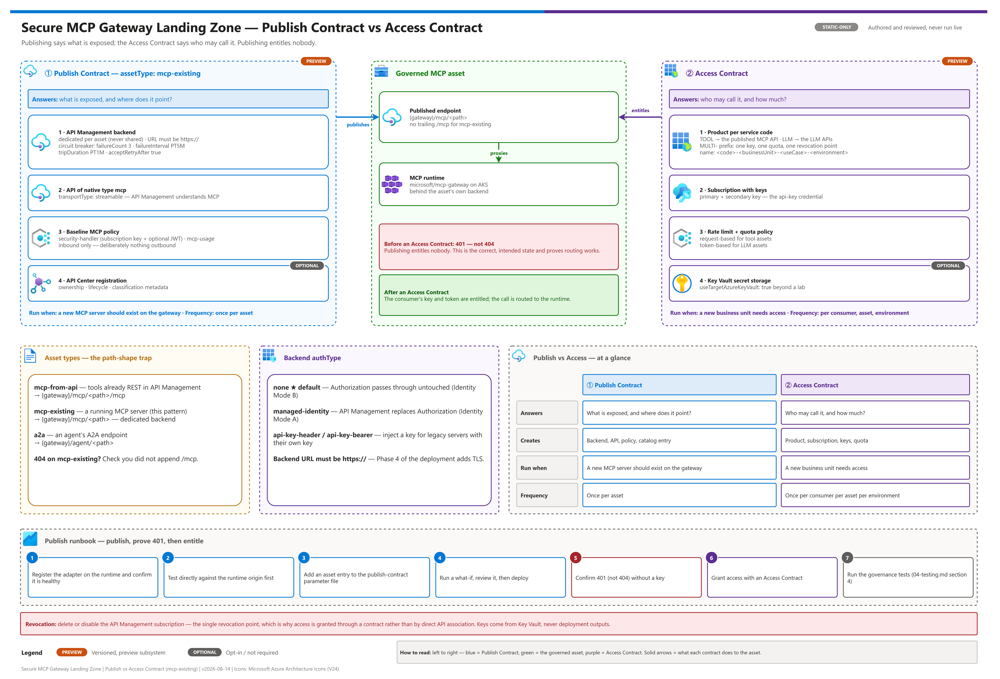
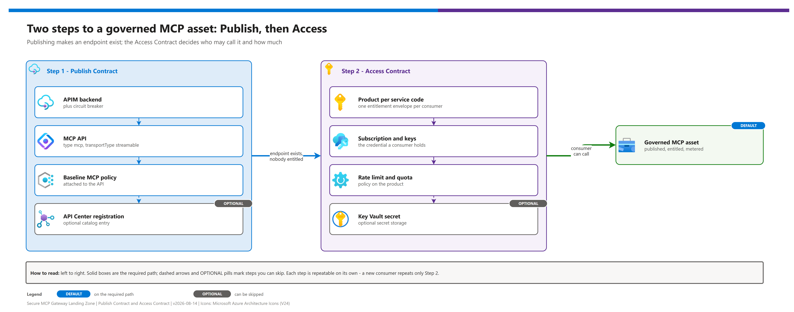

[README](../README.md) › [docs index](./00-reproduce-this-demo.md) › 06 MCP publishing and access contracts

# 06 — MCP Publishing and Access Contracts (deep dive)

<p align="center">
  &nbsp;&nbsp;
  &nbsp;&nbsp;
  &nbsp;&nbsp;
  &nbsp;&nbsp;
  &nbsp;&nbsp;
  
</p>


The integration seam. How an MCP server running on the runtime plane becomes a governed, metered, entitled endpoint on the governance plane — using a supported extensibility point rather than custom glue.

Read [01-architecture.md](./01-architecture.md) first.

## At a glance

| | |
|---|---|
| **Question answered** | How does a running MCP server become a governed, entitled endpoint? |
| **Mechanism** | Publish Contract (what is exposed) then Access Contract (who may call it) |
| **Where it lives** |  API Management backend, API, product and subscription |
| **Optional extras** |  API Center catalog entry,  Key Vault secret storage |
| **Next** | [07 - Identity and token flow](./07-identity-and-token-flow.md) |

> [!IMPORTANT]
> Publishing entitles nobody. After Step 1 the endpoint returns `401` to everyone, which is the correct and intended state. Access is a separate, repeatable step.

---

## The two-step model

The accelerator deliberately separates **publishing** an asset from **granting access** to it. Most integration mistakes come from conflating them.

[](./assets/mcp-publish-access-contracts.png)

<sub>Editable source: [`assets/mcp-publish-access-contracts.drawio`](./assets/mcp-publish-access-contracts.drawio) - regenerate with `python scripts/export_diagrams.py docs/assets`.</sub>

The overview above shows the whole contract; the step-by-step view below lists what each step creates and which parts are optional.

[](./assets/06-publish-access-two-step.png)

<sub>Editable source: [`assets/06-publish-access-two-step.drawio`](./assets/06-publish-access-two-step.drawio) - regenerate with `python scripts/export_diagrams.py docs/assets`.</sub>

| | Publish Contract | Access Contract |
|---|---|---|
| Answers | *What is exposed, and where does it point?* | *Who may call it, and how much?* |
| Creates | Backend, API, policy, catalog entry | Product, subscription, keys, quota |
| Run when | A new MCP server should exist on the gateway | A new business unit needs access |
| Frequency | Once per asset | Once per consumer per asset per environment |

**Publishing entitles nobody.** After Step 1 the endpoint returns `401` to everyone — which is the correct and intended state.

---

## Asset types

The Publish Contract supports three asset types. Choosing correctly is the first decision.

| `assetType` | Use when | Backend | Resulting endpoint |
|---|---|---|---|
| `mcp-from-api` | Your "tools" are **already REST APIs** onboarded in API Management | Reuses the source API's backend | `{gateway}/mcp/<path>/mcp` |
| **`mcp-existing`** | You have a **running MCP server** to govern — this pattern | **Dedicated backend** at your URL | **`{gateway}/mcp/<path>`** |
| `a2a` | Publishing an agent's A2A endpoint | Managed-identity policy auth | `{gateway}/agent/<path>` |

### The path-shape trap

Note the difference above. It causes more `404`s than anything else in this architecture:

| Asset type | Trailing `/mcp`? | Why |
|---|---|---|
| `mcp-existing` | **No** | The upstream server already serves MCP at its own path. API Management proxies to it. |
| `mcp-from-api` | **Yes** | API Management is *synthesizing* the MCP surface from REST operations, so it owns that path segment. |

If you get a `404` on a `mcp-existing` asset, the first thing to check is whether you appended `/mcp`.

> [!TIP]
> Quick check: an `mcp-existing` asset is served at `{gateway}/mcp/<path>` with no trailing `/mcp`; only `mcp-from-api` adds it.

### When you should not use this pattern at all

If your tools genuinely are REST APIs already managed in API Management, `mcp-from-api` gives you an MCP surface with **zero additional compute**. You do not need a Kubernetes runtime, session affinity, or this landing zone. Choose the simpler path rather than over-architecting.

This pattern earns its complexity when MCP servers are arbitrary workloads that must be hosted, scaled, and session-affine.

---

## What the Publish Contract actually creates

For an `mcp-existing` asset, one declaration produces four things:

### 1. An API Management backend

A dedicated backend resource pointing at your MCP runtime origin, with a **circuit breaker**:

| Setting | Default | Purpose |
|---|---|---|
| `failureCount` | 3 | Failures before tripping |
| `failureInterval` | `PT5M` | Window over which failures are counted |
| `tripDuration` | `PT1M` | How long the breaker stays open |
| `acceptRetryAfter` | `true` | Honors the backend's own `Retry-After` |

**Do not disable this.** The same API Management instance carries LLM traffic; an unhealthy MCP runtime must not consume shared gateway capacity waiting on dead backends.

Backends are **not shared** between assets — each published asset owns its own, so one failing asset cannot trip another's breaker.

### 2. An API of native type `mcp`

Not a generic HTTP proxy — an API Management API whose type is `mcp`, with `transportType: streamable`. API Management understands MCP semantics rather than blind-forwarding bytes.

### 3. The baseline MCP policy

Attached automatically. It:

- Records which backend serves the asset, so usage metrics can attribute calls
- Runs the shared `security-handler` fragment — subscription key validation, plus optional product-scoped JWT validation
- Runs the `mcp-usage` fragment — an **inbound** request-count metric feeding the FinOps pipeline
- On error, runs opt-in alerting

**And it deliberately does nothing outbound.** That is not an oversight — see [The streaming constraint](#the-streaming-constraint).

### 4. Optional API Center registration

Registers the asset in the discovery catalog with ownership, contact, lifecycle stage, classification, and compliance metadata. This is what turns a collection of endpoints into a governed catalog.

---

## Backend authentication

The `authType` field is where the identity decision from [docs/07](./07-identity-and-token-flow.md) is expressed.

| `authType` | Behaviour | Use for |
|---|---|---|
| **`none`** | **No credential injected — the caller's `Authorization` header passes through untouched** | **Identity Mode B (this pattern's default)** |
| `managed-identity` | API Management mints a token for `authConfig.resource` and **replaces** the `Authorization` header | Identity Mode A |
| `api-key-header` | Injects a key into a named header, sourced from a named value, Key Vault secret, or literal | Legacy MCP servers with their own key |
| `api-key-bearer` | Injects a key as a bearer token | Legacy MCP servers expecting bearer-style keys |

```jsonc
// Mode B — default
backend: {
  url: 'https://<MCP_RUNTIME_PUBLIC_ORIGIN>'
  authType: 'none'
}

// Mode A — machine workloads only
backend: {
  url: 'https://<MCP_RUNTIME_PUBLIC_ORIGIN>'
  authType: 'managed-identity'
  authConfig: { resource: 'api://<MCP_GATEWAY_CLIENT_ID>' }
}
```

> [!WARNING]
> **The backend URL must be `https://`.** The MCP runtime ships an HTTP-only edge listener; Phase 4 of [03-deployment.md](./03-deployment.md) adds TLS. Publishing against `http://` puts bearer tokens on the wire in cleartext between the two planes.

### When your MCP server has its own subscription key

A specific trap applies to `mcp-from-api`. If the source REST API requires its own subscription key, the internal hop that `tools/call` makes will fail with a missing-key `401` — while `initialize` and `tools/list` still appear to work, because they never reach the backend. This produces a confusing partial failure.

Two resolutions:

1. Onboard the source API with `subscriptionRequired: false` so the internal hop is unauthenticated (it is not publicly reachable anyway), **or**
2. Keep the source API protected and set `forwardSubscriptionKeyToSource: true`, which forwards the caller's key in a custom header (default `x-mcp-sub-key`) that API Management will not strip. Also grant the source API in the Access Contract's API mapping.

This does not apply to `mcp-existing`, which has its own dedicated backend.

---

## The streaming constraint

The baseline policy states it plainly, and it governs every policy you write for MCP:

> [!WARNING]
> **Do not read `context.Response.Body` in an MCP policy.** Doing so triggers response buffering, which breaks the SSE streaming that MCP requires.

Consequences, stated as a boundary rather than discovered in a pilot:

| Control | Available? | Where it lives instead |
|---|---|---|
| Subscription key / JWT validation | ✅ Inbound | API Management |
| Rate limit, quota | ✅ Inbound | Access Contract product policy |
| Request-count metering | ✅ Inbound | `mcp-usage` → Event Hub → Cosmos |
| Tool-surface allow-listing | ✅ Inbound (request body **is** safe to read) | Hardened overlay |
| Payload size limits | ✅ Inbound | Hardened overlay |
| Request-side PII / content safety | ⚠️ Possible inbound, per asset | Custom overlay |
| **Response PII de-anonymization** | ❌ **Impossible** | The MCP server |
| **Response content safety** | ❌ **Impossible** | The MCP server |
| **Token-based metering** | ❌ Not applicable | MCP meters by request count |

Reading `context.Request.Body` **is** safe — always with `preserveContent: true` so the body still reaches the backend.

The design implication is significant: **the MCP server is a trust participant, not an untrusted upstream.** Anything enforced on the way out must be enforced by the server itself. That is why control-plane write access — the ability to register an arbitrary image as an MCP server — is a privileged operation.

---

## Custom policy overlays

Supplying `policyXml` on an asset **replaces** the baseline policy for that asset. This is why [`infra/policies/mcp-hardened-policy.xml`](../infra/policies/mcp-hardened-policy.xml) opens with `<base />` — to inherit the shared security and metering fragments.

> [!CAUTION]
> **Removing `<base />` silently disables authentication and metering** while the endpoint continues to work. It is the most dangerous single-line edit in this architecture.

The overlay adds two controls the MCP runtime does not provide:

### Tool-surface allow-listing

Inspects the inbound JSON-RPC envelope and blocks `tools/call` for any tool outside an allow-list held in an API Management named value.

Deliberate scoping decisions:

- Only `tools/call` is gated. `initialize`, notifications, and `tools/list` pass freely so discovery still works.
- A `tools/call` with **no** tool name is blocked — fail closed.
- Setting the allow-list to `*` disables the control explicitly rather than by omission.

This is a compensating control, not a substitute for authorization inside the server. It operates on the tool **name**, not on arguments or results.

### Per-asset rate ceiling

The Access Contract product supplies the primary quota envelope. The overlay adds a per-asset ceiling so one noisy asset cannot consume a business unit's entire allowance.

---

## The Access Contract

Creates what a consumer actually uses.

### Naming drives governance

```
<code>-<businessUnit>-<useCaseName>-<environment>
```

For example `TOOL-PlatformEngineering-AgentToolAccess-DEV`. When a contract spans multiple asset kinds, the accelerator uses a `MULTI-` prefixed product so one key covers all of them under one quota envelope.

This naming **is** the governance model. It is the granularity at which quota applies, chargeback attributes, and revocation operates. One contract per consuming business unit, per use case, per environment.

### Mapping service codes to APIs

```jsonc
param apiNameMapping = {
  TOOL: ['<PUBLISHED_MCP_API_NAME>']
  LLM:  ['universal-llm-api', 'azure-openai-api']
}
```

API names are **case-sensitive** and must already exist. Resolve them from the live instance rather than assuming:

```bash
az apim api list -g <RG> -n <APIM_NAME> --query "[].{name:name,path:path,type:type}" -o table
```

### Combined LLM and tool access

Listing both `TOOL` and `LLM` in `services` produces a combined product: one subscription key grants a business unit both model access and tool access, under one quota envelope, with one revocation point.

This is the strongest argument for the whole architecture. An agent workload typically needs **both** — model inference and tool invocation. Governing them separately means two keys, two quotas, two chargeback streams, and two places to revoke during an incident. Governing them together means one of each.

The product policy applies the right control per asset kind automatically: token-based limits for LLM assets, request-based rate limit and quota for tool assets.

### Secret handling

> [!IMPORTANT]
> Set `useTargetAzureKeyVault: true` for anything beyond a lab. With `false`, the subscription key is emitted in **deployment outputs** — readable by anyone with access to deployment history, and captured in CI logs.

Underscores in secret names are normalized to hyphens (`MCP_TOOL_API_KEY` → `MCP-TOOL-API-KEY`).

---

## What API Management provides natively — and what it does not

Verified against Microsoft Learn, 2026-08-14. Re-check before a production build; this surface is moving.

| Capability | State | Source |
|---|---|---|
| SKUs supporting MCP servers | `Developer`, `Basic`, `Basic v2`, `Standard`, `Standard v2`, `Premium`, `Premium v2`. **Consumption is not listed.** This pattern's `StandardV2` default is supported | *About MCP servers in API Management* |
| Expose a REST API as MCP | Supported (`mcp-from-api`) | *Expose a REST API as an MCP server* |
| Expose an existing MCP server | Supported (`mcp-existing`) — e.g. LangChain, LangServe, Logic Apps, Functions | *Expose and govern existing MCP server* |
| Transports | Streamable HTTP (portal default) or SSE | *Expose and govern existing MCP server* |
| **External server protocol floor** | **Must conform to MCP `2025-06-18` or later** | *Expose and govern existing MCP server* |
| MCP **tools** | Supported | *Expose and govern existing MCP server* |
| MCP **resources** | Supported for external servers | *Expose and govern existing MCP server* |
| MCP **prompts** | **Not supported** for external servers | *Expose and govern existing MCP server* |
| Static tool exposure control | **Tools blade** on the MCP server selects which operations are exposed | *Expose and govern existing MCP server* |
| **Per-tool policy scope** | **Not available** — *"policies apply to all API operations exposed as tools in the MCP server"* | *About MCP servers in API Management* |
| Products / subscriptions | Supported — associate the MCP server with products to manage access | *Expose and govern existing MCP server* |
| Policy evaluation order | **Global (All APIs) scope evaluates BEFORE MCP server scope** | *Expose and govern existing MCP server* |
| Workspaces | **Not supported** | *Expose and govern existing MCP server* |
| Programmatic management | REST API, ARM, Bicep, Azure CLI, Terraform | *About MCP servers in API Management* |
| Native telemetry | `gen_ai.*` OpenTelemetry GenAI conventions, zero config | *Monitor MCP server traffic* |

### The protocol compatibility window cuts both ways

API Management requires the external server to be **`2025-06-18` or later**. The MCP runtime in this pattern is built on the session-oriented protocol (`mcp-session-id`) with RFC 9728 protected-resource-metadata authorization — consistent with that specification family — while its SDK is pinned to a preview release and upstream tracks the newer **stateless** revision as unimplemented.

So there are two ways to fall outside the window, and you should check both rather than assume either:

- **Too old** → API Management rejects the server for not meeting the `2025-06-18` floor.
- **Outrun** → clients speaking the newer stateless revision are not yet supported by the runtime.

Verify empirically: perform an `initialize` handshake and read the negotiated `protocolVersion` (`scripts/validate_mcp_endpoint.py` reports it).

### Native tool selection vs. the hardened overlay

These solve different problems and are complementary, not redundant:

| | Tools blade (native) | Hardened policy overlay |
|---|---|---|
| Scope | Static — which operations exist as tools at all | Runtime — which tools a given caller may invoke |
| Granularity | Per MCP server | Per subscription / product, per call |
| Changes require | Reconfiguration | Named-value update |
| Good for | Trimming an over-broad third-party tool surface | Differentiating consumers on a shared asset |

Use the Tools blade first to remove anything nobody should ever call. Use the overlay to differentiate between consumers of what remains.

---

## Operational runbook

| Task | Contract | Touches |
|---|---|---|
| [Publishing a new MCP server](#publishing-a-new-mcp-server) |  Publish | Backend, API, policy, optional API Center entry |
| [Onboarding a new consumer](#onboarding-a-new-consumer) |  Access | Product, subscription, keys, optional Key Vault secret |
| [Revoking a consumer](#revoking-a-consumer) |  Access | The API Management subscription |
| [Rotating keys](#rotating-keys) |  Access | Primary and secondary subscription keys |

### Publishing a new MCP server

1. Register the adapter on the runtime plane and confirm it is healthy
2. Test **directly** against the runtime origin first — isolate faults before adding the gateway
3. Add an asset entry to the publish contract parameter file
4. Run a what-if, review it, then deploy
5. Confirm the endpoint returns `401` (not `404`) without a key — that proves routing works and entitlement is enforced
6. Grant access with an Access Contract
7. Run the governance tests in [04-testing.md](./04-testing.md) §4

### Onboarding a new consumer

1. Resolve the published API name from the live instance
2. Create an Access Contract with that consumer's `useCase` values
3. Retrieve the key from Key Vault — never from deployment outputs
4. Give the consumer the endpoint, the key header name, and the token audience
5. Validate with the endpoint validator before handing over

### Revoking a consumer

Delete or disable the API Management subscription. That is the single revocation point — which is precisely why access is granted through a contract rather than by direct API association.

### Rotating keys

Every subscription is created with **primary and secondary** keys. Rotate by moving consumers to the secondary, regenerating the primary, then moving back. The accelerator ships a dedicated key-rotation guide alongside the access contract — follow it rather than improvising.

---

## Version and schema drift

Both subsystems are **versioned and preview**. The accelerator's `release.json` tracks `publish-contract-version` and `access-contract-version` independently of the master version, and the running gateway exposes its component versions at `GET /version`.

> [!WARNING]
> Both contracts are versioned and preview. A parameter-schema change or a renamed policy fragment can fail at deploy or, worse, silently change behaviour. Run the regression harness before and after every upstream bump.

Before any upstream bump:

1. Diff the accelerator's own parameter files at the new commit against the templates in this repository
2. Check whether `publish-contract-version` or `access-contract-version` moved
3. Deploy to non-production and run the regression harness in [04-testing.md](./04-testing.md) §9
4. Update the pins in `README.md` and `demo-ids.template.json`

**Highest-risk changes to watch for:** parameter schema changes to either contract, policy fragment renames (a custom overlay referencing a renamed fragment fails at deploy or, worse, silently changes behaviour), and changes to the API type or transport model.

---

## Common failures

| Symptom | Cause | Fix |
|---|---|---|
| `404` on the published path | Appended `/mcp` to an `mcp-existing` asset | Drop the suffix — it applies only to `mcp-from-api` |
| `401` without a key | **Correct behaviour** after publishing, before granting | Run the Access Contract |
| `initialize` works, `tools/call` returns `401` | Source API requires its own key on the internal hop (`mcp-from-api`) | `subscriptionRequired: false`, or `forwardSubscriptionKeyToSource: true` |
| Client hangs, response arrives all at once | A policy read the response body and buffered the stream | Audit every policy in scope; keep MCP policies inbound-only |
| Client hangs even though MCP-scope policies are clean | A **global-scope** policy or diagnostic setting — global evaluates **before** MCP scope | Set global Frontend Response payload bytes to `0`; audit the All-APIs policy |
| Authentication stops being enforced after adding an overlay | The overlay dropped `<base />` | Restore it as the first element of `<inbound>` |
| `403` on every call in a fresh environment | App roles never assigned — they fail closed | Assign `mcp.admin` / `mcp.engineer` |
| Rapid `5xx` after a period of failures | Circuit breaker open | Fix the backend; wait out the trip duration |
| Access Contract deploys but grants nothing | `apiNameMapping` name mismatch (case-sensitive) | Resolve names from the live instance |
| Key visible in pipeline logs | `useTargetAzureKeyVault: false` | Set `true` and rotate the exposed key |
| External server rejected on publish | Server does not meet the MCP `2025-06-18` floor | Upgrade the server/SDK; confirm via the negotiated `protocolVersion` |
| MCP prompts unavailable | Not supported for external MCP servers | Keep prompts client-side |
| `Authorization` does not reach the runtime | Headers forward *with exclusions*; Mode B depends on it arriving intact | Declare `Authorization` as a required header and forward with `set-header`, or use credential manager. Verify empirically per environment |

---

Next: [07 - Identity and token flow](./07-identity-and-token-flow.md) →

*Last updated: 2026-10-02*
