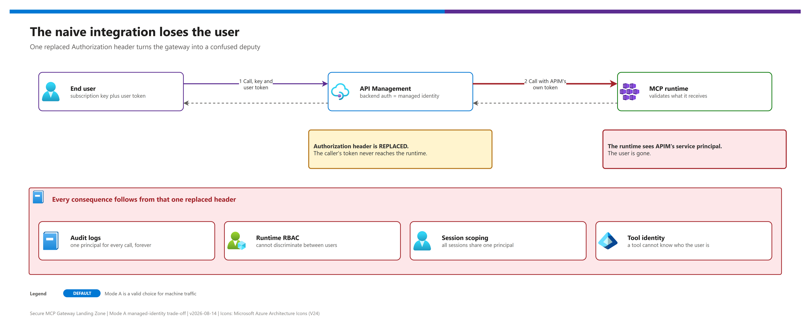
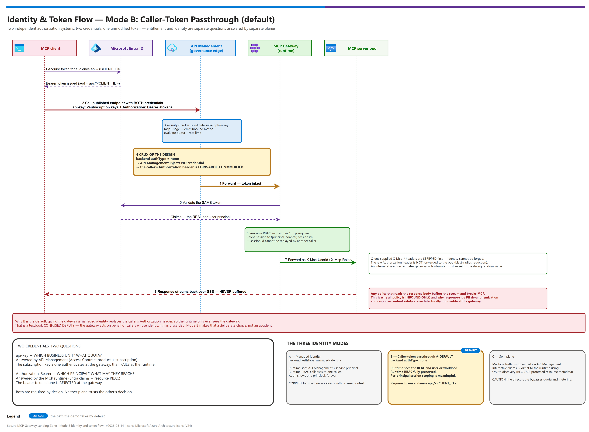
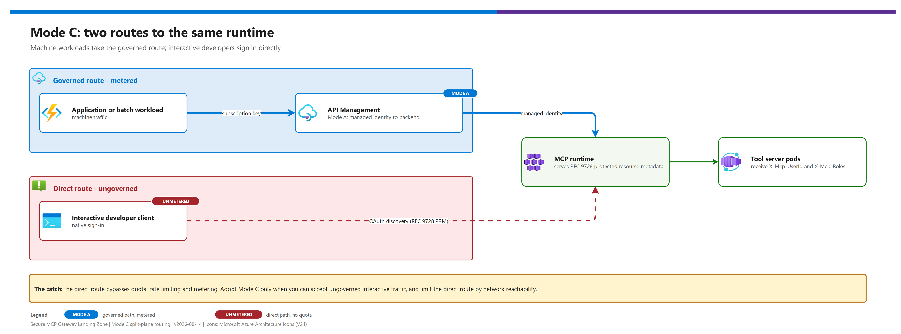
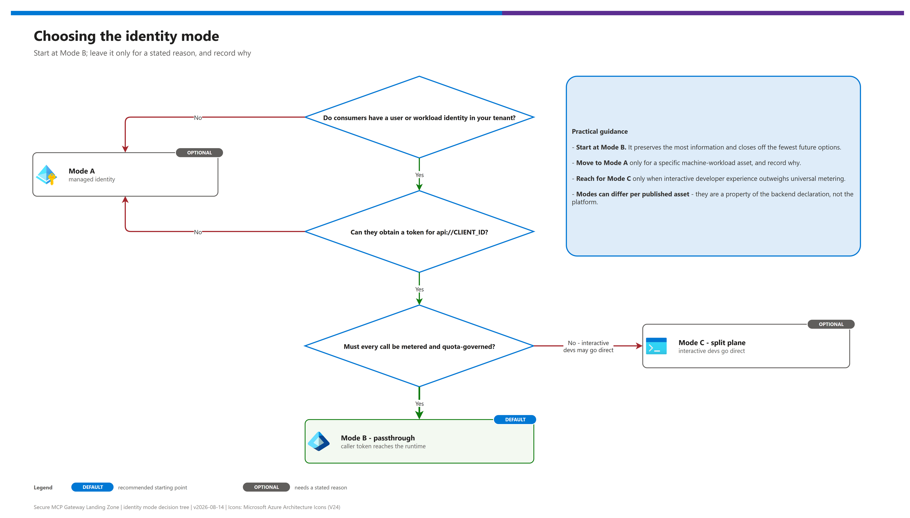

# 07 — Identity and Token Flow (deep dive)

[README](../README.md) › [docs index](./00-reproduce-this-demo.md) › 07 Identity and token flow

<p align="center">&nbsp;&nbsp;&nbsp;&nbsp;&nbsp;&nbsp;&nbsp;&nbsp;&nbsp;&nbsp;</p>

<p align="center"></p>

How a caller's identity travels from an MCP client, through Azure API Management, into the MCP runtime, and down to a tool server pod — and the trade-off you are making when you choose how.

This is the most consequential design decision in the pattern. Read [01-architecture.md](./01-architecture.md) first.

## At a glance

| Question | Short answer |
|---|---|
| Default mode | **Mode B** — caller-token passthrough (`authType: none`) |
| Credentials per call | Two: subscription key (`api-key`) **and** Entra bearer token (`Authorization`) |
| Hard requirement | Caller token audience `aud = api://<CLIENT_ID>` |
| Biggest risk | The `Authorization` header not surviving the API Management backend hop — verify per environment |
| Alternatives | Mode A (managed identity, machine traffic) and Mode C (split plane, bypasses metering on the direct route) |

> [!IMPORTANT]
> Only one credential can occupy the `Authorization` header. The identity mode you pick decides whether the runtime sees the real user or only the gateway.

---

## The problem in one sentence

An MCP call in this architecture must satisfy **two independent authorization systems** that were designed without knowledge of each other, and only one credential can occupy the `Authorization` header.

| System | Asks | Decides using |
|---|---|---|
| **Azure API Management** (governance edge) | *Which consuming business unit is this, and are they within quota?* | Subscription key, optionally a product-scoped JWT |
| **MCP runtime** (workload plane) | *Which principal is this, and what may they reach?* | Entra bearer token, app roles, per-resource ACLs |

These are genuinely different questions. **Entitlement** is commercial and organizational; **identity** is a security principal. Collapsing them into one credential loses information — which is exactly what happens in the naive integration.

---

## Why the naive integration loses the user

The reflexive way to connect a gateway to a backend is to give the gateway a managed identity and let it authenticate. That works, and it destroys end-user attribution:

[](./assets/07-naive-managed-identity.png)

<sub>Editable source: [`assets/07-naive-managed-identity.drawio`](./assets/07-naive-managed-identity.drawio) - regenerate with `python scripts/export_diagrams.py docs/assets`.</sub>

Every consequence follows from that one replaced header:

- Audit logs show one principal for every call, forever
- The runtime's per-resource RBAC cannot discriminate between users
- Session scoping becomes meaningless — all sessions share one principal
- A tool that needs to act on behalf of a user cannot know who the user is

This is a textbook **confused deputy**: the gateway, holding more authority than any individual caller, acts on behalf of callers whose identity it has discarded.

Sometimes that is fine. Often it is not. The pattern makes it an explicit choice.

---

## The three identity modes

| | **Mode A — Managed identity** | **Mode B — Caller-token passthrough** ⭐ | **Mode C — Split plane** |
|---|---|---|---|
| Backend `authType` | `managed-identity` | **`none`** | `managed-identity` (governed path) |
| `Authorization` at the runtime | API Management's token | **The caller's own token** | Depends on route |
| Runtime sees | API Management's service principal | **The real end user or workload** | Both, by route |
| Runtime RBAC | Collapses to one caller | **Fully preserved** | Preserved on the direct route |
| Consumer credentials | Subscription key only | **Subscription key + bearer token** | Varies by route |
| Audit fidelity | Gateway-level only | **Per principal** | Mixed |
| Client complexity | Lowest | Moderate | Highest |
| Quota and metering | ✅ | ✅ | Governed route only |

---

## Mode B — the default, and why it works

The enabling fact, verified against the upstream policy:

> The baseline MCP policy applied by the Publish Contract runs the shared `security-handler` and `mcp-usage` fragments **and does not rewrite the `Authorization` header**.

So when the backend is declared with `authType: 'none'`, API Management injects no credential of its own, and the caller's original bearer token arrives at the MCP runtime **intact**. The runtime validates it independently against Entra and derives genuine end-user identity.

[](./assets/secure-mcp-gateway-identity-flow.png)

<sub>Editable source: [`assets/secure-mcp-gateway-identity-flow.drawio`](./assets/secure-mcp-gateway-identity-flow.drawio) - regenerate with `python scripts/export_diagrams.py docs/assets`.</sub>

### Two credentials, two jobs

| Credential | Header | Answers | Issued by |
|---|---|---|---|
| Subscription key | `api-key` | Which business unit, and what quota? | Access Contract |
| Bearer token | `Authorization: Bearer` | Which principal, and what may they reach? | Entra ID |

The subscription key alone authenticates at the gateway and then fails at the runtime. The bearer token alone is rejected at the gateway. **Both are required by design** — this is the mechanism, not an inconvenience.

### The hard requirement

The caller's token audience **must** be the MCP runtime's application ID URI:

```
aud = api://<CLIENT_ID>
```

Consumers acquire it with:

```bash
az account get-access-token --tenant <TENANT_ID> --resource api://<CLIENT_ID>
```

or, in code, for the scope `api://<CLIENT_ID>/.default`.

This is the constraint that occasionally forces Mode A or C. If your consumer population cannot obtain a token for that audience — for example a third party in another tenant with no federation — Mode B is not available to them.

### ⚠️ Verify header forwarding empirically — do not assume it

Mode B rests entirely on one behaviour: the caller's `Authorization` header reaching the MCP runtime intact. Two independent things have to hold, and only the first is fully under this pattern's control.

1. **The Citadel baseline MCP policy does not rewrite `Authorization`** — verified by reading the policy. With backend `authType: none`, API Management injects no credential of its own. ✅
2. **API Management must actually forward the header to the backend.** Microsoft Learn (*Secure access to MCP servers*, last updated 2025-11-18) states that request headers are *"automatically forwarded (with certain exclusions)"* to MCP tool invocations — **and the exclusion list is not enumerated in the documentation.** `Authorization` is exactly the kind of header a gateway commonly strips on the backend hop.

**Therefore: treat Mode B as verified-per-environment, not guaranteed by design.** Prove it during deployment rather than discovering it in a pilot:

```bash
python ./scripts/validate_mcp_endpoint.py \
  --endpoint https://<APIM_HOST>/mcp/<ASSET_PATH> \
  --subscription-key <SUBSCRIPTION_KEY> \
  --use-azure-identity --scope api://<CLIENT_ID>/.default \
  --call-tool describe_environment --tool-args '{}'
```

If the forwarded identity comes back empty, or the runtime returns `401` while the same token succeeds against the runtime origin directly, the header is not surviving the hop.

**Remedy** — force explicit forwarding, per the same Microsoft Learn article:

- Declare `Authorization` as a **required header** in the API settings and forward it with a `set-header` policy, **or**
- Use API Management **credential manager** (`get-authorization-context` + `set-header`) to attach the token deliberately.

```xml
<!-- Explicit forward. Keep it inbound — never touch the response body on MCP. -->
<set-header name="Authorization" exists-action="override">
    <value>@(context.Request.Headers.GetValueOrDefault("Authorization"))</value>
</set-header>
```

> [!WARNING]
> The Microsoft Learn article describes forwarding "in the Outbound policy." In API Management, `<outbound>` is the **response** direction — to send a header **to the backend** it belongs in `<inbound>`. The snippet above places it inbound accordingly. Validate the effective behaviour in your environment rather than relying on either the doc's wording or this note.

This does not weaken the Mode B recommendation — it makes it operationally honest. A design whose central mechanism is unverified is a design that fails in someone's pilot.

### What you get in return

- **Real audit.** "Who called this tool?" has an answer.
- **Meaningful runtime RBAC.** `mcp.admin` and `mcp.engineer` discriminate between actual people.
- **Per-principal session scoping.** The runtime keys sessions on the authenticated principal, so a session identifier cannot be replayed by a different caller — even one with legitimate access to the same server. Under Mode A this protection is inert, because everyone is the same principal.
- **Defense in depth.** Two independent validations of the same token. Neither plane has to trust the other's decision.

---

## Mode A — managed identity

Correct when consumers genuinely have **no user identity to preserve**: batch jobs, scheduled pipelines, service-to-service workloads.

```jsonc
backend: {
  url: 'https://<MCP_RUNTIME_PUBLIC_ORIGIN>'
  authType: 'managed-identity'
  authConfig: { resource: 'api://<MCP_GATEWAY_CLIENT_ID>' }
}
```

and set `managedIdentityClientId` in the publish contract to a user-assigned identity, or leave it empty to use API Management's system-assigned identity.

**Required setup:** grant that identity an app role (typically `mcp.engineer`) on the MCP runtime's app registration. Without it, every call returns `403` — the roles fail closed.

**Accept these consequences explicitly:**

- Audit shows one principal
- Runtime RBAC becomes a single allow/deny for the gateway
- Session scoping cannot separate users
- **All** meaningful per-consumer authorization must live at the edge

Mode A is not a lesser choice — it is the right choice for machine traffic. It is a wrong choice when someone will later ask which human ran a tool.

---

## Mode C — split plane

Two routes to the same runtime, for populations with different needs.

[](./assets/07-mode-c-split-plane.png)

<sub>Editable source: [`assets/07-mode-c-split-plane.drawio`](./assets/07-mode-c-split-plane.drawio) - regenerate with `python scripts/export_diagrams.py docs/assets`.</sub>

The MCP runtime serves an RFC 9728 **protected resource metadata** document, so a standards-compliant MCP client can discover the authorization server and complete an OAuth flow with no gateway involvement. Interactive developers get a native sign-in; machine workloads get governed, metered access.

**The catch — and it is a real one:** the direct route **bypasses quota, rate limiting, and metering**. Adopt Mode C only when you can accept ungoverned interactive traffic, and constrain the direct route by network reachability so it is available only to a known population.

If you have already applied the Phase 4.3 origin lock in [03-deployment.md](./03-deployment.md) — as you should — the direct route is closed by construction, and Mode C requires deliberately re-opening a restricted path.

---

## Choosing

[](./assets/07-choosing-identity-mode.png)

<sub>Editable source: [`assets/07-choosing-identity-mode.drawio`](./assets/07-choosing-identity-mode.drawio) - regenerate with `python scripts/export_diagrams.py docs/assets`.</sub>

Practical guidance:

- **Start at Mode B.** It preserves the most information and closes off the fewest future options.
- **Move to Mode A** only for a specific machine-workload asset, and record why.
- **Reach for Mode C** only when interactive developer experience genuinely outweighs universal metering.
- **Modes can differ per published asset** — they are a property of the backend declaration, not the platform. A machine-facing asset in Mode A can coexist with a user-facing asset in Mode B on the same gateway.

---

## Identity inside the runtime

Once the runtime has validated a token, it forwards identity to the tool server pod using dedicated headers rather than passing the raw token onward.

| Header | Carries |
|---|---|
| `X-Mcp-UserId` | The authenticated principal |
| `X-Mcp-Roles` | The principal's app roles |

Two properties matter:

1. **The inbound `Authorization` header is not forwarded to the pod.** Tool servers cannot replay the caller's token against other resources — a deliberate blast-radius reduction.
2. **Client-supplied `X-Mcp-*` headers are stripped before re-injection.** A caller cannot forge identity by setting the header themselves. Test this (see [04-testing.md](./04-testing.md) test 5.7).

An internal shared secret gates the trust relationship between the gateway and its tool-router component, so the router only honors forwarded identity from the gateway. **Set it to a strong random value.** A default or placeholder value here undermines the whole forwarded-identity model.

> [!CAUTION]
> The internal shared secret gates the trust relationship between the gateway and its tool-router component. A default or placeholder value undermines the whole forwarded-identity model — set it to a strong random value.

### Tools that need to call Azure resources

A tool server that must reach Azure resources on its own behalf uses **workload identity federation** — not the caller's token. That capability is **gated to an admin-only role by default**, because the federated identity is shared at cluster scope and any pod bound to it can obtain its tokens. Treat requests for it as privilege escalation reviews.

---

## Failure modes

| Symptom | Cause | Fix |
|---|---|---|
| `401`, no `WWW-Authenticate` | Missing or wrong subscription key | Check the key and the header name (`api-key` vs `Ocp-Apim-Subscription-Key`) |
| `401` **with** `WWW-Authenticate: Bearer` | Token problem at the runtime | Check audience, expiry, and issuer |
| `403` on every call in a fresh environment | App roles never assigned — they fail closed | Assign `mcp.admin` / `mcp.engineer` |
| Forwarded identity is constant for all callers | Asset is effectively in Mode A | Verify `backend.authType` is `none` |
| **Forwarded identity is empty; works direct, `401` through the gateway** | **`Authorization` is not surviving the backend hop — headers forward "with certain exclusions"** | **Force explicit forwarding with `set-header`, or use credential manager. See the verification section above** |
| Works through the gateway, `401` direct | Expected under Mode A | Not a fault |
| Session replay across users succeeds | Running in Mode A — scoping cannot discriminate | Switch to Mode B if per-user isolation is required |
| Token audience mismatch | Token requested for the wrong resource | Request `api://<CLIENT_ID>` explicitly |
| Inbound JWT rejected at the gateway | Product-scoped JWT validation misconfigured | Check issuer/audience; consider the native `validate-azure-ad-token` policy |

---

## Client configuration

### Interactive MCP client, governed path

```jsonc
{
  "servers": {
    "governed-mcp": {
      "url": "https://<APIM_HOST>/mcp/<ASSET_PATH>"
    }
  }
}
```

The client must present **both** the subscription key and a bearer token. Where a client cannot send a custom header alongside its OAuth token, either publish a variant asset that reads the key from a header the client does support, or place that population on Mode C.

### Programmatic consumer

```python
from azure.identity import DefaultAzureCredential

credential = DefaultAzureCredential()
token = credential.get_token("api://<CLIENT_ID>/.default")

headers = {
    "api-key": subscription_key,            # entitlement  -> API Management
    "Authorization": f"Bearer {token.token}",  # identity    -> MCP runtime
    "Content-Type": "application/json",
    "Accept": "application/json, text/event-stream",
}
```

Both headers, every call. Never log either one.

---

## Verification

Confirm the mode you think you deployed is the mode you actually deployed:

```bash
python ../scripts/validate_mcp_endpoint.py \
  --endpoint https://<APIM_HOST>/mcp/<ASSET_PATH> \
  --subscription-key <SUBSCRIPTION_KEY> \
  --use-azure-identity --scope api://<CLIENT_ID>/.default \
  --call-tool describe_environment --tool-args '{}'
```

The reference tool echoes the forwarded identity headers it received. If two different principals produce two different identities, you are in **Mode B**. If they produce the same identity, you are in **Mode A** — intentionally or otherwise.

---

Next: [08 - Observability and governance parity](./08-observability-and-governance-parity.md) →

*Last updated: 2026-10-02*
