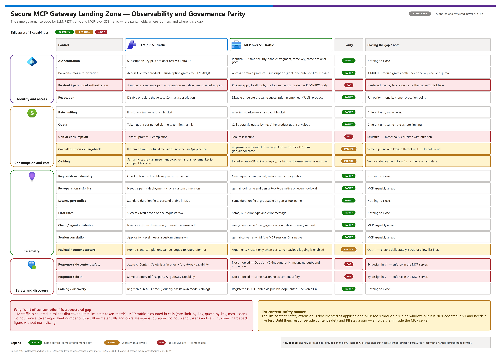
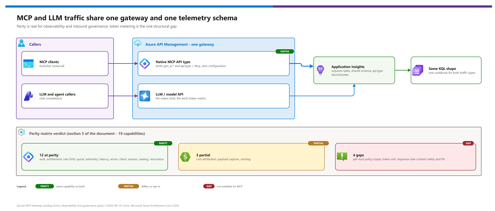

# 08 — Observability and Governance Parity (deep dive)

[README](../README.md) › [docs index](./00-reproduce-this-demo.md) › 08 Observability and governance parity

<p align="center">&nbsp;&nbsp;&nbsp;&nbsp;&nbsp;&nbsp;&nbsp;&nbsp;&nbsp;&nbsp;</p>

<p align="center"></p>

The pattern's owner asked a direct question: *"ensure we can effectively monitor and govern MCP access like we would AI model access with the AI Gateway."* This document is the answer — a rigorous, honest side-by-side of MCP tool traffic against LLM/model traffic on the same Azure API Management instance, covering where the two reach parity, where they do not, and what to do about the gaps that are real.

Read [01-architecture.md](./01-architecture.md) first, especially [The streaming constraint](./01-architecture.md#the-streaming-constraint-read-this-before-designing-policy), [Native observability](./01-architecture.md#native-observability--richer-than-the-policy-constraint-suggests) (which forward-references this document), and [Compensating controls](./01-architecture.md#compensating-controls); then [06 — MCP Publishing and Access Contracts](./06-mcp-publishing-and-access-contracts.md) and [07 — Identity and Token Flow](./07-identity-and-token-flow.md). This document assumes familiarity with the Publish/Access Contract model and the three identity modes, and extends [04-testing.md](./04-testing.md)'s [governance test suite](./04-testing.md#4-governance-tests-negative-by-design) with the observability side of the same story.

---

## At a glance

| Question | Short answer |
|---|---|
| Is MCP traffic observable like model traffic? | **Yes** — native `gen_ai.*` telemetry in the same Application Insights `requests` table, zero configuration |
| Is it governed like model traffic? | **Yes for everything evaluated inbound** — same Access Contract, subscription key, rate limit, quota, revocation |
| What does not close? | **Token-based metering** (structural) and **response-side inspection** (streaming constraint) |
| Parity matrix tally | 12 ✅ · 3 ⚠️ · 4 ❌ across 19 capabilities |

---

## 1. The question

> [!NOTE]
> Scope of this page: MCP tool traffic compared with LLM/model traffic on the **same** API Management instance. It is a static analysis of documentation and shipped policy — no dated live run is recorded in this repository.

An organization that already governs LLM traffic through an AI gateway is being asked to add MCP tool traffic to the same front door. Before doing that, the reasonable question is: **can MCP tool calls be monitored and governed to the same standard this organization already holds model traffic to** — the same authentication model, the same per-consumer entitlement, the same request-level telemetry, the same chargeback discipline, the same latency and error dashboards? Or is MCP a second-class citizen on the gateway, observable only through custom instrumentation nobody has built yet?

The honest answer has two halves, and both matter: most of what makes model-traffic governance trustworthy today is **already present for MCP, natively**, because Azure API Management treats MCP as a first-class, semantically-understood API type rather than an opaque HTTP proxy target. But one piece of the model-governance story — token-based metering — has no equivalent for tool calls, for a structural reason, not a product gap. This document draws the line precisely, so nobody discovers it by surprise in front of a customer.

---

## 2. Executive answer

**Yes, mostly — and the one place it says "no" is structural, not a shortcoming to be fixed in a future release.**

MCP tool traffic and LLM/model traffic land in the same Azure API Management instance, in the same Application Insights `requests` table, described by the **same OpenTelemetry semantic-convention family for generative AI** (`gen_ai.*`). Per *Monitor MCP server traffic* (Microsoft Learn, last updated 2026-06-30): *"For every MCP request, API Management writes an Application Insights `requests` row with MCP-specific dimensions and sets the standard `duration` field. You can chart per-tool latency without changing any configuration."* That parenthetical — **without changing any configuration** — is the headline. Observability parity is real, and it arrives before most teams think to look for it.

Governance parity is also real for everything that can be evaluated **on the way in**: authentication, per-consumer entitlement, rate limiting, quota, and revocation all use the identical Access Contract mechanism this pattern already applies to LLM traffic — frequently through the very same subscription key, via a combined `MULTI-` product (see [docs/06](./06-mcp-publishing-and-access-contracts.md)).

The one gap that does not close, and this document will not paper over: **there is no token-based metering for MCP.** Tool calls have no token economy — the unit of account is the call, not the token. Anywhere this document marks a control unavailable, it traces back to that structural fact or to the streaming constraint in [01-architecture.md](./01-architecture.md#the-streaming-constraint-read-this-before-designing-policy) — never to "nobody built it yet."

[](./assets/observability-governance-parity.png)

<sub>Editable source: [`assets/observability-governance-parity.drawio`](./assets/observability-governance-parity.drawio) - regenerate with `python scripts/export_diagrams.py docs/assets`.</sub>

The step-by-step view below traces the same flow and tallies the parity matrix.

[](./assets/08-observability-parity-flow.png)

<sub>Editable source: [`assets/08-observability-parity-flow.drawio`](./assets/08-observability-parity-flow.drawio) - regenerate with `python scripts/export_diagrams.py docs/assets`.</sub>

---

## 3. Parity matrix

✅ parity · ⚠️ partial · ❌ gap

| Capability | LLM / model traffic | MCP tool traffic | Verdict | How to close it (or why you can't) |
|---|---|---|---|---|
| Authentication | Subscription key (`api-key` / `Ocp-Apim-Subscription-Key`) plus optional JWT validation via Microsoft Entra ID or another IdP | Identical — the same `security-handler` policy fragment, the same subscription key, the same optional JWT check | ✅ Parity | Nothing to close. Same policy fragment, same Access Contract. |
| Authorization per consumer (product / subscription entitlement) | Access Contract product + subscription grants access to the LLM API(s) (`azure-openai-api`, `universal-llm-api`) | Access Contract product + subscription grants access to the published MCP asset | ✅ Parity | A combined `MULTI-` product grants both under one key and one quota envelope — see [docs/06](./06-mcp-publishing-and-access-contracts.md#the-access-contract). |
| Per-tool / per-model authorization | A specific deployed model is normally a separately addressable path/operation, so per-model policy or product mapping is a native, fine-grained scoping primitive | *"Currently, policies apply to all API operations exposed as tools in the MCP server"* (*About MCP servers in Azure API Management*) — every tool shares one policy surface; the tool name lives inside the JSON-RPC body, not the URL path | ❌ Gap | Compensate with the hardened overlay's inbound, body-inspecting tool-surface allow-list (`../infra/policies/mcp-hardened-policy.xml`) plus the native **Tools blade** for static exposure — see §7. |
| Rate limiting | `llm-token-limit` — a token-bucket keyed by subscription, IP, or a custom expression | `rate-limit-by-key` — a call-count bucket, same policy family, same enforcement point | ✅ Parity (different unit, same layer) | Nothing to close; the enforcement point is identical even though the counted unit differs. |
| Quota | Token quota over a period (hourly/daily/monthly/yearly) via the token-limit policy family | Call quota via `quota-by-key` / the Access Contract product's quota envelope | ✅ Parity (different unit) | Same note as rate limiting. |
| Unit of consumption | Tokens (prompt + completion) | Tool calls (count) | ❌ No equivalence — structural | Do not try to force a token-equivalent number onto a call. Meter calls; correlate against duration/latency instead. |
| Cost attribution / chargeback | Token-based, attributed to product/subscription via `llm-emit-token-metric` custom dimensions into the FinOps pipeline | Call-count based via the `mcp-usage` inbound metric → Event Hub → Logic App → Cosmos DB, **plus** the native per-tool `gen_ai.tool.name` telemetry for a richer breakdown than the metric alone provides | ⚠️ Partial | Same pipeline, same attribution keys (product/subscription); different unit. Don't blend tokens and calls into one number without normalizing first. |
| Request-level telemetry | One Application Insights `requests` row per call | One Application Insights `requests` row per call, natively, with MCP-specific dimensions, zero configuration (*Monitor MCP server traffic*) | ✅ Parity | Nothing to close. |
| Per-operation visibility | Distinguishing which model/deployment was called usually needs the path/deployment-id dimension or a custom `llm-emit-token-metric` dimension | `gen_ai.tool.name` and `gen_ai.tool.type` are native, zero-config dimensions on every `tools/call` | ✅ Parity (MCP arguably ahead) | This is the asymmetry [01-architecture.md](./01-architecture.md#compensating-controls) calls out: *"observability arrives before enforcement does."* |
| Latency percentiles | Standard `duration` field, percentile-able in KQL | Same standard `duration` field, same query shape, additionally groupable by `gen_ai.tool.name` with zero config | ✅ Parity | Nothing to close. |
| Error rates | `success` / result code on the `requests` row | Same, plus `error.type` / `error.message` dimensions specific to the MCP call | ✅ Parity | Nothing to close. |
| Client / agent attribution | Typically needs a custom dimension (for example an `x-user-id` header captured via an `llm-emit-token-metric` `<dimension>` element) to know which calling application made the request | `user_agent.name` / `user_agent.version` are native on every request — which MCP client called, with zero configuration | ✅ Parity (MCP arguably ahead) | Nothing to close. |
| Session / conversation correlation | Conversation/thread grouping is normally an application-level construct; the gateway doesn't natively track it without a custom dimension | `gen_ai.conversation.id` — the MCP session ID — is native on every request, and is the identifier this pattern's session-affinity model already keys on | ✅ Parity (MCP arguably ahead) | Nothing to close. |
| Payload / content capture | Prompts and completions can be logged to Azure Monitor per the AI gateway's observability guidance | `gen_ai.tool.call.arguments` / `.result`, **only** when per-MCP-server payload logging is explicitly enabled | ⚠️ Partial, opt-in | Same trade-off shape on both sides: enable deliberately, scrub or allow-list first — see §6. |
| Response-side content safety | Azure AI Content Safety integration is a documented, first-party AI-gateway capability for LLM requests and completions | Not enforced in this pattern — Decision #7 (inbound-only policy processing) means no outbound content inspection is applied to MCP responses | ❌ Gap, by design in this pattern | Enforce inside the MCP server itself. **A narrower exception exists upstream — see the callout at the end of this section before assuming this is absolute.** |
| Response-side PII | Same category of first-party AI-gateway capability as above | Not enforced in this pattern, same reasoning as content safety | ❌ Gap, by design in this pattern | Enforce inside the MCP server itself. |
| Caching | Semantic caching via `llm-semantic-cache-store` / `llm-semantic-cache-lookup` against an external Redis-compatible cache — reduces backend calls and token spend | "Caching" is listed as an available governance policy category for MCP servers (*About MCP servers in Azure API Management*), but caching a response means storing it | ⚠️ Partial — verify at deployment time | Treat `tools/list` (a static catalog) as the safe caching candidate; treat caching a streamed `tools/call` result as unproven against this pattern's zero-outbound-touch posture until you test it. |
| Catalog / discovery | Registered in Azure API Center alongside REST APIs; Microsoft Foundry also carries its own model catalog | Registered in Azure API Center via `publishToApiCenter` — this pattern's Decision #13 | ✅ Parity | Nothing to close. |
| Revocation | Disable or delete the Access Contract subscription | Disable or delete the **same** subscription when it's a combined `MULTI-` product | ✅ Full parity (arguably stronger) | One key, one revocation point, for both — stronger than gateways that keep tool and model access on separate keys. |

> [!IMPORTANT]
> **A nuance worth testing before you trust the two `❌` rows above as absolute.** Microsoft's `llm-content-safety` policy reference states the policy *"can also enforce content safety checks on requests or responses for MCP tools or A2A Agent APIs managed in API Management,"* and its usage notes describe a **sliding-window stream handler** for outbound use: *"For streaming responses, the stream handler buffers events in a sliding window and, if a content safety violation is detected, stops forwarding further events to the client."* That is a materially different mechanism from a custom policy calling `context.Response.Body` directly — it does not fully buffer the stream before forwarding anything, it forwards incrementally and truncates on a violation. This pattern's Decision #7 ("inbound only, never read the response body") deliberately does **not** adopt this policy for MCP responses in v1: it would require standing up an Azure AI Content Safety backend and role assignment that is out of this pattern's locked v1 scope, and truncating a tool-call stream mid-flight with no clean protocol-level error is a new failure mode this pattern has not tested. **Verify this capability directly against this pattern's MCP asset before relying on it** — the policy's own "Usage" table lists scopes as `global, workspace, product, API` without explicitly naming an MCP-server scope, which is worth resolving with a live test rather than assuming either direction.

---

## 4. What you get natively, with zero configuration

Per the *MCP telemetry reference* in *Monitor MCP server traffic* (Microsoft Learn, last updated 2026-06-30), these dimensions appear without writing a policy, without a `trace` statement, and without touching a response body.

### On every MCP request

| Dimension | What it is | Operationally good for |
|---|---|---|
| `gen_ai.operation.name` | The JSON-RPC method: `tools/list` or `tools/call` | Splitting discovery traffic from invocation traffic in every chart or query |
| `gen_ai.conversation.id` | The MCP session ID | Correlating every call within one client session; joins directly to this pattern's session-affinity model |
| `network.protocol.name` | Protocol name | Confirming MCP traffic when the same instance also carries LLM or plain REST traffic |
| `network.protocol.version` | Protocol version | Catching a client or server on an unexpected MCP protocol revision — ties to the protocol-era risk called out in the root [README.md](../README.md#maturity-and-honesty-notes) |
| `auth.type` | The inbound authentication method actually used | Confirming, from telemetry alone, whether a caller used subscription-key-only vs. subscription-key-plus-bearer — spotting a Mode A vs. Mode B asset without a manual test (see [docs/07](./07-identity-and-token-flow.md)) |
| `user_agent.name` / `user_agent.version` | The MCP client (for example `vscode`, `claude-desktop`) | Adoption tracking; spotting an unexpected or unauthorized client type |
| `service.name` / `service.version` | The published MCP server (asset) name and version | Attributing traffic to the right asset when several are on one gateway |
| `api.type` (`Mcp`) | Discriminator value | Filtering MCP traffic out of a shared `requests` table that also carries LLM and REST calls |
| `error.type` / `error.message` | Failure classification and message | Error-rate dashboards and alerting without needing payload logging |
| `duration` (standard field, not `gen_ai`-prefixed) | Request duration | Latency percentiles and SLO tracking — the same field LLM traffic already uses |

### Additional, on `tools/list`

| Dimension | What it is | Operationally good for |
|---|---|---|
| `ToolCount` | Number of tools returned in the response | Catching a catalog regression — a tool silently disappearing after a redeploy |

### Additional, on `tools/call`

| Dimension | What it is | Operationally good for |
|---|---|---|
| `gen_ai.tool.name` | The tool the agent invoked | Per-tool volume, latency, and error-rate breakdowns — the per-operation-visibility story in §3 |
| `gen_ai.tool.type` | The tool's type | Distinguishing tool categories where one MCP server exposes more than one kind |
| `gen_ai.tool.call.arguments` | Arguments JSON | **Only present when payload logging is enabled** (§6) — useful for debugging a specific failing call, not for routine dashboards |
| `gen_ai.tool.call.result` | Result JSON | Same availability and caution as arguments |

---

## 5. The KQL cookbook

The first five queries are reproduced from *Monitor MCP server traffic* (Microsoft Learn, last updated 2026-06-30), with the server name replaced by the placeholder `<mcp-server-name>`. Run them from the Application Insights **Logs** blade (or via `az monitor app-insights query --app <APP_INSIGHTS_NAME> --analytics-query "..."`, the same CLI shape [04-testing.md §4.11](./04-testing.md#4-governance-tests-negative-by-design) already uses for usage attribution). The last two are derived queries this pattern specifically needs and are not in the Microsoft Learn source.

### Last 50 tool calls on a given MCP server

*Answers: what exactly happened on this server in the last few calls — which tool, which session, which client, how long did it take, did it succeed?*

```kusto
requests
| where customDimensions["api.type"] == "Mcp"
  and customDimensions["service.name"] == "<mcp-server-name>"
  and customDimensions["gen_ai.operation.name"] == "tools/call"
| project timestamp,
          tool       = customDimensions["gen_ai.tool.name"],
          session    = customDimensions["gen_ai.conversation.id"],
          client     = strcat(customDimensions["user_agent.name"], "/",
                               customDimensions["user_agent.version"]),
          durationMs = duration,
          success
| order by timestamp desc
| take 50
```

### Top MCP clients by tool-call volume

*Answers: which MCP clients (agents, IDEs) are actually driving load on this platform?*

```kusto
requests
| where customDimensions["api.type"] == "Mcp"
  and customDimensions["gen_ai.operation.name"] == "tools/call"
| summarize calls = count()
    by client = strcat(customDimensions["user_agent.name"], "/",
                       customDimensions["user_agent.version"])
| top 10 by calls desc
```

### p50 / p95 latency per tool, last 24 hours

*Answers: which specific tools are slow, and by how much, at the percentiles that actually matter for an SLO conversation?*

```kusto
requests
| where customDimensions["api.type"] == "Mcp"
  and customDimensions["gen_ai.operation.name"] == "tools/call"
  and timestamp > ago(24h)
| summarize p50   = percentile(duration, 50),
            p95   = percentile(duration, 95),
            calls = count()
    by tool = tostring(customDimensions["gen_ai.tool.name"])
| order by p95 desc
```

### Per-tool error rate over time

*Answers: is a specific tool degrading right now, and since when did it start?*

```kusto
requests
| where customDimensions["api.type"] == "Mcp"
  and customDimensions["gen_ai.operation.name"] == "tools/call"
| summarize total    = count(),
            failures = countif(success == false)
    by bin(timestamp, 5m),
       tool = tostring(customDimensions["gen_ai.tool.name"])
| extend errorRate = todouble(failures) / total
| render timechart
```

### Inspect arguments sent to a specific tool

*Answers: what exactly did a caller send this tool? Requires payload logging to be enabled for this MCP server (§6) — the fields are absent otherwise.*

```kusto
requests
| where customDimensions["api.type"] == "Mcp"
  and customDimensions["service.name"] == "<mcp-server-name>"
  and customDimensions["gen_ai.tool.name"] == "<tool-name>"
  and timestamp > ago(1h)
| project timestamp,
          session = customDimensions["gen_ai.conversation.id"],
          args    = customDimensions["gen_ai.tool.call.arguments"],
          result  = customDimensions["gen_ai.tool.call.result"]
```

### Per-subscription / product tool-call volume — the chargeback view

*Answers: which consuming business unit (product/subscription) is generating this MCP traffic? This reuses the same `Subscription Name` dimension key as the usage-attribution test in [04-testing.md §4.11](./04-testing.md#4-governance-tests-negative-by-design), extended down to the tool level.*

```kusto
requests
| where customDimensions["api.type"] == "Mcp"
  and customDimensions["gen_ai.operation.name"] == "tools/call"
  and timestamp > ago(7d)
| summarize calls = count()
    by subscription = tostring(customDimensions["Subscription Name"]),
       tool = tostring(customDimensions["gen_ai.tool.name"])
| order by calls desc
```

### Adoption by client, across every published MCP server

*Answers: which MCP clients have actually adopted this platform, and how broadly — how many distinct published servers does each one touch, not just how many calls did it make to one?*

```kusto
requests
| where customDimensions["api.type"] == "Mcp"
  and timestamp > ago(30d)
| summarize servers = dcount(tostring(customDimensions["service.name"])),
            calls   = count()
    by client = strcat(customDimensions["user_agent.name"], "/",
                       customDimensions["user_agent.version"])
| order by calls desc
```

---

## 6. Payload logging — the deliberate trade-off

By default, arguments and results are **not** captured. Enabling capture is a per-MCP-server, opt-in decision (*Monitor MCP server traffic*):

1. In the Azure portal, go to the API Management instance.
2. Select **APIs** → **MCP servers**, then select the MCP server to log.
3. Select **Settings** → **Diagnostic Logs**.
4. Enable **Frontend** and **Backend** payload logging, then **Save**.

This unlocks `gen_ai.tool.call.arguments` and `gen_ai.tool.call.result` on `tools/call` rows only — every other dimension in §4 is already present regardless of this setting.

**The caution is not boilerplate.** Tool arguments and results can include prompts, customer data, or secrets. Enable payload logging only for the MCP servers and environments where it's actually needed, and apply scrubbing or claim allow-lists before any broad rollout.

### The global-scope trap — read this before enabling anything

This is a separate setting from the one above, and confusing the two causes real incidents. Per *Expose and govern existing MCP server* (Microsoft Learn): if diagnostic logging via Application Insights or Azure Monitor is enabled at **global scope (all APIs)** for the API Management instance, you must set **"Number of payload bytes to log" for Frontend Response to `0`**. Microsoft's own reasoning, quoted directly: *"This setting prevents unintended logging of response bodies across all APIs and helps ensure proper functioning of MCP servers."* Log payloads selectively at the API or MCP-server scope instead — never at global scope.

> [!WARNING]
> Setting Frontend Response payload bytes to anything other than `0` at global scope silently logs response bodies for every API and can break MCP streaming.

Make the distinction unmistakable:

| Scope | Frontend Response payload bytes | What happens if you get it backwards |
|---|---|---|
| **Global (all APIs)** | **Must be `0`** | Every API on the instance — including ones with nothing to do with MCP — silently logs response bytes; for MCP specifically, this also interferes with the streaming behaviour MCP requires |
| **Per-MCP-server** | Selectively enabled (Frontend **and** Backend), only where needed | This is the correct, narrow place to opt in to payload capture |

[01-architecture.md § The constraint has a scope trap](./01-architecture.md#the-constraint-has-a-scope-trap) names this precisely: a global policy or diagnostic setting that reads the response body breaks MCP even when every MCP-scoped policy in the deployment is written correctly.

---

## 7. Closing the governance gaps

Three gaps come directly from the parity matrix in §3 and have a concrete remedy already built into this pattern (for the rest of the runtime's compensating controls — image allow-listing, catalog approval, coarse in-runtime RBAC — see [01-architecture.md § Compensating controls](./01-architecture.md#compensating-controls), which are not specific to the observability/governance-parity question this document answers).

| Gap | Concrete remedy in this pattern | Where |
|---|---|---|
| No per-tool **policy** scope — a `policyXml` on an MCP server governs every tool it exposes | **Static exposure**: the MCP server's own Tools blade selects which upstream operations are exposed as tools at all. **Runtime, per-consumer enforcement**: the hardened overlay reads `params.name` from the inbound JSON-RPC body (safe — request-body reads don't break streaming) and blocks a disallowed `tools/call` | `../infra/policies/mcp-hardened-policy.xml`; Azure portal → APIs → MCP servers → select server → **Tools** |
| No token-based metering — tool calls have no token economy | Meter and quota by **call**, not token. Attribute cost by call volume and latency rather than forcing a token-equivalent number onto a call | Access Contract product quota + `mcp-usage` inbound metric + the native `gen_ai.tool.name` / `duration` telemetry from §4 |
| No response-side inspection — MCP responses stream, and reading the body breaks the stream | Enforce PII and content-safety controls **inside the MCP server itself**. The server is a trust participant in this architecture, not an untrusted upstream — this is why control-plane write access (registering an arbitrary image as an MCP server) is a privileged operation | The MCP server implementation (see the `llm-content-safety` sliding-window caveat in §3 before assuming this is universally impossible at the platform level — this pattern still doesn't use it in v1; see also [`05-troubleshooting.md`](./05-troubleshooting.md) symptom 15, which documents this as an intentional constraint, not a bug to route around) |

---

## 8. The `trace` policy for custom dimensions

The built-in schema in §4 does not know about an application-specific agent ID, a JWT claim, or anything else outside the standard `gen_ai.*` set. To capture that, Microsoft's guidance (*Monitor MCP server traffic*; also *Expose and govern existing MCP server*) is to add the [`trace`](https://learn.microsoft.com/azure/api-management/trace-policy) policy at MCP-server scope:

> *"To capture data that's not in the built-in schema — for example, a custom `x-agent-id` header, a JWT claim, or a correlation ID — use the trace policy at the scope of the MCP server."*

The `trace` policy statement, per its own reference page:

```xml
<trace source="arbitrary string literal" severity="verbose | information | error">
    <message>String literal or expressions</message>
    <metadata name="string literal or expressions" value="string literal or expressions" />
</trace>
```

It writes a **Trace** telemetry item to Application Insights (severity-gated by the instance's diagnostic-setting verbosity), carrying whatever `metadata` name/value pairs you supply as additional, queryable data — not a modification of the native `requests` row itself, but a companion telemetry item you can correlate back to it.

**The standing warning applies here as everywhere else in this pattern: the `trace` policy — like every other MCP-scoped policy — must stay inbound-only.** Reading `context.Response.Body` from any policy attached to MCP scope, `trace` included, breaks the stream.

**The shipped `mcp-hardened-policy.xml` already does this.** Its inbound section includes a `trace` element (`source="mcp-hardened-overlay"`, severity `information`) that writes the MCP method plus `correlationId`, `agentId`, `subscriptionName`, `productName` and `jsonRpcMethod` metadata. See the `<trace` element in `../infra/policies/mcp-hardened-policy.xml`. The snippet below is a **minimal pattern** for adding the same kind of trace to another MCP-scoped policy. Follow this repository's XML-escaping convention: embedded C# expressions inside an *attribute* need `&quot;`, while expressions inside *element content*, like `<message>`, do not (see the escaping comment block at the top of `../infra/policies/mcp-hardened-policy.xml`). Place it early in `<inbound>`, right after `<base />`:

```xml
<trace source="secure-mcp-gateway" severity="information">
    <message>@("tools/call observed")</message>
    <metadata name="x-agent-id" value="@(context.Request.Headers.GetValueOrDefault(&quot;x-agent-id&quot;, &quot;n/a&quot;))" />
    <metadata name="correlation-id" value="@((string)context.Variables[&quot;mcpCorrelationId&quot;])" />
</trace>
```

`mcpCorrelationId` here reuses the variable the hardened overlay already sets for the `X-Correlation-Id` response header — giving you a join key between this `trace` entry and the `requests` row for the same call, without inventing a second correlation scheme. Swap the `x-agent-id` metadata line for a JWT claim (for example `context.Request.Headers.GetValueOrDefault(&quot;Authorization&quot;,&quot;&quot;)` parsed for a claim, or a value already extracted into a `context.Variables` entry from [docs/07](./07-identity-and-token-flow.md)'s identity flow) if that is the dimension you need instead.

---

## 9. Verification checklist

> [!TIP]
> Static-only today: none of these checks has a dated live run recorded. Tick them in your own environment and record the date.

Run this after any deploy or policy change, alongside the governance tests in [04-testing.md §4](./04-testing.md#4-governance-tests-negative-by-design):

- [ ] Call one tool against the governed endpoint — `echo` or `describe_environment` via `scripts/validate_mcp_endpoint.py` (the same reference tools used throughout [04-testing.md](./04-testing.md)) — and confirm success.
- [ ] Query Application Insights for that call and confirm a `requests` row exists with `customDimensions["api.type"] == "Mcp"`, `customDimensions["gen_ai.operation.name"] == "tools/call"`, and `customDimensions["gen_ai.tool.name"]` equal to the tool you called.
- [ ] Confirm `duration` is populated and plausible on that row — this is what feeds the latency-percentile query in §5.
- [ ] Run the **last 50 tool calls** query from §5 and confirm your test call appears with the expected `gen_ai.conversation.id` (session) and `user_agent.name` (client).
- [ ] Run the **p50/p95 latency per tool** query and confirm your MCP server's tool(s) appear — even with `n=1` this verifies the query shape, not the tuning.
- [ ] Run the **chargeback** query from §5 and confirm the call attributes to the correct product/subscription — the same proof point as [04-testing.md §4.11](./04-testing.md#4-governance-tests-negative-by-design)'s usage-attribution test, extended to the tool level.
- [ ] If payload logging is enabled on a test/dev server, call a tool with a known argument and confirm `gen_ai.tool.call.arguments` shows it in the **inspect arguments** query — then confirm the field is **absent** for a server where you deliberately left payload logging off. Both outcomes are pass conditions; only an unexpected reversal is a fail.
- [ ] Re-run [04-testing.md §7 — Streaming integrity](./04-testing.md#7-streaming-integrity-tests) after any change touched here. Adding a `trace` call is inbound-only and should not affect streaming, but this pattern verifies that claim rather than assuming it.

---

## 10. Known limits, stated plainly

> [!CAUTION]
> Do not "fix" a streaming or truncation symptom by adding response-body inspection to an MCP policy — it breaks SSE streaming.

- **No native per-tool policy scope.** Every `policyXml` attached to an MCP server governs every tool it exposes — the per-tool boundary is enforced by inbound body inspection (this pattern's hardened overlay) or by static exposure (the Tools blade), never by attaching a distinct declarative policy per tool the way a REST API can attach one per operation.
- **No MCP prompts for external (`mcp-existing`) servers.** For servers hosted outside API Management, API Management supports MCP **tools and resources** but not **prompts** (*Expose and govern existing MCP server*).
- **No MCP server capability support inside API Management workspaces.**
- **No token-based metering.** Tool calls have no token economy; the unit of account is the call, and that will not change by configuration.
- **Response-side inspection is not enabled in this pattern.** Decision #7 keeps all MCP policy processing inbound-only; PII and content-safety controls belong in the MCP server itself. A narrower, streaming-aware exception is documented upstream for the `llm-content-safety` policy, including for MCP tool responses (§3) — verify it independently before treating it as available; this pattern does not adopt it in v1. [`05-troubleshooting.md`](./05-troubleshooting.md) symptom 15 documents this as the intended behavior when someone tries anyway — read it before "fixing" a streaming/truncation symptom by adding response-body inspection.
- **The external MCP server must speak protocol version `2025-06-18` or later** to be published via `mcp-existing` — an older server cannot be onboarded this way (*Expose and govern existing MCP server*).
- **MCP server support — and everything in this document — requires a SKU that lists it.** *About MCP servers in Azure API Management* scopes support to **Developer, Basic, Basic v2, Standard, Standard v2, Premium, Premium v2** — **Consumption is not listed**. This pattern's StandardV2 default (README Decision #1) already clears that bar; a proposal to run this pattern on Consumption tier for cost reasons needs this raised explicitly, before it becomes a deployment-day surprise.

---

## Source pages referenced in this document

Verify against the live pages before reusing exact field names, portal paths, or policy syntax in a customer-facing artifact — Microsoft revises these regularly, and this pattern verifies drift the same way (see the root [README.md § Upstream pins](../README.md#upstream-pins)).

| Page | Cited for | Verified |
|---|---|---|
| *About MCP servers in Azure API Management* (`/azure/api-management/mcp-server-overview`) | SKU list, governance policy categories, the "policies apply to all tools" quote, monitoring guidance pointers | 2026-08-14 |
| *Monitor MCP server traffic* (`/azure/api-management/monitor-mcp-servers`) | The `gen_ai.*` telemetry reference table, payload-logging steps, all base KQL queries, the `trace`-policy pointer | Last updated 2026-06-30; verified 2026-08-14 |
| *Expose and govern existing MCP server* (`/azure/api-management/expose-existing-mcp-server`) | Protocol version floor, transport support, prompts/workspaces limitations, the global payload-bytes trap, policy evaluation order, the official `trace` + `rate-limit-by-key` example | Verified 2026-08-14 |
| *Secure access to MCP servers* (`/azure/api-management/secure-mcp-servers`) | Key-based and token-based inbound auth, header-forwarding behaviour | Last updated 2025-11-18; verified 2026-08-14 |
| *Azure API Management policy reference — trace* (`/azure/api-management/trace-policy`) | Exact `trace` policy statement and attribute/element schema | Verified 2026-08-14 |
| *AI gateway capabilities in Azure API Management* (`/azure/api-management/genai-gateway-capabilities`) | LLM-side token rate limiting, semantic caching, `llm-emit-token-metric` example, content-safety framing | Verified 2026-08-14 |
| *Azure API Management policy reference — llm-content-safety* (`/azure/api-management/llm-content-safety-policy`) | The MCP-applicability claim and the sliding-window streaming behaviour cited in the §3 callout | Verified 2026-08-14 |

---

Next: [Back to the README](../README.md) →

*Last updated: 2026-10-02*
