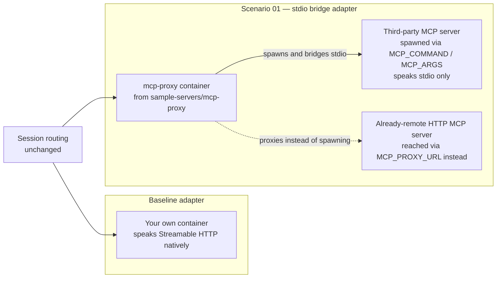

# Scenario 01 — Bridging a stdio MCP Server

Most MCP servers that exist today — community packages, vendor CLIs, internal scripts someone wrapped for Claude Desktop — speak the **stdio transport**, not Streamable HTTP. This is the highest-value expansion scenario precisely because it is the most common starting point: "we found/use an MCP server, and it only runs as a local process."

Read [`../../01-architecture.md`](../../docs/01-architecture.md) and [`../README.md`](../README.md) first.

---

## When to use this

- You have a stdio-only MCP server — a package run via a local interpreter/runtime invocation, a vendor CLI, an internal script — and want it to benefit from this platform's session affinity, horizontal scaling, and governance envelope instead of running it as an unmanaged local process per developer.
- You want **one governed, metered, discoverable endpoint** for a tool that otherwise only exists as "clone this repo and run it locally" folklore.
- You already have (or are willing to stand up) a tool-surface allow-listing policy, because bridging inherently means running code you did not write inside your cluster.

## When not to

- **The tool is already available as a maintained Streamable HTTP or SSE MCP server.** Bridging adds an extra process hop and an extra failure domain for no benefit — register it directly as an adapter (the baseline pattern in [`../mcp-server/README.md`](../mcp-server/README.md)) instead.
- **You cannot accept the residual trust risk even after allow-listing.** The MCP runtime has **no image allow-listing** — upstream's own guidance is "only register trusted MCP servers." If the upstream package is unmaintained, unvetted, or you cannot review what it does, tool-surface allow-listing at the edge limits *which tool names* can be invoked, but it does not audit what the bridged code does internally, what it phones home to, or what it does with the arguments it receives. If that residual risk is unacceptable, do not bridge it — find a maintained alternative or fork and audit the code first.
- **The tool assumes durable local state across restarts.** A stdio process spawned inside a pod dies with the pod. If the upstream tool depends on writing to local disk and expects that state to survive a restart or rescheduling, this bridge will not preserve it — no persistent volume behavior for spawned stdio processes is documented in this pattern's verified fact base. Treat this as a **verify at deployment time** item before committing to bridging a stateful tool.

## What it exercises

- Dynamic adapter registration (`POST /adapters`) — the same control-plane call as any other adapter, but pointed at the `mcp-proxy` image instead of a server you wrote
- The `mcp-proxy` process-spawn model: bridging a stdio child process, or alternatively proxying an already-remote HTTP MCP endpoint
- Session affinity, unchanged — the bridged adapter is still a StatefulSet behind a headless Service, still pinned by `mcp-session-id`
- **Tool-surface allow-listing as the primary compensating control**, since there is no image allow-listing upstream
- Control-plane write access as a privileged operation — registering an adapter means pointing the cluster at an arbitrary image, which is exactly the risk the architecture calls out in its compensating-controls table

## Architecture delta



`mcp-proxy` runs in exactly one of two modes per adapter — it either spawns a child stdio process, or it proxies to a remote HTTP MCP server. It does not do both at once.

## Step-by-step

### Pre-flight — tenant-explicit auth

```bash
az login --tenant <TENANT_ID>
az account set --subscription <SUBSCRIPTION_ID>
az account show --output table
```

Never proceed on a bare `az login` or an assumed ambient context — confirm the tenant/subscription shown matches where this cluster's ACR and AKS actually live.

### 1. Build the `mcp-proxy` adapter image

The MCP Gateway control plane does **not** build images — it only pulls from a registry it already trusts, exactly as [`../mcp-server/README.md`](../mcp-server/README.md) documents for the reference server. Build `mcp-proxy` the same way, from the upstream `microsoft/mcp-gateway` repository's `sample-servers/mcp-proxy/` path at the pinned commit (`59201a91f0c033dab7259f7c3c27be15353dafa4`):

```bash
git clone https://github.com/microsoft/mcp-gateway.git
cd mcp-gateway
git checkout 59201a91f0c033dab7259f7c3c27be15353dafa4

az acr build \
  --registry <acr-name> \
  --image mcp-samples/mcp-proxy:1.0.0 \
  --file sample-servers/mcp-proxy/Dockerfile \
  sample-servers/mcp-proxy
```

> **Verify at deployment time:** the exact Dockerfile path and build context inside `sample-servers/mcp-proxy/` are not part of this pattern's verified fact base beyond the folder's existence — confirm the actual Dockerfile location and any build arguments against the live repository at the pinned commit before running `az acr build`.

### 2a. Register — spawning a stdio process (`MCP_COMMAND` / `MCP_ARGS`)

```json
POST /adapters
{
  "name": "<ADAPTER_NAME>",
  "imageName": "<acr-name>.azurecr.io/mcp-samples/mcp-proxy",
  "imageVersion": "1.0.0",
  "description": "stdio bridge for <third-party MCP server>, spawned in-pod",
  "replicaCount": 2,
  "environmentVariables": {
    "MCP_COMMAND": "<STDIO_SERVER_COMMAND>",
    "MCP_ARGS": "<STDIO_SERVER_ARGS>"
  },
  "requiredRoles": ["mcp.engineer"],
  "useWorkloadIdentity": false
}
```

`MCP_COMMAND`/`MCP_ARGS` are illustrative of "an interpreter/runtime invocation that starts the third-party stdio server" — for example `MCP_COMMAND: npx` with `MCP_ARGS: -y <third-party-package>`, or an equivalent invocation for whatever runtime the bridged server requires. The exact command and arguments are specific to the tool you're bridging; only the env var **names** (`MCP_COMMAND`, `MCP_ARGS`) are the verified contract.

### 2b. Register — proxying an already-remote HTTP MCP server (`MCP_PROXY_URL`)

Use this variant instead when the third-party server is already reachable over HTTP somewhere (not stdio-only), and you want it to inherit this platform's session affinity and governance without also being an in-pod spawned process:

```json
POST /adapters
{
  "name": "<ADAPTER_NAME>",
  "imageName": "<acr-name>.azurecr.io/mcp-samples/mcp-proxy",
  "imageVersion": "1.0.0",
  "description": "proxy bridge for remote HTTP MCP server at <UPSTREAM_URL>",
  "replicaCount": 2,
  "environmentVariables": {
    "MCP_PROXY_URL": "<https://upstream-remote-mcp-server/mcp>"
  },
  "requiredRoles": ["mcp.engineer"],
  "useWorkloadIdentity": false
}
```

`MCP_COMMAND`/`MCP_ARGS` and `MCP_PROXY_URL` are mutually exclusive — pick the mode that matches what you're bridging, never both on the same adapter.

### 3. Register with the operator script

Use [`../../scripts/Register-McpAdapter.ps1`](../../scripts/Register-McpAdapter.ps1) rather than a raw REST call — it already handles tenant-explicit token acquisition and idempotency:

```powershell
./scripts/Register-McpAdapter.ps1 `
  -GatewayBaseUrl 'https://<mcp-gateway-host>' `
  -Name '<ADAPTER_NAME>' `
  -ImageName '<acr-name>.azurecr.io/mcp-samples/mcp-proxy' `
  -ImageVersion '1.0.0' `
  -ReplicaCount 2 `
  -RequiredRoles @('mcp.engineer') `
  -EnvironmentVariables @{ MCP_COMMAND = '<STDIO_SERVER_COMMAND>'; MCP_ARGS = '<STDIO_SERVER_ARGS>' } `
  -TenantId '<TENANT_ID>' `
  -ClientId '<CLIENT_ID>'
```

### 4. Test directly against the runtime origin first

Isolate the bridge from the governance edge before adding API Management — exactly the operational runbook in [`../../docs/06-mcp-publishing-and-access-contracts.md`](../../docs/06-mcp-publishing-and-access-contracts.md) recommends for any new asset. Call `initialize` → `tools/list` directly against `{GatewayBaseUrl}/adapters/<ADAPTER_NAME>/mcp` and confirm the bridged server's real tool names appear.

### 5. Publish through the governance edge

Add an entry to [`../../infra/publish-contract/mcp-gateway.bicepparam`](../../infra/publish-contract/mcp-gateway.bicepparam) with `assetType: 'mcp-existing'`, exactly as the baseline asset is published — nothing about the Publish Contract step changes because the backend happens to be a bridge rather than a server you wrote. Strongly consider attaching the hardened policy overlay ([`../../infra/policies/mcp-hardened-policy.xml`](../../infra/policies/mcp-hardened-policy.xml)) with `mcp-allowed-tools` populated to the bridged server's actual tool names — see Governance notes below.

## Identity mode implications

**Mode B (the default) still applies**, but its benefit here is narrower than for a server you wrote. The caller's token still reaches the MCP runtime intact, and the runtime still derives real end-user identity and scopes sessions per-principal — that part is unchanged. What's different: the bridged third-party code almost certainly does not know how to read `X-Mcp-UserId` / `X-Mcp-Roles`, so **per-user authorization inside the tool itself is typically not available** unless you fork the bridged server to add it. Mode B still earns its keep here through audit (who called this tool) and per-principal session scoping — it just doesn't extend into the tool's own logic the way it does in [scenario 03](./03-workload-identity-data-tool.md).

Mode A could be considered only for a bridged tool that is a genuinely shared utility with no meaningful per-user distinction (for example, a public reference-data lookup) — but default to Mode B regardless, since it costs nothing and keeps the option open if you later fork the bridge to honor forwarded identity.

## Governance notes

- **Tool-surface allow-listing is the primary compensating control** for this scenario specifically because there is no image allow-listing in the MCP runtime. Populate the `mcp-allowed-tools` named value with the bridged server's exact tool names (discovered via `tools/list` in step 4) rather than leaving it at `*`.
- **Treat `POST /adapters` write access as a privileged operation** for this scenario more than any other — registering an adapter here means pointing the cluster at a container that runs arbitrary third-party code you did not author. Restrict who can reach the control plane and require change-management sign-off before registering a new bridge, the same way you'd gate a new dependency into a supply chain.
- Scope `requiredRoles` on the registration as tightly as the consuming population allows — don't default to leaving it broad because the tool "feels low-risk."
- Registry-level policy still matters here too: build the `mcp-proxy` image (and confirm the bridged package's provenance) through your organization's normal container supply-chain controls, not as an ad hoc pull.

## Gotchas

- **"Only register trusted MCP servers" is upstream's literal posture**, given there is no image allow-listing today. Treat every new bridge registration as a trust decision, not a routine deploy.
- `MCP_COMMAND`/`MCP_ARGS` and `MCP_PROXY_URL` are mutually exclusive — setting both on the same adapter is a configuration error.
- If the bridged stdio process writes non-JSON-RPC noise to its own stdout (a startup banner, a progress bar — common in npm-style CLI packages), whether `mcp-proxy` filters that before framing it as JSON-RPC is **not documented in this pattern's verified fact base** — verify this behavior with the specific package you're bridging before assuming it just works.
- The bridged process's crash-loop behavior is opaque to the platform beyond ordinary pod restarts. Use `GET /adapters/{name}/logs` on the control plane to see what the spawned process actually printed.
- Tool-surface allow-listing (the hardened overlay) only gates `tools/call`. Whether it — or any other control in this pattern — also covers `resources/*` or `prompts/*` if the bridged server exposes those capabilities is not verified here; confirm before assuming parity.

## Validation

1. `tools/list` directly against the adapter (step 4 above) to enumerate the bridged server's real tool names.
2. Run [`../../scripts/validate_mcp_endpoint.py`](../../scripts/validate_mcp_endpoint.py) against the **published** endpoint with `--call-tool` set to one of those real tool names:

   ```bash
   python scripts/validate_mcp_endpoint.py \
     --endpoint https://<apim-gateway-host>/mcp/<ASSET_PATH> \
     --subscription-key <SUBSCRIPTION_KEY> \
     --use-azure-identity --scope api://<CLIENT_ID>/.default \
     --call-tool <BRIDGED_TOOL_NAME> --tool-args '{}'
   ```
3. Attempt a `tools/call` for a tool name **not** on the `mcp-allowed-tools` list and confirm it is rejected with the `-32601`-coded error the hardened overlay returns, proving the compensating control is actually active rather than left at `*`.
4. Check `GET /adapters/<ADAPTER_NAME>/logs` to confirm the spawned/proxied process started cleanly with no unexpected errors.

---

*Last updated: 2026-08-14*
