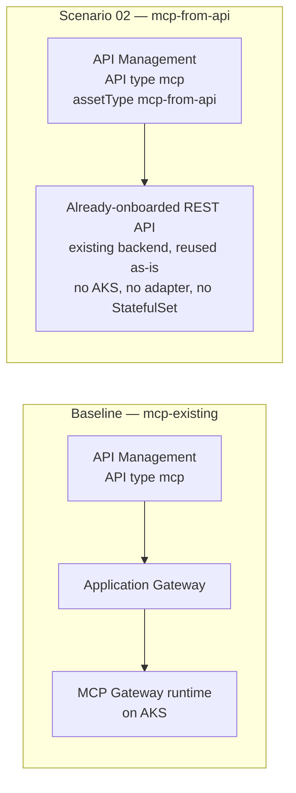

# Scenario 02 — Exposing a REST API as MCP

Sometimes the honest answer is that you don't need this landing zone's runtime plane at all. If the "tools" an agent needs are already REST operations onboarded in Azure API Management, the Publish Contract's `mcp-from-api` asset type gives you an MCP surface with **zero additional compute** — no AKS, no adapter, no StatefulSet, nothing to scale or patch.

Read [`../../01-architecture.md`](../../docs/01-architecture.md) and [`../../docs/06-mcp-publishing-and-access-contracts.md`](../../docs/06-mcp-publishing-and-access-contracts.md) first — this scenario is entirely a Publish Contract decision.

---

## When to use this

- The tools an agent needs **already exist as REST operations** in an API Management API you (or another team) already onboarded.
- You want the fastest possible path to "give agents access to what we already built" — this is hours of API Management configuration, not a Kubernetes deployment.
- You want the MCP surface to inherit whatever authentication, policy, and lifecycle the source API already has, rather than standing up a parallel identity/RBAC story.

## When not to

- **Your "tool" doesn't already exist as an onboarded API Management API.** If you need to host an arbitrary MCP server container — something you wrote, or a bridged third-party stdio server — you need `mcp-existing` and the runtime plane. See [scenario 01](./01-stdio-bridge.md) or the baseline in [`../mcp-server/README.md`](../mcp-server/README.md).
- **The tool needs genuinely stateful, multi-step behavior beyond a REST request/response.** `mcp-from-api` is a straightforward mapping of existing REST operations to MCP tools — there is no adapter pod here to put custom orchestration logic into. "Where the tool logic lives" for this scenario is entirely the source API itself; if that logic needs to change, you change the REST API, not this asset.
- **You need the MCP runtime's per-resource RBAC or forwarded end-user identity headers.** Those are properties of `mcp-existing` and the `microsoft/mcp-gateway` runtime specifically — see [Identity mode implications](#identity-mode-implications) below. This asset type has no equivalent.

## What it exercises

- `assetType: 'mcp-from-api'` — the Publish Contract's REST-to-MCP synthesis path
- `sourceApiName` / `operationNames` — which already-onboarded API, and which subset of its operations, become MCP tools
- **The path-shape difference**: `mcp-from-api` gets a trailing `/mcp` appended; `mcp-existing` does not
- **The internal-hop 401 trap** — a confusing partial failure where `initialize`/`tools/list` succeed but `tools/call` fails

## Architecture delta



There is no runtime plane in the delta at all. That absence is the entire value proposition of this scenario.

## Step-by-step

### Pre-flight — tenant-explicit auth

```bash
az login --tenant <TENANT_ID>
az account set --subscription <SUBSCRIPTION_ID>
az account show --output table
```

### 1. Resolve the source API name and its operations

API names are case-sensitive and must already exist — resolve them from the live instance rather than assuming, exactly as [`../../docs/06-mcp-publishing-and-access-contracts.md`](../../docs/06-mcp-publishing-and-access-contracts.md) recommends:

```bash
az apim api list -g <GOVERNANCE_PLANE_RESOURCE_GROUP> -n <APIM_INSTANCE_NAME> \
  --query "[].{name:name,path:path,type:type}" -o table

az apim api operation list -g <GOVERNANCE_PLANE_RESOURCE_GROUP> -n <APIM_INSTANCE_NAME> \
  --api-id <EXISTING_APIM_API_NAME> --query "[].{name:name,method:method,urlTemplate:urlTemplate}" -o table
```

### 2. Add the asset to the Publish Contract

```jsonc
// Add alongside (not instead of) any mcp-existing entries in publishAssets —
// see infra/publish-contract/mcp-gateway.bicepparam for the sibling mcp-existing
// example this pattern ships by default.
{
  assetType: 'mcp-from-api'
  name: '<ASSET_NAME>'
  displayName: '<ASSET_DISPLAY_NAME>'
  description: 'Existing REST API exposed as MCP tools -- no additional compute.'

  path: '<ASSET_PATH>'
  transportType: 'streamable'
  subscriptionRequired: true
  subscriptionKeyHeaderName: 'api-key'

  // The already-onboarded API Management API this asset wraps.
  sourceApiName: '<EXISTING_APIM_API_NAME>'

  // Subset of that API's operations to expose as MCP tools.
  operationNames: [
    '<OPERATION_NAME_1>'
    '<OPERATION_NAME_2>'
  ]

  // -------------------------------------------------------------------
  // THE INTERNAL-HOP 401 TRAP — resolve with exactly ONE of the two
  // options below. See "Gotchas" for what this looks like when unresolved.
  // -------------------------------------------------------------------
  forwardSubscriptionKeyToSource: true
  sourceSubscriptionKeyHeaderName: 'x-mcp-sub-key'   // default; override only if the source API expects a different header

  publishToApiCenter: false
}
```

> **Verify at deployment time:** `sourceApiName`, `operationNames`, `forwardSubscriptionKeyToSource`, and `sourceSubscriptionKeyHeaderName` are the fields this pattern has verified for `mcp-from-api`. Whether omitting `operationNames` means "expose every operation" or is a required field, and whether any other optional fields exist on this asset type, are not confirmed in this pattern's fact base — diff this snippet against the accelerator's own parameter schema for `mcp-from-api` at the pinned commit (`06f7ea6c2f99371900feefba11c10212b16364b4`) before deploying, the same discipline [`../../infra/publish-contract/mcp-gateway.bicepparam`](../../infra/publish-contract/mcp-gateway.bicepparam) already calls for on the `mcp-existing` entries.

### 3. Resolve the internal-hop 401 trap — pick one

The internal hop that `tools/call` makes from the synthesized MCP API to the source API's own backend will fail with a missing-key `401` if the source API requires its own subscription key — while `initialize` and `tools/list` still appear to succeed, because neither of them reaches the backend. Resolve with **exactly one** of:

1. Onboard the source API with `subscriptionRequired: false` (it is not publicly reachable on its own anyway), **or**
2. Keep the source API protected and set `forwardSubscriptionKeyToSource: true` as shown above — this forwards the caller's key in the `x-mcp-sub-key` header (or your override), which API Management will not strip. Also grant the source API in the Access Contract's `apiNameMapping`.

### 4. Deploy and verify the path shape

```bash
python scripts/validate_mcp_endpoint.py \
  --endpoint https://<apim-gateway-host>/mcp/<ASSET_PATH>/mcp \
  --subscription-key <SUBSCRIPTION_KEY>
```

Note the trailing `/mcp` — see Gotchas below.

## Identity mode implications

**The Identity Mode A/B/C framework in [`../../docs/07-identity-and-token-flow.md`](../../docs/07-identity-and-token-flow.md) does not apply here** — those modes describe how a caller's token reaches the `microsoft/mcp-gateway` runtime and its Entra-validated resource RBAC, and there is no runtime in this scenario. Identity for a `mcp-from-api` asset is entirely whatever the **source API** already enforces at the API Management layer — one of the same `authType` values documented in [`../../docs/06-mcp-publishing-and-access-contracts.md`](../../docs/06-mcp-publishing-and-access-contracts.md#backend-authentication) (`none`, `managed-identity`, `api-key-header`, `api-key-bearer`), plus the internal-hop key-forwarding decision above.

If the source API needs real end-user identity for its own authorization (row-level access control, per-user audit), that has to come from a JWT validation policy already present on — or added to — the source API itself. It is not something this asset type derives for you the way `mcp-existing` derives it from the runtime's Entra token validation.

## Governance notes

- There is no tool-surface allow-listing mechanism documented for `mcp-from-api` the way there is for `mcp-existing` (the hardened policy overlay in [`../../infra/policies/mcp-hardened-policy.xml`](../../infra/policies/mcp-hardened-policy.xml) is written against the `mcp-existing` baseline policy). The natural allow-list for this scenario is simply **which `operationNames` you choose to expose** — don't map more of the source API's surface into tool form than the consuming population actually needs.
- Quota and rate limiting still come from the Access Contract product exactly as with `mcp-existing` — nothing changes about Access Contract mechanics for this asset type.
- There is no separate MCP-runtime security posture to reason about here (no NetworkPolicy, no pod isolation, no workload identity) — because there are no pods. Whatever governance the source API already has *is* the governance for this asset.

## Gotchas

- **The path gets a trailing `/mcp` appended** — the opposite of `mcp-existing`. Forgetting this is the most common `404` this pattern documents; see [`../../docs/06-mcp-publishing-and-access-contracts.md`](../../docs/06-mcp-publishing-and-access-contracts.md#the-path-shape-trap).
- **The 401 trap is a confusing partial failure.** `initialize` and `tools/list` succeed — because neither reaches the source API's backend — while `tools/call` fails with `401`. This looks like "auth is mostly working" when it is actually completely unresolved for the one call that matters.
- `operationNames` matching is presumed exact and case-sensitive like other API Management identifiers, but this is not independently verified in this pattern's fact base for this specific field — confirm against the live operation list (step 1 above) rather than assuming.
- If the source API's operations return payloads not shaped for LLM tool consumption (deeply nested, huge, binary), a raw REST-to-MCP mapping may produce technically-correct but practically unusable tool output. That's a tool-design concern, not a wiring concern — review what each exposed operation actually returns before assuming "it responds" means "it's a good tool."

## Validation

1. Confirm the API is resolvable and its operations are what you expect (step 1 above) **before** publishing.
2. Run [`../../scripts/validate_mcp_endpoint.py`](../../scripts/validate_mcp_endpoint.py) against `https://<apim-gateway-host>/mcp/<ASSET_PATH>/mcp` (note the trailing `/mcp`) to confirm `initialize` → `tools/list` succeed and the exposed `operationNames` appear as tools.
3. Deliberately test **both branches of the 401 trap**: call `tools/call` once before resolving the key-forwarding decision (step 3) to see the partial failure firsthand, then again after fixing it, to confirm the difference. This is worth doing once so the failure mode is recognizable in real deployments rather than mistaken for a broken deployment.
4. If you set `forwardSubscriptionKeyToSource: true`, confirm the Access Contract's `apiNameMapping` also grants the consumer's product access to the source API itself, not just the synthesized MCP asset.

---

*Last updated: 2026-08-14*
