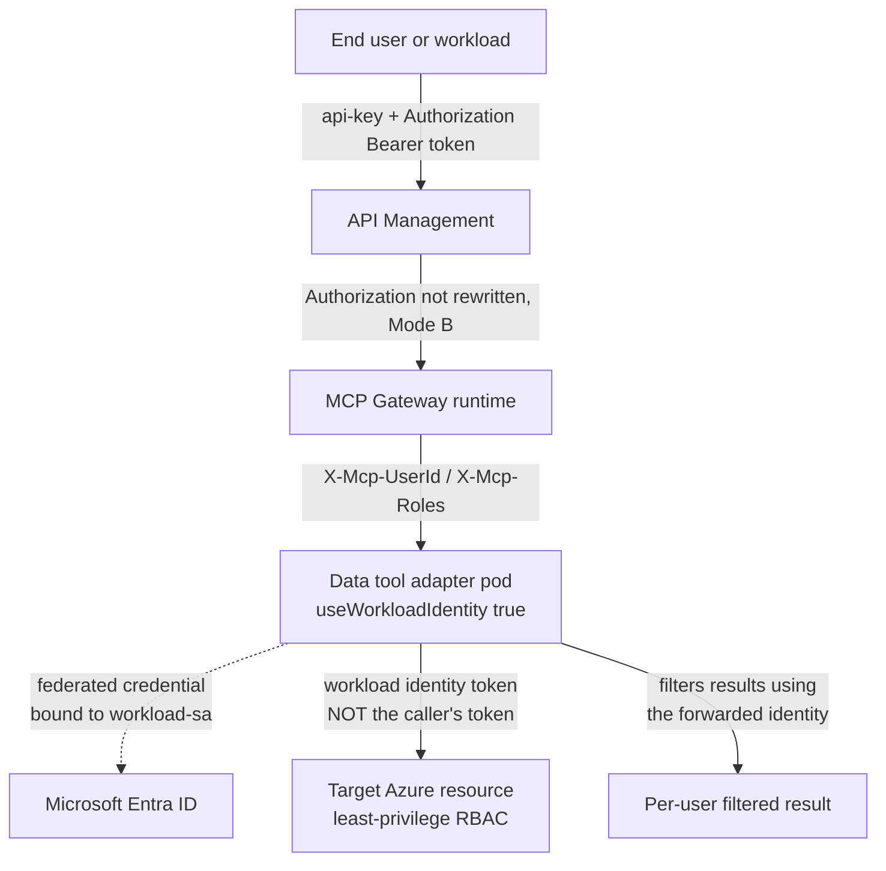

# Scenario 03 — A Workload-Identity Data Tool

Some tools cannot rely on the caller's own permissions — they need to reach an Azure resource under their **own** credentials, and then enforce per-user authorization themselves using the identity the platform forwards to them. This is the scenario where **workload identity federation** and **Identity Mode B** stop being independent design choices and start being the same decision.

Read [`../../docs/07-identity-and-token-flow.md`](../../docs/07-identity-and-token-flow.md) in full before this scenario — everything here depends on it.

---

## When to use this

- The tool must query, write, or otherwise act on an **Azure resource** (a data store, a management-plane resource, anything reachable via Entra-based Azure RBAC) using its own service identity, not a per-call delegation of the caller's own Azure permissions.
- The tool needs to make its **own** per-user authorization decisions — row filtering, resource-level scoping, redaction — using the identity of the human or workload that called it, even though the actual Azure call underneath uses a different, shared credential.
- You have (or are willing to establish) an owner who can define a **least-privilege** RBAC scope for the workload identity and can stand behind a privilege-escalation review, because that is what enabling this capability actually is.

## When not to

- **The caller's own Azure identity should reach the resource directly.** This scenario is specifically about a shared workload credential plus in-tool per-user filtering — it is not an on-behalf-of delegation flow, and no on-behalf-of mechanism is documented in this pattern's verified fact base. If true per-caller Azure RBAC delegation is the actual requirement, that is a different design question to resolve before reaching for workload identity — do not default to this scenario just because "the tool needs Azure access."
- **You don't have a clear owner ready to scope least-privilege RBAC.** Don't request `useWorkloadIdentity: true` "just in case a tool might need it later." It fails closed to `mcp.admin`-only by default for a reason — see Governance notes.
- **The tool won't actually honor the forwarded identity headers.** If nobody is going to write the per-user filtering logic inside the tool, workload identity plus Mode B buys you nothing over a much simpler design — you'd just have a shared-identity tool with no per-user distinction, which is what Mode A already gives you at lower operational cost.

## What it exercises

- `useWorkloadIdentity: true` on adapter registration
- Federated credential binding to the cluster's `workload-sa` service account
- Why this capability **fails closed to `mcp.admin`-only by default** — the federated identity is shared at cluster scope, so any pod bound to `workload-sa` can mint its tokens, which makes granting it a privilege-escalation review rather than a routine registration
- **The caller's token is not what reaches Azure** — the pod's workload identity token is
- Least-privilege RBAC scoping for the workload identity
- Identity Mode B's forwarded `X-Mcp-UserId` / `X-Mcp-Roles` headers, which is what lets the tool enforce per-user row/resource filtering on top of a shared Azure credential

## Architecture delta



The caller's own token stops at the MCP Gateway's validation step. What continues to the Azure resource is a completely separate credential — the workload identity's token — while what continues to the *tool's own logic* is the forwarded `X-Mcp-UserId`/`X-Mcp-Roles` pair. Those are two different things traveling two different paths, and the tool's job is to combine them correctly.

## Step-by-step

### Pre-flight — tenant-explicit auth

```bash
az login --tenant <TENANT_ID>
az account set --subscription <SUBSCRIPTION_ID>
az account show --output table
```

### 1. Register the adapter with `useWorkloadIdentity: true`

```json
POST /adapters
{
  "name": "<ADAPTER_NAME>",
  "imageName": "<acr-name>.azurecr.io/<your-data-tool-image>",
  "imageVersion": "<TAG>",
  "description": "Data/query tool reaching Azure resources via workload identity; enforces per-user filtering from forwarded identity headers.",
  "replicaCount": 2,
  "environmentVariables": {
    "AZURE_TENANT_ID": "<TENANT_ID>",
    "TARGET_RESOURCE_URI": "<AZURE_RESOURCE_URI>"
  },
  "requiredRoles": ["mcp.admin"],
  "useWorkloadIdentity": true
}
```

Via the operator script:

```powershell
./scripts/Register-McpAdapter.ps1 `
  -GatewayBaseUrl 'https://<mcp-gateway-host>' `
  -Name '<ADAPTER_NAME>' `
  -ImageName '<acr-name>.azurecr.io/<your-data-tool-image>' `
  -ImageVersion '<TAG>' `
  -ReplicaCount 2 `
  -RequiredRoles @('mcp.admin') `
  -UseWorkloadIdentity `
  -EnvironmentVariables @{ AZURE_TENANT_ID = '<TENANT_ID>'; TARGET_RESOURCE_URI = '<AZURE_RESOURCE_URI>' } `
  -TenantId '<TENANT_ID>' `
  -ClientId '<CLIENT_ID>'
```

> **Verify at deployment time:** whether `mcp.admin` in `requiredRoles` is what actually enforces the "fails closed to admin-only" behavior for `useWorkloadIdentity`, or whether the control plane enforces that gate automatically regardless of `requiredRoles`, is not detailed in this pattern's verified fact base. Confirm the exact enforcement mechanism against the live control plane / OpenAPI spec before relying on `requiredRoles` alone as the gate.

### 2. Bind the federated credential to `workload-sa`

The exact mechanism the control plane uses to bind a newly-registered, workload-identity-enabled adapter's pod to the cluster's federated credential for `workload-sa` beyond setting `useWorkloadIdentity: true` is **not detailed in this pattern's verified fact base**. This is very likely a one-time, cluster-level Azure AD Workload Identity federation setup performed outside the `mcp-gateway` control-plane API — for example, an `az identity federated-credential create` binding the cluster's OIDC issuer and the `workload-sa` service account's namespace/name to a user-assigned managed identity. **Verify the exact binding step and its scope (cluster-wide vs. per-adapter) against the runtime's deployment documentation at the pinned commit before assuming this pattern.**

### 3. Scope least-privilege RBAC

```bash
az role assignment create \
  --assignee-object-id <WORKLOAD_IDENTITY_PRINCIPAL_ID> \
  --assignee-principal-type ServicePrincipal \
  --role "<LEAST_PRIVILEGE_ROLE>" \
  --scope <AZURE_RESOURCE_SCOPE>
```

Scope the role assignment to the **narrowest** built-in or custom role that satisfies the tool's need, at the **narrowest** resource scope (the specific resource, not the subscription or resource group, unless the tool genuinely needs that breadth). Registering the adapter with `useWorkloadIdentity: true` does **not** itself grant any Azure permissions — this is a separate step you own.

### 4. Implement per-user filtering in the tool

Inside the tool's own request handling, read the forwarded headers and apply filtering before returning results:

| Header | Carries |
|---|---|
| `X-Mcp-UserId` | The authenticated principal, forwarded by the MCP runtime after validating the caller's token |
| `X-Mcp-Roles` | The principal's app roles |

The runtime strips any client-supplied `X-Mcp-*` headers before re-injecting its own — a caller cannot forge these. But nothing forces the *tool* to use them: that enforcement is entirely the tool author's responsibility, and skipping it is what makes a workload-identity tool a confused deputy at the tool layer even when the platform did its job correctly.

## Identity mode implications

**Mode B is effectively required for this scenario to have a point.** The tool needs the forwarded `X-Mcp-UserId`/`X-Mcp-Roles` headers to filter per user; those headers only carry a real, discriminating principal when the caller's own token reached the MCP runtime intact (backend `authType: none`). Under **Mode A**, every call's forwarded identity would be API Management's own service principal — every user would look the same to the tool, and the entire per-user filtering premise collapses. **Mode A is specifically wrong for this scenario**, not merely suboptimal.

Mode C's direct/OAuth path could serve an interactive-developer population that needs the same per-user filtering without going through API Management's quota — but that reopens the governance-bypass trade-off documented in [`../../docs/07-identity-and-token-flow.md`](../../docs/07-identity-and-token-flow.md#mode-c--split-plane); treat it as a deliberate, scoped exception rather than a default.

## Governance notes

- **`useWorkloadIdentity: true` fails closed to `mcp.admin`-only by default.** Treat every request for it as a **privilege-escalation review**, not a routine adapter registration — the federated identity is shared at **cluster** scope, meaning *any* pod bound to `workload-sa` can mint its tokens, not just the one adapter you intended to grant it to.
- That cluster-wide blast radius has a direct consequence for composing with [scenario 01](./01-stdio-bridge.md): don't assume a bridged, less-trusted third-party adapter is isolated from a workload-identity-enabled adapter's credential just because they're registered separately — if both end up bound to the same `workload-sa`, they share the same blast radius. Keep that boundary explicit when reviewing what gets `useWorkloadIdentity: true`.
- RBAC should be scoped to the **narrowest** role and resource that satisfies the need — resist granting broad roles (e.g. `Contributor`) when a narrower built-in or custom role suffices.
- Tool-surface allow-listing at the edge remains relevant as defense-in-depth here too — it limits which tool *names* external callers can invoke even before the tool's own per-user filtering logic runs.
- Rotating or revoking the federated identity affects **every** workload-identity-enabled adapter simultaneously, by design of the cluster-scoped binding. Plan for that blast radius before an incident forces the question, not during one.

## Gotchas

- A tool with workload identity that does **not** also check the forwarded headers is a confused deputy at the tool layer, even though the platform correctly forwarded real end-user identity. The platform forwarding identity and the tool using it are two separate things — verify both.
- `useWorkloadIdentity: true` alone grants **no** Azure permissions. Step 3 (RBAC) is mandatory and separate; forgetting it means the tool authenticates successfully to Entra and then gets authorization failures calling the actual Azure resource.
- Because the federated identity is cluster-scoped, a rotation affects every workload-identity adapter at once — there is no per-adapter credential isolation to fall back on if you need to revoke just one.
- Whether `mcp.admin` in `requiredRoles` is itself the enforcement mechanism for the admin-only gate, or a separate control-plane check enforces it regardless, is unverified — see the callout in step 1. Don't assume setting `requiredRoles` is sufficient without confirming.

## Validation

1. Call the tool via [`../../scripts/validate_mcp_endpoint.py`](../../scripts/validate_mcp_endpoint.py) as **two different principals** — two different bearer tokens, or two different `--use-azure-identity` contexts — and confirm the returned data differs according to each principal's row/resource-level entitlement:

   ```bash
   python scripts/validate_mcp_endpoint.py \
     --endpoint https://<apim-gateway-host>/mcp/<ASSET_PATH> \
     --subscription-key <SUBSCRIPTION_KEY> \
     --use-azure-identity --scope api://<CLIENT_ID>/.default \
     --call-tool <DATA_TOOL_NAME> --tool-args '{}'
   ```

2. Separately confirm (via the target resource's own logs, Azure Monitor, or an activity log entry) that the Azure-side call was authenticated as the **workload identity's** principal, not either caller's principal — proving the "caller's token is not what reaches Azure" property actually holds.
3. Confirm a caller cannot forge `X-Mcp-UserId` themselves — set the header directly in a request and confirm the value the tool actually receives is the runtime-derived one, not the client-supplied one (the same trust-boundary test [`../../04-testing.md`](../../docs/04-testing.md) describes for identity forwarding generally).
4. Confirm the RBAC scope granted in step 3 is actually the narrowest role that lets the tool function — attempt an operation deliberately outside that scope and confirm it fails.

---

*Last updated: 2026-08-14*
