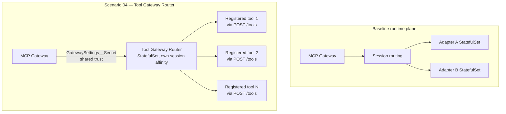

# Scenario 04 — A Multi-Tool Catalog via the Tool Gateway Router

The baseline architecture already includes a **Tool Gateway Router** as a standing component of the MCP runtime plane — it exists to aggregate many individually-registered tools behind one dynamic MCP surface, instead of one adapter (and one Publish Contract asset) per tool. This scenario is about *using* it: registering tools into an already-deployed router, not deploying the router itself.

Read [`../../01-architecture.md`](../../docs/01-architecture.md) first — the Tool Gateway Router already appears in the two-plane diagram there as part of Plane 2.

---

## When to use this

- You have, or expect to accumulate, **many small, individually-owned tools** and want a single client-visible MCP surface rather than a growing list of per-adapter endpoints, each requiring its own Publish Contract asset.
- A **curated catalog** model fits the use case — for example, a shared platform-tools surface serving many small utility tools behind one governed, discoverable, single-endpoint asset.
- The tools involved are individually lightweight enough that aggregating them behind one router and one asset is a net simplification, not a hidden coupling risk.

## When not to

- **You have one or two substantial, stateful tools that each deserve their own lifecycle.** Registering everything behind one router adds an extra hop and concentrates aggregation risk in one place. A tool with its own scaling profile, its own release cadence, or its own security posture is usually better served as its own adapter and its own Publish Contract asset (the baseline pattern, or [scenario 01](./01-stdio-bridge.md)/[scenario 03](./03-workload-identity-data-tool.md)).
- **The tools have wildly different resource or traffic profiles.** A noisy or resource-hungry tool behind a shared router can degrade every other tool sharing that router's session affinity and quota envelope — see Governance notes.
- **You need per-tool network isolation guarantees the router's aggregation model doesn't give you.** If two tools must never share a fate under any circumstance, keep them on separate adapters rather than behind one router.

## What it exercises

- `POST /tools` registration with an inline MCP `toolDefinition`
- The single client-facing `POST /mcp` endpoint, as opposed to per-adapter `POST /adapters/{name}/mcp`
- The router's own StatefulSet deployment with its **own** session affinity, distinct from any individual adapter's
- The `GatewaySettings__Secret` shared-secret trust relationship that lets the router honor forwarded identity from the gateway

## Architecture delta



Every adapter in the baseline is its own StatefulSet with its own client URL. In the delta, many tools live behind **one** StatefulSet (the router) and **one** client URL.

## Step-by-step

### 0. Pre-flight — confirm the shared secret is real

Before registering anything, confirm `GatewaySettings__Secret` is already set to a strong, random value on both the MCP Gateway and Tool Gateway Router components — it should have been set during initial platform bring-up per [`../../03-deployment.md`](../../docs/03-deployment.md). If this is the first time your team is using the router, verify this explicitly rather than assuming it was hardened; a default or placeholder value here undermines the forwarded-identity trust model for **every** tool registered behind the router, not just the one you're about to add.

Generate a strong value if one still needs to be set (a locally-generated random secret, never a default or example string committed anywhere):

```powershell
[System.Convert]::ToBase64String((1..32 | ForEach-Object { Get-Random -Maximum 256 }))
```

> **Verify at deployment time:** the exact configuration surface for setting `GatewaySettings__Secret` on each component (Kubernetes Secret, environment variable injection, or another mechanism) is not part of this pattern's verified fact base beyond the env-var-style name itself, which follows the ASP.NET Core `Section__Key` configuration-binding convention. Confirm the actual deployment mechanism against the runtime's manifests at the pinned commit — this is a [`../../03-deployment.md`](../../docs/03-deployment.md) concern, not something this scenario changes.

### 1. Register a tool

```json
POST /tools
{
  "toolDefinition": {
    "name": "<TOOL_NAME>",
    "title": "<Human-Readable Title>",
    "description": "<what this tool does, written for the calling LLM>",
    "type": "<TOOL_TYPE>",
    "inputSchema": {
      "type": "object",
      "properties": {
        "<PARAM_NAME>": { "type": "string", "description": "<what this parameter means>" }
      },
      "required": ["<PARAM_NAME>"]
    },
    "annotations": {
      "<ANNOTATION_KEY>": "<ANNOTATION_VALUE>"
    }
  },
  "port": <PORT_NUMBER>
}
```

> **Verify at deployment time:** the allowed values for `type` and the meaningful `annotations` keys are not part of this pattern's verified fact base — confirm against `openapi/mcp-gateway.openapi.json` (or a `GET /tools` response from your own deployment) before building a real registration. Similarly, whether the `port` field addresses a process co-located with the router or an independently deployed service is not documented here — the upstream `sample-servers/tool-example/` reference implementation (at the pinned commit `59201a91f0c033dab7259f7c3c27be15353dafa4`) is the concrete starting point to study for the actual deployment topology before designing a production tool for this path, rather than assuming.

### 2. Repeat per tool

Each additional tool is another `POST /tools` call with its own `toolDefinition` and `port` — there is no batch-registration shape documented in this pattern's verified fact base; treat each as its own call.

### 3. Publish the router's single aggregated endpoint

Publish the router's client-facing surface through the Publish Contract exactly like the baseline adapter — same `assetType: 'mcp-existing'`, same `authType: 'none'` for Mode B — so the whole curated catalog becomes **one** governed asset, one quota envelope, one entry in the discovery catalog:

```jsonc
// infra/publish-contract/mcp-gateway.bicepparam — one more publishAssets entry
{
  assetType: 'mcp-existing'
  name: '<CATALOG_ASSET_NAME>'
  displayName: '<CATALOG_ASSET_DISPLAY_NAME>'
  description: 'Curated multi-tool catalog aggregated by the Tool Gateway Router.'
  path: '<CATALOG_ASSET_PATH>'
  transportType: 'streamable'
  subscriptionRequired: true
  subscriptionKeyHeaderName: 'api-key'
  backend: {
    url: 'https://<MCP_RUNTIME_PUBLIC_ORIGIN>'   // the router's own client endpoint (POST /mcp), not an individual adapter
    authType: 'none'                             // Mode B — see Identity mode implications
  }
  publishToApiCenter: false
}
```

Clients then call the aggregated `POST /mcp` endpoint — **not** `POST /adapters/{name}/mcp` — and reach the union of every tool registered in steps 1–2.

## Identity mode implications

**Mode B remains the default, and it is what makes `GatewaySettings__Secret` meaningful in the first place.** The router only honors forwarded identity (`X-Mcp-UserId`/`X-Mcp-Roles`) that actually arrived from the gateway, verified via the shared secret — so any tool behind the router that wants to do its own per-user authorization (composing with [scenario 03](./03-workload-identity-data-tool.md), where composability is itself unverified — see below) can still see genuine end-user identity, exactly as in the baseline.

**A default or weak `GatewaySettings__Secret` undermines the forwarded-identity model for every tool behind the router at once** — not just one. Generate and rotate this secret with the same rigor as any other credential in this pattern, not as an afterthought.

## Governance notes

- The router aggregating many tools behind **one** published asset does not remove the value of tool-surface allow-listing at the edge — a compromised or misbehaving client could otherwise attempt `tools/call` against any tool name registered behind the router. Keep the hardened policy overlay's `mcp-allowed-tools` list current as tools are added and removed.
- Quota and rate limiting are now **shared** across every tool behind the router, because it is one asset under one Access Contract product. A single noisy tool can consume a business unit's entire allowance for the whole catalog. If a tool's traffic profile is meaningfully different from the rest of the catalog, consider giving it its own adapter and asset instead of adding it here.
- Composing with [scenario 03](./03-workload-identity-data-tool.md): the verified field list for `POST /adapters` includes `useWorkloadIdentity`, but this pattern's fact base does **not** confirm whether `POST /tools` supports an equivalent field. Do not assume a router-registered tool can use workload identity the same way an adapter can — verify against the live OpenAPI spec before designing around that assumption.

## Gotchas

- Forgetting to set `GatewaySettings__Secret` (or leaving it at a placeholder) does not necessarily fail loudly — it can quietly break or weaken identity forwarding for every tool behind the router. Treat this as a hard deployment blocker for this scenario, not an optional hardening pass.
- The client-visible single `POST /mcp` endpoint is easy to confuse with an individual adapter's `POST /adapters/{name}/mcp` — be explicit with consumers about which one they've been given, especially if both exist side by side on the same runtime.
- The router runs as its **own** StatefulSet with its **own** session affinity, separate from any individual adapter's session affinity. Don't assume a session pinned at the router level implies anything documented about pinning to a specific backend process behind an individual registered tool — if a specific tool itself needs session-level pinning beyond what the router provides, verify how that interaction actually behaves before relying on it.
- Registering many tools incrementally over time means the allow-list, quota assumptions, and traffic-profile review from Governance notes need to be revisited **each time a tool is added** — this is an ongoing discipline, not a one-time setup step.

## Validation

1. `tools/list` against the router's published single endpoint and confirm it shows the **union** of every tool registered via `POST /tools` in steps 1–2:

   ```bash
   python scripts/validate_mcp_endpoint.py \
     --endpoint https://<apim-gateway-host>/mcp/<CATALOG_ASSET_PATH> \
     --subscription-key <SUBSCRIPTION_KEY>
   ```

2. `--call-tool` against two or three different registered tools in the same run to prove one client endpoint genuinely reaches multiple independently-registered tools:

   ```bash
   python scripts/validate_mcp_endpoint.py \
     --endpoint https://<apim-gateway-host>/mcp/<CATALOG_ASSET_PATH> \
     --subscription-key <SUBSCRIPTION_KEY> \
     --use-azure-identity --scope api://<CLIENT_ID>/.default \
     --call-tool <TOOL_NAME_1> --tool-args '{}'
   ```

3. Re-run the identity-forwarding trust test from [`../../04-testing.md`](../../docs/04-testing.md) (client-supplied `X-Mcp-*` headers must be stripped and replaced) against the router-fronted asset specifically — the baseline test validates the gateway-to-adapter trust boundary; this confirms the same holds for the gateway-to-router-to-tool path.
4. Remove a tool's name from `mcp-allowed-tools` (or add a new tool without adding it to the allow-list) and confirm a `tools/call` against it is rejected, proving the allow-list is being re-evaluated against the router's aggregated tool surface and not just a static list captured at publish time.

---

*Last updated: 2026-08-14*
